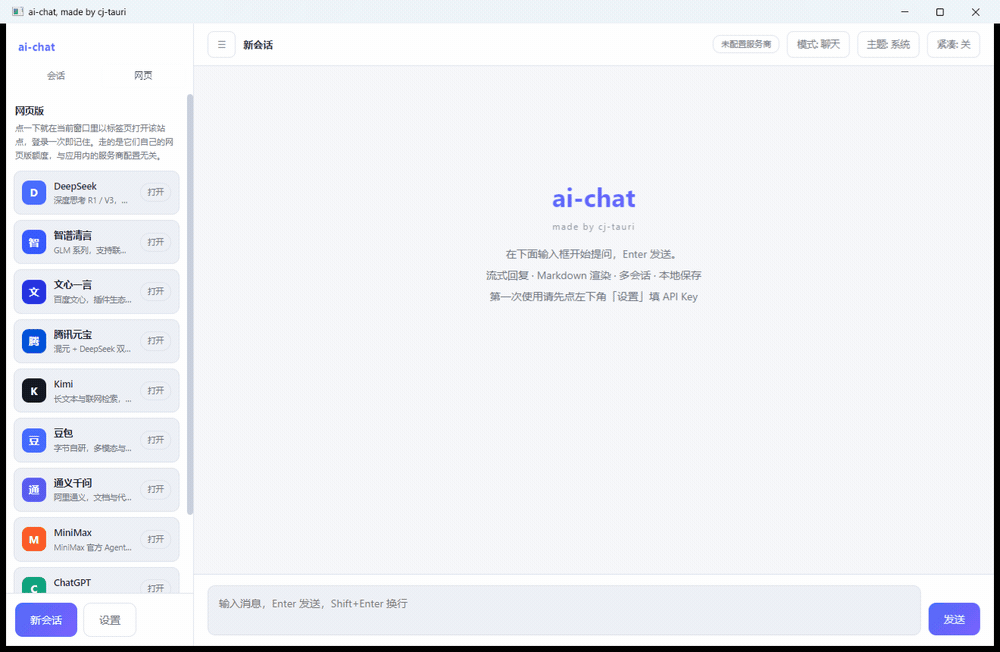
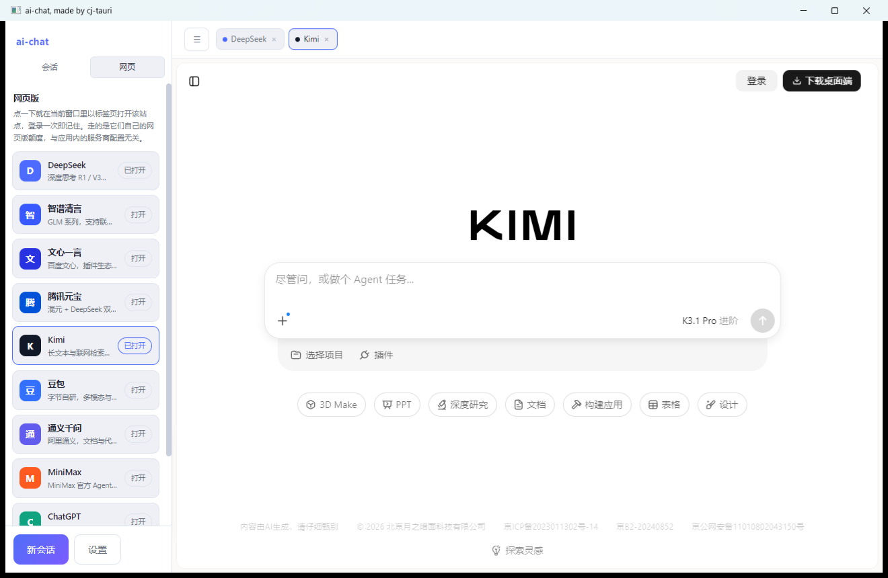
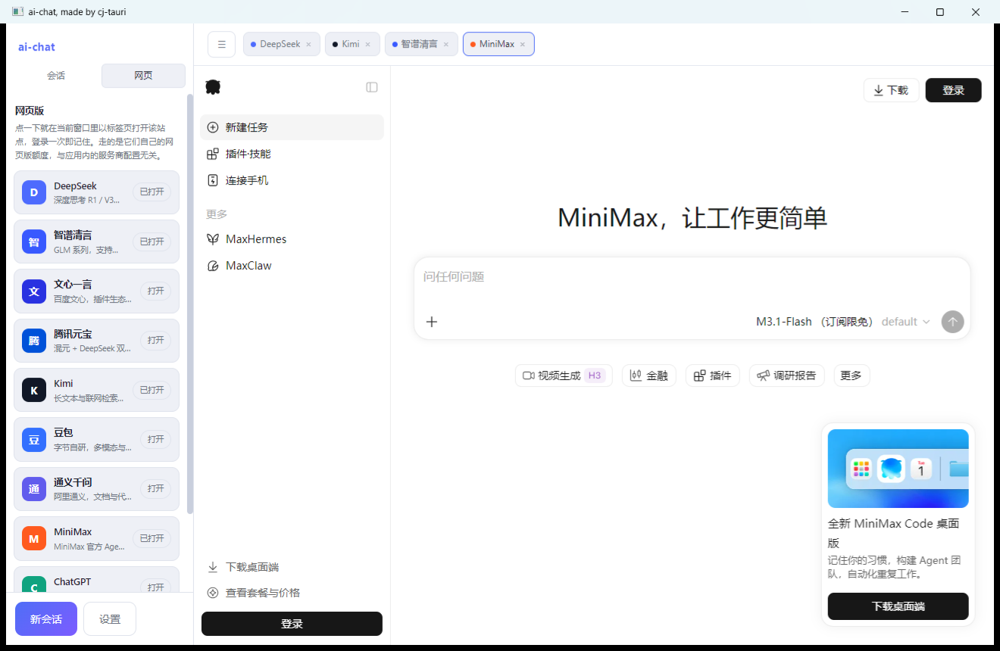

<div align="center">

# cj-tauri · 仓颉版 Tauri

**简体中文** · [**English**](./README.md)

**用仓颉语言实现的桌面应用混合开发框架 —— 仓颉静态编译后端 + 系统 WebView 前端。**
前端照写 Web，后端是仓颉静态编译的二进制 —— 不打包 Chromium，产物 4.7–32.8 MB，
Windows / Linux / 鸿蒙 PC（2in1）三端实机跑通。

页面用 Web 写，逻辑用仓颉写：一条 IPC 桥把两边连起来，命令 / 事件 / 路径 / 出网四道白名单闸门
兜住安全，外加 14 个官方插件、二十多个能直接跑的示例——每个都带无人值守自检。

<p>
  <a href="https://atomgit.com/qq8864/cj-tauri"></a>
  <a href="https://yangyongzhen.github.io/cj-tauri/"></a>
  
</p>

[](#示例一览)
[](https://cangjie-lang.cn)
[](./LICENSE)

[快速开始](#快速开始) · [为什么是 cj-tauri](#为什么是-cj-tauri) · [安全模型](#安全模型可被外部审视的证据) ·
[示例一览](#示例一览) · [架构](#架构) · [文档索引](#文档索引) · [与 Tauri 的差异](docs/与Tauri的差异.md)

</div>

## 快速开始

三条路按需选：**不装任何东西先看效果**选方式一；**写自己的应用**选方式二；**不碰 npm / 要改框架**选方式三。

### 方式一：直接下载单文件工具（免安装、免 SDK）

仓库随版本分发静态链接的单文件 Windows 工具（点击下载，十份产物全部实测过导入表）：

**调试与工具类**：

| 工具 | 说明 |
|---|---|
| [cj-link.exe](examples/cj-link/dist-single/cj-link.exe)（5.6MB） | 串口/网络二合一调试助手：串口 + TCP 客户端/服务器 + UDP 共用收发日志，HEX/ASCII 双显、发送队列、CRC 计算、定时发送，[中文说明](examples/cj-link/README.md) |
| [modbus-poll.exe](examples/modbus-poll/dist-single/modbus-poll.exe)（5.7MB） | Modbus TCP/RTU 调试工具：多面板并行监控、FC 01-04/05/06/15/16、报文监视、CSV 记录，[中文说明](examples/modbus-poll/README.md) |
| [serial-waveform.exe](examples/serial-waveform/dist-single/serial-waveform.exe)（4.7MB） | 串口实时波形示波器：400 Hz 样本流下页面自算速率/上穿/丢帧，[中文说明](examples/serial-waveform/README.md) |

**效率与学习类**：

| 工具 | 说明 |
|---|---|
| [markdown-notes.exe](examples/markdown-notes/dist-single/markdown-notes.exe)（5.0MB） | Markdown 笔记：文件树 / 编辑 / 实时预览三态切换，marked + Highlight.js 内联，[中文说明](examples/markdown-notes/README.md) |
| [leetcode-gui.exe](examples/leetcode-gui/dist-single/leetcode-gui.exe)（9.9MB） | 仓颉力扣：题库 + 编辑器 + 判题终端，判题器就是 `cjc`，[中文说明](examples/leetcode-gui/README.md) |

**示例应用类**：

| 应用 | 说明 |
|---|---|
| [ai-chat.exe](examples/ai-chat/dist-single/ai-chat.exe)（25.3MB） | AI 对话客户端：多会话 / 多服务商流式 Markdown 聊天，Agent 模式接本机 cjh；**主窗内嵌九家模型的网页版**（DeepSeek / Kimi / 通义千问 / 智谱清言 / 文心一言 / 豆包 / 腾讯元宝 / MiniMax / ChatGPT，顶栏标签条切换、登录态记住），[中文说明](examples/ai-chat/README.md) |
| [music.exe](examples/music/dist-single/music.exe)（9.7MB） | 音乐播放器：榜单/歌单/收藏 + 同步歌词 + 4 套主题色，[中文说明](examples/music/README.md) |
| [movie.exe](examples/movie/dist-single/movie.exe)（9.6MB） | 观影应用（数据取自第三方公开接口，[仅供学习研究](examples/movie/README.md#用途与免责声明)） |
| [typing-poem.exe](examples/typing-poem/dist-single/typing-poem.exe)（5.7MB） | 古诗词打字练习（小学生向）：three.js 3D 卡面，[中文说明](examples/typing-poem/README.md) |
| [cjnote.exe](examples/cjnote/dist-single/cjnote.exe)（32.8MB） | AI 原生 Markdown 笔记：三栏布局 + 原生菜单栏 + **内嵌 cjh AI 后端**（安装即用，退出自动收尾）；体积大是因为 cjh 后端整体嵌进了 exe，[中文说明](examples/cjnote/README.md) |

体积与依赖都是**实测**的：十份产物 4.7–32.8 MB，全部单文件免安装、双击即用，不捆绑任何第三方运行时。
复核方式见 [`docs/分发形态实测.md`](docs/分发形态实测.md)，一条命令复核：`bash scripts/dist-report.sh`。

### 方式二：npm 写你自己的应用（推荐）

```bash
npx cj-tauri doctor               # 逐行告诉你「缺了什么、怎么补」，新机器第一件事
npx cj-tauri create myapp         # 免安装，直接跑
cd myapp && npx cj-tauri dev      # 接管 Vite dev server（Vue/React 模板），HMR 在窗口内生效
```

前置：[仓颉 SDK](docs/使用文档.md#2-环境准备) 1.0.5+ 与 stdx（Windows 另需 mingw gcc 与 WebView2 Runtime，
Win11 自带；Linux 需 `libwebkit2gtk-4.1-dev`）。找不到 SDK 时 CLI 会给出安装说明与 `CANGJIE_HOME` 示例，
而不是一句 `command not found`。同目录还有 `cj-tauri build/run/info/doctor`。

鸿蒙 PC（2in1）与桌面共用同一份业务代码：`create --template ohos` 生成的仍是**统一工程**
（`cj-tauri.toml` 清单 + 业务 static 包 + `assets/`），hap 骨架由 `sync` 派生到 `targets/ohos/`，
构建入口是那里面自带的 `build-hap.sh`（**工程根没有它**）：

```bash
npx cj-tauri create myohosapp --template ohos --bundle com.example.myohosapp --label "我的应用"
cd myohosapp
npx cj-tauri sync ohos             # 按清单派生 targets/ohos（桌面端同理：sync desktop）
export CANGJIE_STDX_OHOS=<鸿蒙版 stdx>/linux_ohos_aarch64_cjnative/dynamic/stdx
cd targets/ohos && npx cj-tauri run
# 等价：bash build-hap.sh --install（编 hap → 装到设备 → 拉起，需先在 DevEco 配好自动签名）
```

### 方式三：源码构建

```bash
git clone https://atomgit.com/qq8864/cj-tauri.git && cd cj-tauri
native/build_win.bat               # Windows：编译 C 桥（Linux 为 native/build_linux.sh）

cli\cj-tauri.bat info              # 自检：框架/项目/stdx/SDK/cjpm/桥 是否都解析得到
cli\cj-tauri.bat create myapp && cd myapp
..\cli\cj-tauri.bat dev            # Linux/macOS 用 cli/cj-tauri.sh
```

> 源码仓内的 `cjpm.toml` 用 `${CANGJIE_STDX}` 引用 stdx 动态库目录（机器无关），
> 构建前需把这个环境变量设到 `<stdx>/<三元组>/dynamic/stdx`（如 Linux 的
> `$HOME/.cangjie/stdx/*/dynamic/stdx`、Windows 的
> `D:\cangjie-stdx\windows_x86_64_cjnative\dynamic\stdx`）。`cj-tauri create` 生成的
> 工程不依赖它（脚手架会把探测到的路径写死进生成的 `cjpm.toml`）。

运行仓内示例（以 hello 为例）：`native\build_win.bat` → `cd examples\hello && cjpm build` → 根目录 `run_win.bat`。


*hello 示例：深色卡片 UI，输入名字点 greet 触发 invoke，底部实时显示仓颉后端推送的 tick 事件。*

## 为什么是 cj-tauri

- **三端实机跑通，鸿蒙 PC 真机闭环**：Windows（WebView2）、Linux（WebKitGTK）、鸿蒙 PC（ArkWeb，2in1
  桌面窗）——IPC / 能力模型 / 命令分发完全共用，平台差异只落在条件编译与 C 桥两处；鸿蒙侧的宿主
  写在仓颉侧、不走 C 桥，`music` / `movie` 两个示例与模板生成的工程都能编出可签安装的 hap
- **静态编译的后端**：仓颉无 VM、无 GC 抖动顾虑，协议层两百行可审计；
- **零 Chromium 捆绑**：直接用系统 WebView（Linux WebKitGTK / Windows WebView2），单示例产物 4~10MB；
- **能力安全模型**：`capabilities/` 白名单默认最小权限，未声明命令一律拒绝，与宿主实现解耦；
- **插件体系**：`fs` / `dialog` / `shell` / `serial` / `store` / `clipboard` / `notification` / `menu` / `mqtt` / `redis` / `log` / `http` / `ws` / `sqlite` 十四个官方插件，
  一行接入，权限（命令级白名单 + 命名权限集 + 路径 scope）仍由清单决定；
- **全链路可验证**：桥 stderr 即时取证 + 页面自检断言回传，每个示例都能无人值守自检；
- **配套脚手架**：`cj-tauri create/dev/build/run/info/doctor`，能力清单、GUI 子系统、跨平台链接的坑框架替你踩完；
  `doctor` 逐行给「缺了什么、怎么补」，新机器第一件事跑它。

## 安全模型：可被外部审视的证据

安全设计不靠文字自证——下面的每条断言都对应 `src/tests/` 里的真实用例
（`bash scripts/test.sh` 可复跑，当前 **349 条全绿**；详细设计见 `docs/安全模型.md`）：

| 威胁 | 防线 | 断言（测试用例） |
|---|---|---|
| 页面调未授权命令 | 能力清单默认最小权限，未声明即拒 | `testHubRejectsCommandNotAllowed` / `testRegistryEmptyDeniesEverything` |
| 页面调未注册命令 | 命令必须实现+注册+放行三处齐全 | `testHubRejectsUnregisteredCommand` |
| 页面发未声明事件 | 事件同样进白名单 | `testEmitRequiresDeclaredEvent` / `testFrontendEmitDeniedEventIsRejected` |
| 只注册权限集、清单没引用 | 集声明 ≠ 放行 | `testRegisteredPermissionSetNotReferencedStaysDenied` |
| 声明了没人提供的权限集 | 只提示不生效，不静默放行 | `testPermissionSetWithoutProviderIsInert` |
| 路径穿越 / 越界读写 | 路径 scope：先 deny 后 allow，`..` 词法折叠 + 规范化 | `scope_test.cj`（`*` 不跨目录分隔符、`**` 跨、deny 命中即拒） |
| 运行期加白被滥用 | 注册中心拒通配，只收具体值 | `testRuntimeAllowExtendsManifestScope` |
| 页面可控 URL 出网（SSRF） | http/ws 主机白名单，没写 = 全拒 | `plugin_http_test.cj` 9 条（userinfo 伪造 / 非 http 协议 / IPv6 字面量 等） |
| 慢命令冻住 UI 线程 | 命令异步分发，worker 执行 | `testDispatchReturnsBeforeSlowCommandFinishes` |
| 异常静默吞掉 | 拒绝/异常都回投前端 + stderr 留痕 | `testHubReportsCommandException` / `testHubReportsUnexpectedException` |

## 示例一览

`examples/` 下二十八个可直接运行的桌面示例（另有 4 个鸿蒙 PC 工程在 `examples/ohos*` 下），
`cli/templates/` 有三个脚手架模板
（app / app-vue / app-react，均为 `cj-tauri.toml` 清单 + 业务 static 包 + `assets/` 的新形态，
骨架由 `cj-tauri sync` 派生；鸿蒙工程用 `create --template ohos` 生成同款统一工程）。
各示例的完整说明与自检方式见各自目录的 README。

**运行效果（动图）**——用 cj-tauri 实现的 **AI 对话客户端**（`examples/ai-chat`，聊天直连服务商 / Agent 接本机 cjh 两种模式；单文件包约 25 MB，见[方式一](#方式一直接下载单文件工具免安装免-sdk)）：


*聊天（直连服务商）→ Agent（接本机 cjh）一键切换：侧栏改口、四面板就位、徽章显示 cjh 侧真实模型。*


*缺 cjh 时切 Agent 出引导卡：一键部署（用仓库自带安装包，本地 SHA256 校验后解包启动，不走网络）；
失败回落手动安装——按平台给产物名与下载地址，选一次可执行文件当场拉起并记住路径。*

顺手把**九家模型的网页版**也做进了同一个窗口（不是一个站点一个壳，而是主窗内嵌的浏览器视图 + 顶栏标签条）：
点「打开」就在当前窗口里跑起它自己的网页版——DeepSeek / Kimi / 通义千问 / 智谱清言 / 文心一言 / 豆包 /
腾讯元宝 / MiniMax / ChatGPT，登录一次就记住（登录态落在同一个 WebView2 用户目录里），额度走各自的账号：



*同一扇窗口里依次打开 DeepSeek → Kimi → 智谱清言 → MiniMax：标签一枚枚长出来，切换是原地切，不弹第二个窗。*

| 内嵌网页版：DeepSeek | Kimi | MiniMax |
| :--: | :--: | :--: |
|  |  |  |

*内嵌的是**真实 WebView2 视图**而不是 iframe：站点按自己的规则跑 JS、自己发请求，窗口缩放时视图跟着重排；
最多同时保留 4 枚视图（LRU 淘汰），标签可多于视图数，点回去重建视图、登录态仍在。*

> 截图取自 Windows 实机。Linux 侧已实现同一套 `WebViewHost` 视图接口（GtkOverlay + GtkFixed）**但尚未实机取证**；
> 鸿蒙侧的视图能力位为 0，`webtab:*` 命令会如实返回业务错误、不会假装成功。

**业务向工具与应用**：

| 示例 | 一句话 |
|---|---|
| [modbus-poll](examples/modbus-poll) | **Modbus TCP/RTU 调试工具**：多面板并行监控（一屏任意多组）、读写 FC 01-04/05/06/15/16、报文监视、数据记录 CSV、字节序选项、内置从站自检闭环——对标 Modbus Poll 并补齐其痛点 |
| [mqtt-client](examples/mqtt-client) | **MQTT 调试台**：连 broker / 订阅 / 发布 / 报文流时间线（按 `seq` 去重、可过滤暂停），协议由框架插件 `mqtt` 纯仓颉实现；示例自带 mock broker 对端，Linux 实机 E2E 27 条断言两侧对账 |
| [redis-client](examples/redis-client) | **Redis 调试台**：连接 / 键空间浏览（SCAN 游标分页 + MATCH + TYPE 过滤、每行带类型与 TTL）/ 类型化取值与写值 / 发布订阅消息流 / INFO·DBSIZE·SLOWLOG，协议由框架插件 `redis` 纯仓颉实现（RESP2 双 socket）；示例自带 mock redis 对端，Linux 实机 E2E 47 条断言两侧对账 |
| [markdown-notes](examples/markdown-notes) | **Markdown 笔记**：左文件树 / 中编辑 / 右实时预览（marked + Highlight.js 渲染，代码高亮三种主题勾选切换），工作区 = `notes/` 目录；视图三态（仅编辑 / 分屏 / 仅预览，`Ctrl+1/2/3`）与文件操作全走原生菜单；**路径 scope 的真实用法**——清单把 `fs` 钉在工作区内，越界与 `..` 绕行都由共享层拒，Linux 实机 E2E 25 条断言两侧对账 |
| [cjnote](examples/cjnote) | **AI 原生 Markdown 笔记**：三栏（笔记库 / CodeMirror 编辑 / AI 助手），笔记是 `notes/` 下的纯 `.md`——存取走自研 `NoteStore`（**不引 fs 插件**，路径穿越在入口挡掉）；原生菜单（文件 / 视图 / 帮助）+ `setTitlebarSubtitle` 副标题（平台没这块能力位时自动退回页面顶栏）；视图三态与界面主题**与原生菜单勾选双向同步**；`Ctrl+O` 打开库外文件只进内存、首次保存才落成库里的新笔记，**绝不静默改写磁盘原文件**；**AI 后端只有 cjh 一条路**——⚙ 整页设置把地址 / 密钥 / 模型 / 协议写进 cjh，白名单字段**即时推给运行中的实例**（端口上是别人拉起的 cjh 也照样生效，协议改动才需重启；密钥框留空即不修改），设置页带「测试连通」按钮（用表单里的值发一条帧级覆盖的最小对话，只验连通、不改配置）；随包 cjh 预编译产物让 AI 开箱可用；页面零 `fetch`，网络只走 cjh 的 ws；页面自检 90 项 |
| [http-client](examples/http-client) | **HTTP API 客户端**（Postman 那一类）：左拼请求 / 中看响应（原文 · JSON 树 · 响应头）/ 右管集合与历史，**网络请求全由仓颉侧直发**（页面零 `fetch`，TLS 走系统证书库不关校验）；白名单与响应体上限在仓颉侧兜底，越界读由路径 scope 拒；示例自带 mock 对端，Linux 实机 E2E 55 条断言两侧对账（含截断三侧对账） |
| [sqlite-browser](examples/sqlite-browser) | **SQLite 数据库浏览器**：库对象 / 数据分页网格（排序、类型上色、超长单元格截断标记）/ SQL 调试台（只读与可写两个按钮）；**仓颉 FFI 直连系统 `libsqlite3`**（仓库首例，不经 C 桥），命令放行与路径 scope 两层、只读走内核级连接、`ATTACH` 由 authorizer 按语句拒；示例自带夹具对端，Linux 实机 E2E 49 条断言（含**进程外**只读复查页面写入的那一行） |
| [serial-assistant](examples/serial-assistant) | **串口调试助手**：参数面板、TX/RX 分色收发日志、定时发送、探针自检 |
| [cj-link](examples/cj-link) | **串口/网络二合一调试助手**：串口（serial 插件）+ 网络三模式（TCP 客户端 / TCP 服务器多客户端广播 / UDP）共用收发日志，HEX/ASCII 双显、发送队列、校验计算（CRC16 等）、定时发送（周期可调）、面板配置持久化；自带对端模拟，Linux 实机自检 33 条断言 |
| [ai-chat](examples/ai-chat) | **AI 对话客户端**：聊天（直连服务商，流式 Markdown）/ Agent（接本机 [cjh](https://atomgit.com/qq8864/cjh)：会话/技能/MCP/文件四面板 + 审批 + 模型透传）一键切换，缺 cjh 时给**能走完的引导**（按平台给下载产物、选一次可执行文件当场拉起并记住）；聊天流式走 `ws` 插件、会话/技能/MCP/文件四面板走 `http` 插件；多会话 + 多服务商（自定义 Base URL / API Key / 模型）、流式 Markdown 渲染（模型输出先转义再放行标记）、托盘 + 全局快捷键 + 最小化到托盘 + 日志落盘，**零新命令**；**主窗内嵌九家模型的网页版**（见上方动图）；cjh 预编译包随仓库自带，另提供 Linux 便携包（页面自检 **56/56 全过**） |
| [clipboard-history](examples/clipboard-history) | **剪贴板历史管理器**：**托盘** + **全局快捷键**两个能力位的首个消费者，**Windows 与 Linux 都已实机跑通**——托盘菜单（显示面板 / 清空 / 退出）与 `Ctrl+Alt+V` 唤回全走框架事件，**「最小化到托盘」是框架基元**（没装托盘就如实降级为普通最小化）；点击历史条目即回写剪贴板，并经外部读回对账；Linux 实机自检 15/15，Windows 侧另有「最小化 → 窗口隐藏 → 快捷键唤回」实机链 |
| [serial-waveform](examples/serial-waveform) | **串口实时波形示波器**：`serial` 插件 + canvas 双缓冲自绘，行协议 `<序号>,<值>`；400 Hz 样本流下页面自算速率/上穿/丢帧，实机取证见该目录 README |
| [movie](examples/movie) | **观影应用**：榜单/搜索/详情/播放，数据全由仓颉侧 HTTP 取回，前端零 fetch |
| [music](examples/music) | **音乐播放器**：榜单/歌单/收藏/分享 + 同步歌词 + 4 套主题色，封面由宿主带 Referer 取回并缩略 |
| [typing-poem](examples/typing-poem) | **古诗词打字练习**（小学生向）：108 首诗逐字拼音，three.js 3D 卡面，连对升调、世界随输入变化 |
| [leetcode-gui](examples/leetcode-gui) | **桌面版算法练习工具**：左侧按分类分组的题库 / 中间题面 + 仓颉代码编辑器 / 下方判题终端——点「运行」把代码交给 **cjc 编译**再逐个用例判定，结果带期望值与耗时回投，全程离线 |

**框架能力演示**：

| 示例 | 演示什么 |
|---|---|
| [hello](examples/hello) | 最小闭环：`invoke` 命令 + 事件推送 + 越权拒绝 |
| [todo_check](examples/todo_check) / [vue_todo](examples/vue_todo) | 待办清单（零 Node 版与 Vue 3 + Vite 工程版，同一套命令） |
| [plugin-fs](examples/plugin-fs) / [plugin-dialog](examples/plugin-dialog) / [plugin-shell](examples/plugin-shell) / [plugin-serial](examples/plugin-serial) | 官方插件四件套：文件读写（含**路径 scope 对照**）/ 原生对话框 / 打开链接与子进程 / 串口，各带权限对照 |
| [menu](examples/menu) | 原生菜单栏（Windows + Linux 实机点选证据） |
| [ipc-bench](examples/ipc-bench) | IPC 性能探针：往返延迟 / 吞吐 / payload 放大 / 事件成本 |
| [ipc-coalesce](examples/ipc-coalesce) | 事件合并探针：高频推送时 `emitLatest` 自动合并成个位数次回调（尾值必达），`emit` 保留每一次——对照实验直接展示，默认行为不变 |
| [multi-window](examples/multi-window) | 多窗口：同一份 HTML 起两窗，角色由自己的 label 决定；两窗**同时**开原生对话框各预置 `probe-<label>.txt`，验证宿主回调按句柄路由不串台 |

**框架内置插件**（随框架分发，无需单独示例目录；设计见[插件体系教程](docs/插件体系教程.md)）：

- 持久化键值 `store` 插件（RFC-003 第 2 期）：任意 JSON、原子写（tmp + rename）、命名集 `store:readonly`/`store:default`；`examples/music` 已迁移到它
- `clipboard` / `notification` 插件（RFC-003 第 3 期）：系统剪贴板读写 / 系统通知，Linux 实机取证（外部回读剪贴板、会话总线上实收通知），Windows 侧同名桩且能力位如实上报
- `log` 插件 + 日志落盘（RFC-003 第 5 期）：`app.setLogFile(...)` 把仓颉侧与 C 桥的诊断落进同一份文件，超预算自动轮转；已分发的 exe 也能用 `CJ_TAURI_LOG` 环境变量就地开日志，页面 `log:write` 同走一个出口
- `http` 插件（SEC-006 白名单收口）：页面可控的出网口——`http:get` / `http:post` / `http:delete` / `http:postStream`（SSE 流式经 `http:chunk` 事件按块回投），主机白名单写在能力清单 `scopes.http`（**没写 = 全拒**）、禁自动重定向、8 MiB 上限；`examples/ai-chat` 是首个消费者
- `ws` 插件（长连接出网口）：`ws:connect` / `ws:send` / `ws:close` + `ws:frame` / `ws:state` 事件，主机白名单写在能力清单 `scopes.ws`（**没写 = 全拒**，与 `http` 插件同构、共用核心层 `urlHostOf`）；握手用 stdx 自带 `WebSocket.upgradeFromClient`，不手写协议

**生态项目**（独立仓库，基于 cj-tauri 构建、不在 `examples/` 里）：

| 项目 | 一句话 |
|---|---|
| [cjnote](https://atomgit.com/qq8864/cjnote) | **AI 原生 Markdown 笔记**：三栏（笔记库 / 编辑区 / AI 助手）+ 三态视图（编辑/分屏/预览，`Ctrl+1/2/3`）；**原生菜单栏 + 副标题**——文件 / 视图 / 帮助 三个顶层菜单，标题·保存状态·字数推进系统菜单行右侧（能力位不给就退回页面顶栏）；侧栏「大纲」页签抽 1~3 级标题点击跳行；AI 上下文只给**指针**——默认只带当前笔记的**绝对路径**（正文由 AI 自己按需读取，保证读到的永远是盘上最新内容），勾「问笔记库」才要求这一轮做全库检索，选区改写 / 续写 / 翻译走 **diff 确认**；`Ctrl+O` 打开库外 `.md` 只进内存作草稿（首次 `Ctrl+S` 才落库，绝不静默改写原文件）、`Ctrl+P` 页内快速打开；**AI 全走 cjh**（随包预编译产物 + 整页设置可改地址/密钥/模型并即时生效，自带「测试连通」），页面零 `fetch`；Linux 实机页面自检 **90 PASS / 2 FAIL**（仅有的 2 条 FAIL 为真实服务商聊天往返，随厂商可用性波动）；**AI 面板可折叠**（面板头「»」/ `Ctrl+4` / 视图菜单「显示 AI 助手」，隐藏后工具条出「✦ AI 助手」把手唤回，状态落盘） |

**实机截图墙**（全部为实机截图，完整集见各示例 README）：

| [markdown-notes](examples/markdown-notes)：文件树 / 编辑 / 实时预览 | [sqlite-browser](examples/sqlite-browser)：分页网格 + SQL 调试台 |
|---|---|
|  |  |
| [leetcode-gui](examples/leetcode-gui)：题库 / 编辑器 / 判题终端 | [cj-link](examples/cj-link)：串口 + 网络三模式二合一调试助手 |
|  |  |
| [serial-assistant](examples/serial-assistant)：参数面板 + TX/RX 分色收发日志 | [http-client](examples/http-client)：请求拼装 / 响应查看 / 集合管理 |
|  |  |
| [serial-waveform](examples/serial-waveform)：400 Hz 串口实时波形 | [typing-poem](examples/typing-poem)：古诗词打字练习（three.js 3D） |
|  |  |
| [movie](examples/movie)：观影应用 | [music](examples/music)：音乐播放器（同步歌词） |
|  |  |
| [ai-chat](examples/ai-chat)：聊天模式（直连，流式 Markdown） | [ai-chat](examples/ai-chat)：Agent 模式（cjh 已连接 + 四面板） |
|  |  |
| [modbus-poll](examples/modbus-poll)：多面板监控 + 报文监视逐帧滚动 Tx/Rx 十六进制 | [cjnote](https://atomgit.com/qq8864/cjnote)（生态项目）：分屏编辑 + AI 助手，顶栏并入原生菜单行 |
|  |  |
| [cjnote](https://atomgit.com/qq8864/cjnote)（生态项目）：原生「视图」菜单（三态与主题勾选同步） | [ohos-music](examples/ohos/ohos-music)：鸿蒙 PC 音乐播放器（同步歌词） |
|  |  |
| [ohos-movie](examples/ohos/ohos-movie)：鸿蒙 PC 观影应用（封面经宿主侧带 Referer / UA 取回，绕开防盗链） | [ohos 统一工程](examples/ohos)：`create --template ohos` 生成物，`sync ohos` 派生的 `build-hap.sh` 编出可签安装的 hap |
|  |  |

## 架构

**一份业务代码、多端产物**——改业务改 `src/`，改页面改 `assets/`，`cj-tauri sync` 把骨架派生成 `targets/desktop` 与 `targets/ohos`，业务包以 path 依赖进去，从不复制：


**分层调用链**——页面到宿主每一层的职责与跨平台边界：


分层文字版（同上图，便于搜索与复制）：

```
前端 (HTML/CSS/JS)  ← window.__CJ_TAURI__.invoke/listen/emit（注入桥接 JS，对应 @tauri-apps/api）
        │  JSON over postMessage（Linux: WebKitUserContentManager；Windows: chrome.webview.postMessage）
        ▼
IPC 消息桥（src/ipc_hub.cj）← 命令注册/分发/校验（与 tauri IPC 同构；命令在 worker 线程异步执行）
        ▼
能力安全模型（src/capability.cj）← 命令/事件白名单，默认最小权限（对应 capability）
        ▼
内置命令（src/api_system.cj）：system:version / ping / echo / devtools
        ▼
WebView 宿主（src/host.cj 抽象 + 各平台实现）
   ├─ Linux: webkit2gtk-4.1（src/host_webkit.cj + native/platforms/linux/bridge_linux.c，C 桥在原生 pthread 运行）
   ├─ Windows: WebView2（src/host_webview2.cj + native/platforms/windows/bridge_win.c，Win32 消息循环在宿主线程）
   └─ 鸿蒙: ArkWeb（应用侧 ArkUI 组件宿主 + `arkweb_proxy.cj` 桥接，2in1 / 鸿蒙 PC）
```

开发一个应用只需三步（对应 tauri 的 command / Builder / capabilities）：

```cangjie
// 1. 实现命令
public class GreetCommand <: CommandHandler {
    public func handle(cmd: String, args: JsonObject, ipc: IpcContext): JsonValue {
        return JsonString("Hello, ${argString(args, "name", "world")}!")
    }
}

main(): Int64 {
    // 2. 装配：窗口 + 注册命令；3. 启动（能力清单由 run() 自动扫描 capabilities/）
    let app = TauriApp()
        .window(WindowConfig("hello", 1000, 700))
        .register("greet", GreetCommand())
    app.run(html)
    return 0
}
```

```js
// 前端侧：桥由宿主在页面脚本之前注入（稳妥做法是先等桥出现，模板里的 waitForBridge 即范例）
window.__CJ_TAURI__.invoke('greet', { name: '仓颉' }).then(d => console.log(d));
window.__CJ_TAURI__.listen('tick', p => console.log(p));
```

## 文档索引

**上手**：

| 文档 | 内容 |
|---|---|
| [使用文档](docs/使用文档.md) | 环境准备 → 创建应用 → 开发 → 排障（权威上手文档） |
| [前端入门教程](docs/前端入门教程.md) | 零基础把前端跑起来：目录约定 → 桥 API → 事件 → 能力清单 → 完整实战 |
| [hello-world 入门教程](docs/hello-world-入门教程.md) | npm 版 CLI 从 create 到实机跑通的完整记录（含两个实测坑） |
| [插件体系教程](docs/插件体系教程.md) | 插件是干嘛的 → 一行接入官方插件 → 自己写一个 |
| [IPC 通信机制](docs/IPC-通信机制.md) | 协议报文 → 完整时序 → 实测性能（与 WebSocket/裸 TCP 对照） |

**设计与参考**：

| 文档 | 内容 |
|---|---|
| [安全模型](docs/安全模型.md) | 威胁模型、分层防线（默认拒绝 / 权限集 / 路径 scope / 出网收口）、与 Tauri 2 的对比 |
| [设计决策记录](docs/设计决策记录.md) | 为什么长这样：同进程桥、能力分级、scope 语义等 12 条决策的理由、代价与复评触发条件 |
| [与 Tauri 的差异清单](docs/与Tauri的差异.md) | 从 Tauri 2 过来的人看：概念映射、行为差异、平台能力差异、迁移清单 |
| [平台能力矩阵](docs/平台能力矩阵.md) | 命令 / 插件 / 宿主能力 × Windows / Linux / 鸿蒙：哪些能用、哪些未验证、哪些不支持 |
| [需求追踪矩阵](docs/需求追踪.md) | 每个能力做到哪了：五级状态 + 可复核证据 |
| [源码结构](docs/源码结构.md) | 想改框架先看：`src/` 分层与文件归属、依赖方向与禁止项、何时该拆/不该拆 |

**实战与记录**：

| 文档 | 内容 |
|---|---|
| [movie 实战](docs/cj-tauri-介绍与movie实战.md) / [打字游戏实战](docs/仓颉版Tauri-打字游戏实战.md) / [音乐播放器实战](docs/仓颉版Tauri-音乐播放器实战.md) | 三个业务示例的逐块拆解 |
| [Modbus 工具实战](docs/仓颉版Modbus调试工具-介绍与实战.md) | 脚手架用法 + Modbus 工具实现 + 与 Modbus Poll 对比 |
| [串口/网络调试助手开发记](docs/仓颉版串口调试助手-开发记.md) | 一个窗口两条链路（串口 / TCP·UDP）：探针自检与对端取证、平台层串口读超时的定位、免 SDK 单文件包 |
| [技术方案](docs/技术方案.md) / [踩坑与实施记录](docs/踩坑与实施记录.md) | 可行性论证 / 开发全程踩坑 |
| [CHANGELOG](CHANGELOG.md) / [AGENTS.md](AGENTS.md) / [CONTRIBUTING](CONTRIBUTING.md) / [README.OpenSource](README.OpenSource) | 变更记录 / 开发规范 / 贡献流程 / 依赖与许可 |

延伸阅读（CSDN）：[用仓颉写桌面应用：仓颉语言的 Tauri 框架实现与使用](https://blog.csdn.net/qq8864/article/details/166944044)。

## 用 AtomCode 的 AI 助手开发（skills）

本仓把开发工作流、实机取证、踩坑速查与回贡献流程沉淀成了 **AtomCode skills**（已 marketplace 化）：

```bash
atomcode plugin marketplace add https://atomgit.com/qq8864/cj-tauri.git
atomcode plugin install cj-tauri-skills@cj-tauri-skills
```

五个 skill：`cj-tauri-env`（环境检测 + 工具链安装指引）、`cj-tauri-app-dev`（起工程/三处联动/门禁）、
`cj-tauri-verify`（构建→实机→stderr 取证→断言截图）、`cj-tauri-troubleshoot`（实测坑速查）、
`cj-tauri-contribute`（问题→issue、修法→PR）。详见 [skills/README.md](skills/README.md)。

## 现状与路线

- ✅ **三平台宿主**：Linux（WebKitGTK）、Windows（WebView2）、鸿蒙 PC（ArkWeb，2in1 桌面窗）——
  IPC / 能力模型 / 命令分发完全共用，平台差异只落在条件编译与 C 桥两处
- ✅ 脚手架 CLI（仓颉原生）：`create / dev / build / run / info`，npm 包跨平台分发
- ✅ 插件体系 v1 + 14 个官方插件（fs / dialog / shell / serial / store / clipboard / notification / menu / mqtt / redis / log / http / ws / sqlite）；
  命令级白名单、命名权限集、**路径 scope**（RFC-003 第 4 期）三层闸门，Windows + Linux 实机证据
- ✅ 命令异步分发（慢命令不冻窗口）、多窗口按 label 路由、插件清单 `info --json` 机器可读
- ✅ 宿主能力位：菜单 / **托盘** / **全局快捷键** / 文件拖入 / 通知——Windows（WebView2）与
  Linux（WebKitGTK）双实现、`system:host` 如实上报；「最小化到托盘」是宿主基元（`minimizeToTray`，
  没装托盘就如实降级为普通最小化）
- ✅ 工程化：349 个单元测试 + 免 SDK 静态门禁（CI 跑的就是它）+ 示例无人值守自检
- ✅ 鸿蒙 PC（ArkWeb，2in1 桌面窗）：页面 `system:version` 往返、多窗口 label 路由、`music` / `movie` 两个示例
  真机闭环，`cj-tauri create --template ohos` 直接生成可直接编 hap 的工程
- 🔜 鸿蒙宿主其余能力位（菜单已真机取证；托盘 / 快捷键 / 拖放 / 通知仍如实报 0，对话框不占能力位走应用侧 overlay）、macOS WebView、更多官方插件

## 仓库与推送

同一份代码双托管，`origin` 挂两条 pushurl，**一次 `git push` 同时推 AtomGit + GitHub**：

```bash
git clone https://atomgit.com/qq8864/cj-tauri.git          # AtomGit（国内直连推荐）
git clone https://github.com/yangyongzhen/cj-tauri.git     # GitHub
git ls-remote origin main && git ls-remote github main     # 核对两仓 SHA 一致
```

## License

[MIT](LICENSE) © 2026 yangyongzhen
