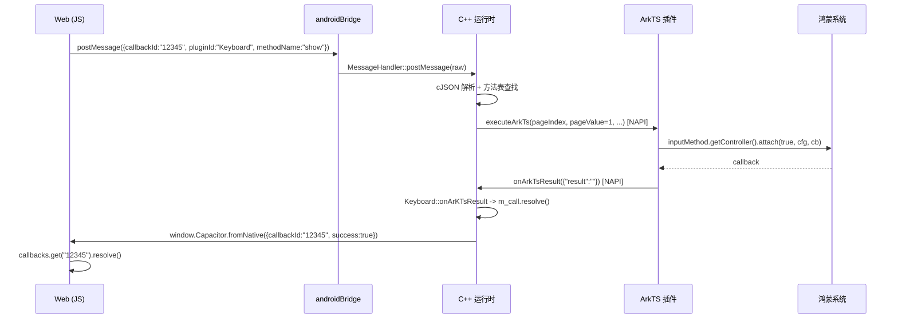
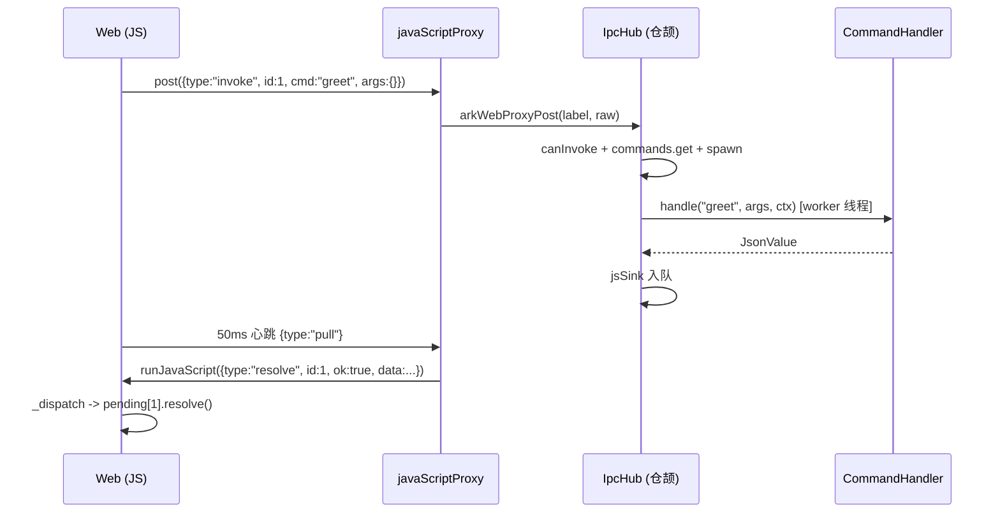

# 少 3 个环节、少 1 次 ABI、少 3500 行代码：cj-tauri 与 Ionic/Capacitor 的鸿蒙桥接机制对比

> 以 [`@capacitor/keyboard`](https://atomgit.com/CPF-Ionic/capacitor-keyboard)（OpenHarmony 适配）与 [`cj-tauri`](https://atomgit.com/qq8864/cj-tauri)（ArkWeb 宿主）的真实源码为例，拆解「JS 调原生」到底要跨几层、几种语言、几次 ABI 边界，并给出复杂度量化与选型建议。

---

## TL;DR

| | Capacitor / Ionic | cj-tauri |
|---|---|---|
| 正向环节 | **7 个环节（含系统端点）** | **4 个环节（+1 回程）** |
| 涉及语言 | JS / C++ / ArkTS（3 种） | JS / 仓颉（2 种） |
| 每次调用跨 ABI | 2 次（C++→ArkTS、ArkTS→C++） | 1 次（`javaScriptProxy`） |
| 方法路由 | 每方法三处对齐 + 运行时字符串路由 | 统一 `invoke(cmd, args)`，查表 |
| 事件模型 | 事件 = 永不结束的 `PluginCall`（`keepAlive`） | 独立 `listeners` 表，与 Promise 解耦 |
| 安全模型 | 无白名单 | capability 白名单 + path scope |
| 回程 | 主动 `evaluateJavaScript` 注入 `fromNative` | 鸿蒙侧 50ms 心跳 `pull` + `runJavaScript` |
| 桥接核心代码量 | ≈ 4 600 行 | ≈ 1 100 行（+ 142 行内联 JS 桥） |

**结论**：单看「桥」这一层，**cj-tauri 的模型明显更简单**——少一种语言、少一次 ABI 边界、命令模型统一。但 Capacitor 的复杂度有相当一部分是**为兼容现有生态付的税**：JS 侧 `@capacitor/keyboard` 一行不改，鸿蒙靠「伪装成 Android」复用整套 Capacitor JS 核心。两者的复杂度来源不同，不能只用「谁代码少」下结论。

---

## 阅读约定

文中路径均相对于各自仓库根目录，`文件:行号` 可直接定位：

- 插件仓库：`CPF-Ionic/capacitor-keyboard`（分支 `main`，提交 `19ef1e2`）
- 运行时仓库：`CPF-Ionic/openHarmony-capacitor`（`libcapacitor.so` + ArkTS 运行时）
- 对比仓库：`qq8864/cj-tauri`（提交 `d129236`）

**术语**：「环节」= 图中一个编号节点（可能只是进程内的一次方法调用）；「跳」= 一次跨语言 / ABI 边界的控制权转移。Capacitor 每次调用要跨 2 跳（C++→ArkTS、ArkTS→C++），cj-tauri 只跨 1 跳（`javaScriptProxy`）。

---

## 一、为什么需要桥

混合开发里，前端跑在系统 WebView 中，原生能力在 WebView 之外。桥至少要解决四件事：

1. **调用**：JS 怎么把「插件名 + 方法名 + 参数」送到原生；
2. **路由**：原生怎么找到对应的处理函数；
3. **回执**：结果怎么回到**发起那一次调用**的 Promise（而不是别的调用）；
4. **事件**：原生主动推送（键盘弹出、电量变化）怎么持续送到 JS，且不干扰上面的 Promise。

两个项目对这四个问题的回答方式截然不同：

- Capacitor 选择**「每个插件方法一个入口」**：插件方法在 C++ 里靠宏注册成方法表，ArkTS 侧再写一个同名函数，两边用一条路由字符串连起来；
- cj-tauri 选择**「一个通用 RPC 入口」**：所有调用都是 `invoke(cmd, args)`，`cmd` 查表，`args` 是任意 JSON 对象，事件走另一条 `emit/listen` 通道。

下面分别拆解。

---

## 二、Capacitor 键盘插件：七环节拆解


### 2.1 打包期：`plugin.xml` 不是装饰

插件本身只有 400 行左右，真正的「接线」由 `plugin.xml` 声明，`hionic sync openharmony` 按它改写宿主工程：

| 配置项 | 作用 |
|---|---|
| `config-json` | 往 `rawfile/capacitor.plugins.json` 追加 `{pkg, classpath:"Keyboard"}` —— 运行时查表的唯一依据 |
| `CMakeLists` | 往 `capacitor` 模块注入 `add_subdirectory(Keyboard)`，父工程再 `--whole-archive` 链接 |
| `source-file` | 把 `.h` / `.cpp` / `CMakeLists.txt` / `.ets` 拷到 capacitor 模块固定目录 |
| `runtimeOnly="true"` | ArkTS 文件只参与编译不参与导出，并写进 `build-profile.json5` 的 `runtimeOnly.sources` |

两个容易被忽略的点：

- ArkTS 源码被拷进 `src/main/ets/components/Keyboard/`，与运行时**同属一个 HAR**，所以 `Keyboard.ets` 能用相对路径 `import ... from "../PluginGlobal"`、`import capacitor from 'libcapacitor.so'`；
- `--whole-archive` 是必须的。插件靠静态构造函数自注册，不加它，链接器会把「没人引用」的 `Keyboard.o` 整个裁掉，注册就丢了。

### 2.2 启动期：两级注册表

**第一级是 C++ 静态自注册**，一行宏：

```cpp
// capacitor-keyboard/src/main/cpp/Keyboard/Keyboard.cpp:19
REGISTER_CAP_PLUGIN(Keyboard, Keyboard)
```

宏展开成全局 `KeyboardHandler` 变量，构造函数在 `CCapacitorPluginFactory` 里登记「类名 → 构造函数」。纯静态初始化，没有运行时反射。

**第二级是运行时实例化**：`PluginManager::registerAllPlugins()` 读 `capacitor.plugins.json`，按 `classpath` 调工厂造对象，包成 `PluginHandle`，以 **pluginId**（这里是 `"Keyboard"`）为 key 存表。JS 侧 `@capacitor/keyboard` 的 `capacitor.id` 必须与此字符串完全一致。

**第三级是方法表**：

```cpp
// capacitor-keyboard/src/main/cpp/Keyboard/Keyboard.cpp:72
REGISTER_PLUGIN_METHOD(Keyboard, show, PluginMethod::RETURN_PROMISE)
void Keyboard::show(PluginCall& call)
{
    m_call = call;
    executeArkTs("./Keyboard/Keyboard/ShowKeyboard", 1, "", "Keyboard", call);
}
```

方法名、成员函数指针、返回类型（promise / callback / none）被塞进 `classFunctions()[类名][方法名]`。注意这里已经暴露了两个设计特征：

- 路由是**硬编码字符串** `"./Keyboard/Keyboard/ShowKeyboard"`，写错只能运行时发现；
- `show` / `hide` 共用同一个 ArkTS 函数，只靠 `pageValue` 的 `1 / 0` 区分语义。

### 2.3 JS → C++：伪装成 Android

鸿蒙 ArkWeb 没有 Capacitor 原生使用的 `addWebMessageListener`，运行时的做法是注册一个名为 **`androidBridge`** 的 JS 代理对象：

```cpp
// openHarmony-capacitor/src/main/cpp/getcapacitor/MessageHandler.cpp:38
ArkWeb_ProxyMethod function1 = {"postMessage", MessageHandler::postMessage, static_cast<void *>(this)};
ArkWeb_ProxyMethod methodList[1] = {function1};
ArkWeb_ProxyObject proxyObject = {"androidBridge", methodList, 1};
Application::g_controller->registerJavaScriptProxy(m_strWebTag.c_str(), &proxyObject);
```

配合 `native-bridge.js` 的平台探测：

```js
// openHarmony-capacitor/src/main/resources/rawfile/native-bridge.js:156
const getPlatformId = (win) => {
    if (win?.androidBridge) return 'android';
    else if (win?.webkit?.messageHandlers?.bridge) return 'ios';
    ...
};
```

于是整个 Capacitor JS 核心走 Android 分支：

```js
// native-bridge.js:893（节选）
cap.toNative = (pluginName, methodName, options, storedCallback) => {
    let callbackId = '-1';
    if (storedCallback && ...) {
        callbackId = String(++callbackIdCount);
        callbacks.set(callbackId, storedCallback);   // Promise 的 resolve/reject 存在 Map 里
    }
    const callData = { callbackId, pluginId: pluginName, methodName, options: options || {} };
    postToNative(callData);
    return callbackId;
};
```

**这一步是 Capacitor 方案里最「巧」也最「脆」的地方**：巧在 JS 生态零改动；脆在平台身份是「借」来的——README 里 `show()` 标注「仅 Android 支持」，本质就是 JS 层认定自己是 android。

### 2.4 C++ → ArkTS：NAPI 只传一个扁平对象

C++ 插件不能直接调 ArkTS，只能走 `executeArkTs`：

```cpp
// openHarmony-capacitor/src/main/cpp/getcapacitor/Plugin.h:141
virtual bool executeArkTs(const std::string &strAction, const int nValue, const char *pArgs,
                          const char *pObject, PluginCall &call)
{
    void *pFunctionRefresh = Application::getFunctionRefresh(call.getWebTag());
    ...
    napi_property_descriptor desc[] = {
        {"pageIndex", ...}, {"pageValue", ...}, {"pageArgs", ...},
        {"pageObject", ...}, {"pageWebTag", ...}};
    ...
    napi_call_function((napi_env)Application::g_env, nullptr, function, 1, argv, NULL);
}
```

它做四件事：

1. 按 `webTag` 取出该 WebView 预先注册的 JS 函数引用（来自 `InitCordova` 的第 3 个参数 `PluginHandler`）；
2. 用 `napi_create_object_with_properties` 拼一个**五字段扁平对象**；
3. `napi_call_function` 同步调用；
4. 目标函数执行完后，通过 `onArkTsResult` 回传结果。

五个字段的含义：

| 字段 | 含义 |
|---|---|
| `pageIndex` | 路由串，如 `"./Keyboard/Keyboard/ShowKeyboard"` |
| `pageValue` | 一个整数槽位（0/1 表示隐藏/显示） |
| `pageArgs` | 一个字符串槽位（通常是 JSON 串） |
| `pageObject` | 插件名（`"Keyboard"`） |
| `pageWebTag` | 发起调用的 WebView 标识 |

**只有两个通用参数槽**，这是 `show` / `hide` 不得不共用一个函数的原因，也是这套桥扩展性受限的根源。

### 2.5 ArkTS：动态 `import()` 路由

`PluginHandler` 的路由规则非常朴素——最后一个 `/` 前是模块路径，后面是函数名：

```ts
// openHarmony-capacitor/src/main/ets/components/PluginHandler.ets:43
let pos: number = nativeAttribute.pageIndex.lastIndexOf("/");
let module: string = nativeAttribute.pageIndex.substring(0, pos);
let functionName = nativeAttribute.pageIndex.substring(pos + 1);
import(module).then((ns: ESObject) => {
  ns[functionName](nativeAttribute);
});
```

到插件自己的 ArkTS 代码里，就是普通鸿蒙开发：

```ts
// capacitor-keyboard/src/main/ets/components/Keyboard/Keyboard.ets:100
export function ShowKeyboard(pageIndex: NativeAttribute) {
  if (pageIndex.pageValue == 1) {
    let textConfig: inputMethod.TextConfig = { inputAttribute: inputAttribute };
    inputMethod.getController().attach(true, textConfig, (err: BusinessError) => {
      if (err) {
        capacitor.onArkTsResult(JSON.stringify({ result: "failed", errorMsg: err.message }), ...);
        return;
      }
      capacitor.onArkTsResult(JSON.stringify({ result: "" }), ...);
    });
  }
  if (pageIndex.pageValue == 0) {
    inputMethod.getController().hideTextInput().catch(...);
    capacitor.onArkTsResult(JSON.stringify({ result: "" }), ...);
  }
}
```

事件类能力则挂在窗口事件上，并且有版本门控：

```ts
// Keyboard.ets:164
async function listenerKeyboardWillShow(pageIndex: NativeAttribute) {
  const context = getContext() as common.UIAbilityContext;
  const windowClass = await window.getLastWindow(context);
  if (deviceInfo.distributionOSApiVersion >= 60000) {   // API 20
    windowClass.on('keyboardWillShow', willShowCallback(pageIndex));
  }
}
```

`DidShow` / `DidHide` 的门槛是 `>= 50100`（API 18），与 README 的能力矩阵一致。

### 2.6 回程：两种语义共用一条通道

ArkTS 侧统一出口是：

```ts
capacitor.onArkTsResult(jsonString, "Keyboard", webTag)
```

它是一个 NAPI 导出函数，C++ 侧按 `webTag` 找到桥，调用插件注册的 `onArKTsResult`。插件的处理就是一段分发：

```cpp
// capacitor-keyboard/src/main/cpp/Keyboard/Keyboard.cpp:93
void Keyboard::onArKTsResult(PluginCall& call)
{
    if (call.hasOption("notify")) {
        std::string eventName = call.getString("notify");
        if (call.hasOption("content")) {
            notifyListeners(eventName, call.getObject("content"));
        } else {
            cJSON* pJson = cJSON_CreateObject();
            notifyListeners(eventName, pJson);
            cJSON_Delete(pJson);
        }
    } else if (call.hasOption("result")) {
        std::string result = call.getString("result");
        if (result == "") m_call.resolve();
        else if (result == "failed") m_call.reject(call.getString("errorMsg"));
        else m_call.resolve(call.getObject("content"));
    }
}
```

两种报文语义：

| 报文 | 处理 | 用途 |
|---|---|---|
| `{"notify":"keyboardDidShow","content":{...}}` | 遍历 `m_mapEventListeners[event]`，逐个 `resolve` | 事件推送 |
| `{"result":""}` / `{"result":"failed","errorMsg":...}` | `m_call.resolve()` / `m_call.reject()` | Promise 结算 |

最终由 `MessageHandler::sendResponseMessage` 拼成 `window.Capacitor.fromNative({callbackId, success, data})`，经队列交给 ArkWeb 执行，JS 侧用 `callbackId` 从 `callbacks` Map 里找回最初那个 Promise。

### 2.7 一次 `show()` 的完整时序



---

## 三、cj-tauri：四环节拆解


### 3.1 三件套架构

cj-tauri 自称「仓颉语言的 Tauri 2」，三件套对应关系很清楚：

| 组件 | 对应 Tauri | 本仓位置 |
|---|---|---|
| WebView 宿主 | tao / wry | `src/host_arkweb.cj`（鸿蒙）、`host_webkit.cj`、`host_webview2.cj` |
| IPC 双向桥 | invoke / event | `src/ipc_hub.cj`、`src/ipc_message.cj`、`src/arkweb_script.cj` |
| 能力安全模型 | capabilities | `src/capability.cj`、`src/scope.cj` |

它没有复用任何 Capacitor 代码，前端桥是**自己写的一份 142 行内联 JS**。

### 3.2 前端桥：只有三个入口

```js
// cj-tauri/src/arkweb_script.cj（ARKWEB_BRIDGE_JS 常量，节选）
invoke: function (cmd, args) {
  var id = ++seq;
  var p = new Promise(function (resolve, reject) { pending[id] = { resolve: resolve, reject: reject }; });
  post({ type: 'invoke', id: id, cmd: cmd, args: args || {}, window: labelOf() });
  return p;
},
listen: function (event, cb) { ... },
emit: function (event, payload) { ... },
_dispatch: function (msg) {
  if (msg.type === 'resolve') { /* 按 id 结算 */ }
  else if (msg.type === 'event') { /* 按 label 过滤 + 回调 */ }
}
```

对比 Capacitor 的 `toNative`，差别一目了然：**没有 pluginId、没有 methodName 的二元组**，只有 `cmd` 一个字符串和一个任意 JSON 的 `args`。

### 3.3 报文协议

协议定义写得很直白（`src/ipc_message.cj` 顶部注释）：

```
JS → 仓颉 (invoke):
  {"type":"invoke","id":1,"cmd":"greet","args":{...},"window":"main"}
JS → 仓颉 (emit):
  {"type":"emit","id":2,"event":"tick","payload":{...},"window":"main"}
仓颉 → JS (resolve/reject):
  {"type":"resolve","id":1,"ok":true,"data":...}
  {"type":"resolve","id":1,"ok":false,"error":"..."}
仓颉 → JS (event):
  {"type":"event","event":"tick","payload":{...},"window":"main"}
```

四个字段就覆盖了调用、事件、回执、多窗口四件事。**这是它比 Capacitor 简单的根本原因**：Capacitor 用「插件方法表 + 每个方法一个 ArkTS 函数」表达能力，cj-tauri 用「一维命令名 + JSON 参数」表达能力。

### 3.4 能力校验与线程模型

```cangjie
// cj-tauri/src/ipc_hub.cj:244（节选，注释为原文）
private func handleInvoke(req: InvokeRequest): Unit {
    if (!this.capabilities.canInvoke(req.cmd)) {
        this.reject(req.id, "command not allowed: ${req.cmd}", req.window);
        return;
    }
    if (!this.commands.contains(req.cmd)) {
        this.reject(req.id, "command not registered: ${req.cmd}", req.window);
        return;
    }
    match (this.serialCmdToGroup.get(req.cmd)) {
        case Some(group) => this.enqueueSerial(group, req)
        case None => let _ = spawn { => this.runCommand(req) }
    }
}
```

三个设计点值得对照 Capacitor：

1. **校验在调用线程同步完成**，拒绝即时且顺序确定；
2. **执行挪到 worker 线程**，慢命令不会钉住宿主 UI；
3. **默认最小权限**：未在能力清单声明的命令一律拒绝。

Capacitor 侧没有等价物：只要 JS 能发消息，就能调任何已注册插件方法。这是安全性与易用性的直接取舍。

### 3.5 鸿蒙侧的特殊补偿：`pull`

`javaScriptProxy` 的返回值**传不回页面**（真机实测，返回值恒为 `null`），所以「页面拉、原生答」的同步取数模型不成立，只能反过来推：

```js
// arkweb_script.cj（节选）
function pump() {
  if (pumping) return;
  pumping = true;
  try {
    var host = window.__CJ_TAURI_HOST__;
    if (host && typeof host.post === 'function') {
      host.post('{"type":"pull","window":' + JSON.stringify(labelOf()) + '}');
    }
  } finally { pumping = false; }
}
try { setInterval(pump, 50); } catch (e3) { }
```

对应宿主侧：

```cangjie
// src/arkweb_proxy.cj
@When[env == "ohos"]
public func arkWebProxyPost(label: String, raw: String): String {
    match (ArkWebRuntime.hostFor(label)) {
        case Some(h) => h.acceptPageMessage(raw)
        case None => ()
    }
    return ""
}
```

`acceptPageMessage` 会先截掉两类控制报文（`reload`、`pull`），再把真正的 IPC 报文交给 `IpcHub`；`pull` 的响应由应用侧 `Web` 组件的 post 回调取 `takePendingScripts()`，用 `runJavaScript` 推回页面。

**这是 cj-tauri 链路里唯一比 Capacitor「更绕」的地方**，而且是平台限制导致的补偿，不是设计选择。

### 3.6 一次 `invoke()` 的完整时序



---

## 四、并排对比


### 4.1 逐维度对比

| 维度 | Capacitor（本仓库） | cj-tauri | 谁更简单 |
|---|---|---|---|
| 分层 | JS → C++ 运行时 → ArkTS 模块 → 系统 API，**3 种语言** | JS → 仓颉宿主 → 命令处理器 → 系统 API，**2 种语言** | cj-tauri |
| JS↔原生通道 | 伪装 Android：`androidBridge.postMessage` | 自有 `javaScriptProxy.post(json)` | 平手，都是代理对象 |
| 方法路由 | 三处对齐：C++ 宏 + ArkTS 函数 + 硬编码路由串，靠 `import()` 加载 | 一个入口 `invoke(cmd, args)`，命令名即 map key | cj-tauri |
| 参数模型 | NAPI 只传 5 个扁平字段，`show/hide` 只能共用函数用 0/1 区分 | `args: JsonObject`，任意结构 | cj-tauri |
| Promise 配对 | `callbackId` + `PluginCall`；事件依赖 `keepAlive` | `id` + `pending` Map；事件独立 `listeners` 表 | cj-tauri |
| 回程通道 | C++ 主动 `evaluateJavaScript`，无轮询 | 鸿蒙 50ms `pull` + `runJavaScript` | **Capacitor** |
| 事件模型 | 事件 = 永不结束的 call，插件自维护监听表 | hub 统一 `emit/emitLatest` + label 过滤 | cj-tauri |
| 安全模型 | 无白名单 | 能力白名单 + path scope + 串行组 | cj-tauri（有意的复杂度） |
| 新增一个方法 | 改 C++ 宏、写 ArkTS 函数、写路由串 | 实现接口 + `register` + 清单声明 | cj-tauri |

### 4.2 复杂度量化

| 指标 | Capacitor | cj-tauri |
|---|---|---|
| 正向环节 | 7 个环节（含系统端点） | 4 个环节 |
| 语言数 | 3 | 2 |
| ABI 边界/次调用 | 2 | 1 |
| 桥接核心代码 | ≈ 4 600 行 | ≈ 1 100 行 |
| 前端桥 JS | 1 035 行（官方 `native-bridge.js`，非鸿蒙专有） | 142 行（内联） |
| 新增能力接线点 | 3 处（宏、ArkTS、路由串） | 3 处（接口、注册、清单） |

> 代码量口径：Capacitor 统计 `Plugin.*`、`PluginCall.*`、`Bridge.cpp`、`MessageHandler.cpp`、`PluginManager.cpp`、`PluginHandle.cpp`、`napi_init.cpp`、`PluginHandler.ets`、`PluginCall.ets`、`CapacitorPlugin.ets`、`native-bridge.js`；cj-tauri 统计 `ipc_hub.cj`、`ipc_message.cj`、`capability.cj`、`scope.cj`、`arkweb_proxy.cj`、`arkweb_script.cj`。

---

## 五、简单性之外：各自付出的代价

### 5.1 Capacitor 侧的「薄适配层」问题

读源码过程中发现几处可以复现的缺陷，它们都源于「尽量少改上游语义」的适配策略：

1. **`m_call` 单实例竞态**：`Keyboard.h:22` 只有一个 `PluginCall m_call`，`show/hide/setScroll` 每次调用都会覆盖它。连续 `show()` 后紧跟 `hide()` 时，先发起的 Promise 永远不结算。
2. **`removeListener` 取错参数**：`Keyboard.cpp:46-48` 用 `cJSON_GetArrayItem(pJson, 0)->valuestring` 取事件名，但 JS 传的 `options` 对象第一个属性是 `callbackId`（`native-bridge.js:195` 字段顺序为 `callbackId, eventName`），于是把 callbackId 当成事件名，`Keyboard.ets` 的 `keyValue` 永远匹配不上 → `window.off` 实际不执行，原生监听泄漏，且 C++ 去重标志已置 false，再次 `addListener` 会重复注册。
3. **`off` 未传 callback**：`windowClass.off("keyboardWillShow")` 会移除该事件**所有**监听者，可能误伤宿主其他模块。
4. **版本不满足时静默失败**：低版本直接跳过 `window.on`，但 C++ 已 `resolve`，JS 拿到合法 handle 却收不到事件。
5. **`hide()` 提前 resolve**：`Keyboard.ets:127-134` 先挂 `catch`，随后立刻回 `{result:""}`，Promise 在键盘真正隐藏前就成功。
6. **跨 WebView 串扰**：4 个 bool 去重标志与 `m_mapEventListeners` 都在单例插件对象上，多 WebView 共享。

这些不是「桥设计必然产生的」，而是「薄适配层 + 手工接线」这种工程方式的典型产物。

### 5.2 cj-tauri 侧的代价

1. **新增命令要三处联动**：实现 `CommandHandler`、`TauriApp.register()`、能力清单声明。漏第二处得到 `command not registered`，漏第三处得到 `command not allowed`。
2. **鸿蒙回程有 50ms 节拍**：`pull` 轮询带来最多 50ms 的额外延迟，队列空时仍有一次同步调用开销。桌面平台没有这个问题（C 桥主动投递）。
3. **框架包不能引用 ArkUI**：真机实测会启动即 `SIGSEGV`，所以 `@Component` / `Web` / `javaScriptProxy` 必须留在应用侧，框架只导出 ArkUI-free 的桥接函数——装置成本比 Capacitor 的「拷源码进模块」更高。
4. **能力清单与服务端一致性**：白名单提高了安全下限，但也意味着「页面能调什么」不再只由代码决定，还要维护一份清单。

### 5.3 一句话总结

- **Capacitor 的复杂，是「生态兼容税」**：用 3 种语言、7 个环节，换来 JS 侧零改动与整个 Capacitor 插件生态的复用。
- **cj-tauri 的简单，是「自建协议的收益」**：用 1 次 FFI、4 个环节，换来统一的命令/事件模型与能力沙箱，代价是平台壳要自己啃。

---

## 六、选型建议

| 你的场景 | 建议 | 理由 |
|---|---|---|
| 已有 Ionic / Capacitor 应用，要上鸿蒙 | **Capacitor** | 生态与 JS 代码零改动，插件可直接复用 |
| 需要大量 Capacitor 官方/社区插件 | **Capacitor** | 插件生态是它的核心资产 |
| 新写「原生 + WebView」鸿蒙应用，追求内核可读可控 | **cj-tauri** | 桥只有 1 次 FFI，命令模型统一，源码可全量审计 |
| 对安全边界（能力白名单、路径 scope）有硬要求 | **cj-tauri** | capability + scope 是内建能力，不需要自己补 |
| 对回程实时性极敏感（< 10ms） | **Capacitor** | 鸿蒙侧 cj-tauri 受 `javaScriptProxy` 限制要 50ms `pull` |
| 需要多窗口 / 多 WebView 隔离 | **cj-tauri** | 协议自带 `window` label 路由；Capacitor 插件状态是单例 |

---

## 附录 A：源码索引

### Capacitor / 键盘插件

| 关注点 | 位置 |
|---|---|
| 插件声明与打包接线 | `plugin.xml` |
| 静态注册与工厂 | `src/main/cpp/getcapacitor/Plugin.h:67`（`REGISTER_CAP_PLUGIN`） |
| 方法表注册 | `src/main/cpp/getcapacitor/Plugin.h:379`（`REGISTER_PLUGIN_METHOD`） |
| C++→ArkTS 调用 | `src/main/cpp/getcapacitor/Plugin.h:141`（`executeArkTs`） |
| C++→ArkTS 异步版 | `src/main/cpp/getcapacitor/Plugin.h:209`（`executeArkTsAsync`，thread-safe function） |
| 插件实例化 | `src/main/cpp/getcapacitor/PluginManager.cpp:120`（`registerAllPlugins`） |
| JS 消息入口 | `src/main/cpp/getcapacitor/MessageHandler.cpp:79`（`postMessage`） |
| JS→C++ 分发 | `src/main/cpp/getcapacitor/Bridge.cpp:67`（`callPluginMethod`） |
| ArkTS 路由 | `src/main/ets/components/PluginHandler.ets:43` |
| 键盘实现 | `src/main/ets/components/Keyboard/Keyboard.ets:100`（`ShowKeyboard`） |
| 键盘事件监听 | `src/main/ets/components/Keyboard/Keyboard.ets:164` |
| Promise 回程 | `src/main/cpp/getcapacitor/PluginCall.cpp:66`、`MessageHandler.cpp:126` |
| 前端桥 | `src/main/resources/rawfile/native-bridge.js:893`（`toNative`） |

### cj-tauri

| 关注点 | 位置 |
|---|---|
| IPC 协议定义 | `src/ipc_message.cj`（文件头注释即协议） |
| 命令分发 | `src/ipc_hub.cj:213`（`handleRawMessage`）、`:244`（`handleInvoke`） |
| 命令接口 | `src/ipc_hub.cj:11`（`CommandHandler`） |
| 能力校验 | `src/capability.cj`、`src/scope.cj` |
| 鸿蒙 proxy | `src/arkweb_proxy.cj` |
| 前端桥与 `pull` | `src/arkweb_script.cj` |
| 页面消息入口 | `src/host_arkweb.cj:806`（`acceptPageMessage`） |
| 待执行脚本队列 | `src/host_arkweb.cj:733`（`takePendingScripts`） |

---

## 附录 B：术语

| 术语 | 含义 |
|---|---|
| NAPI | Node-API，ArkTS/Node 与 C/C++ 之间的原生接口 |
| FFI | Foreign Function Interface，仓颉调用 C 或嵌入 JS 引擎的接口层 |
| `javaScriptProxy` | 鸿蒙 ArkWeb 提供的「页面 ↔ 原生」代理对象注册机制 |
| capability | cj-tauri 的能力白名单，声明页面可调用哪些命令 / 事件 |
| `keepAlive` | Capacitor 中让 `PluginCall` 不随一次响应结束，用于事件持续推送 |
| `pull` 心跳 | 鸿蒙侧页面定时向原生取待执行脚本的补偿机制（50ms） |

---

*本文所有结论均基于上述三个仓库的源码与注释；涉及真机行为的描述（如 `javaScriptProxy` 返回值不可用、框架包引用 ArkUI 会崩溃）来自 cj-tauri 的踩坑文档与代码注释，未在本环境复跑。*