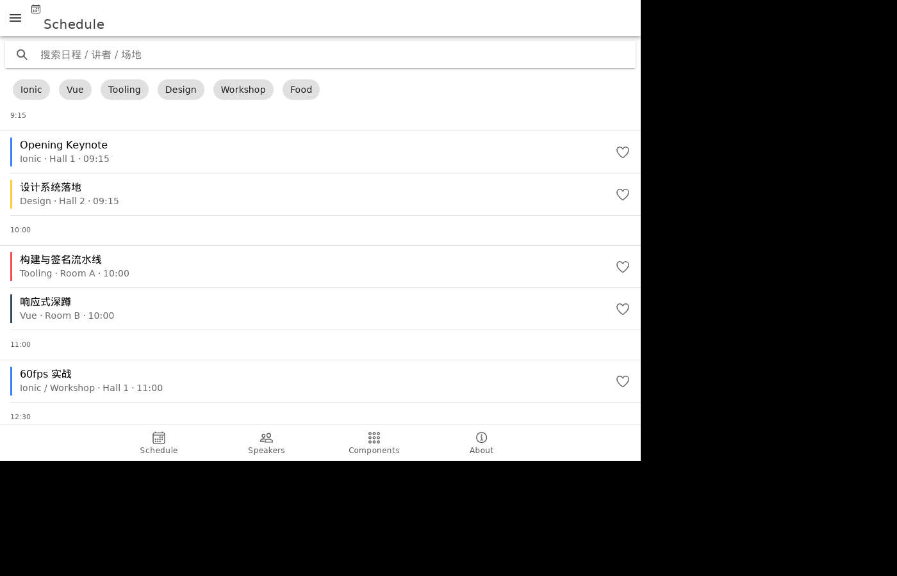
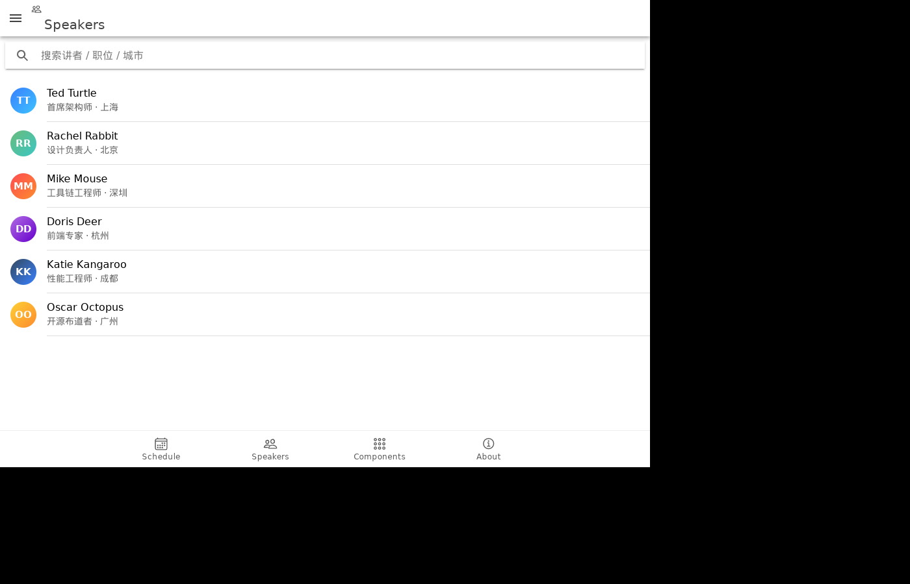
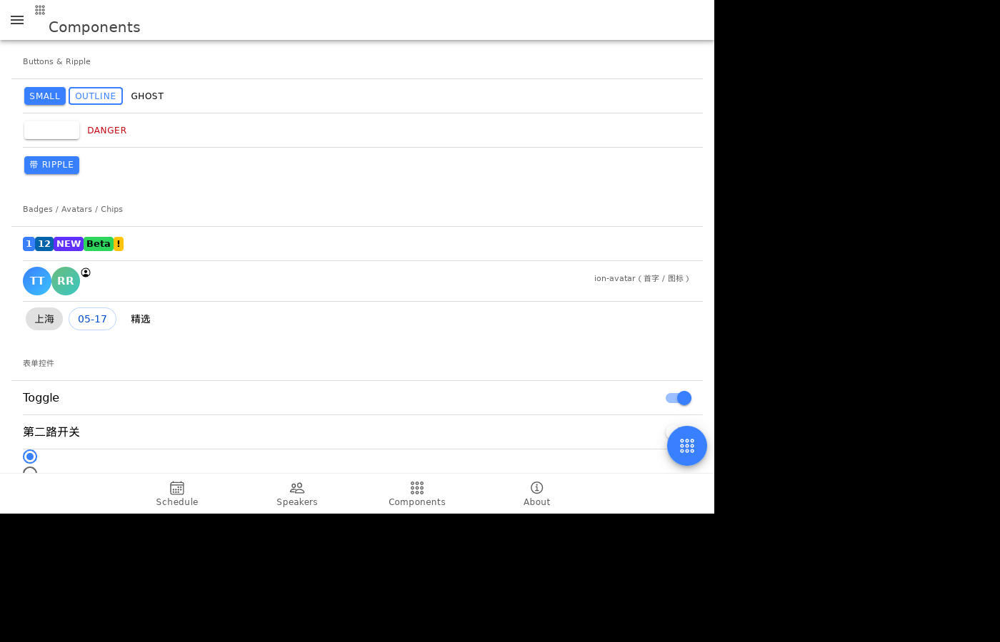
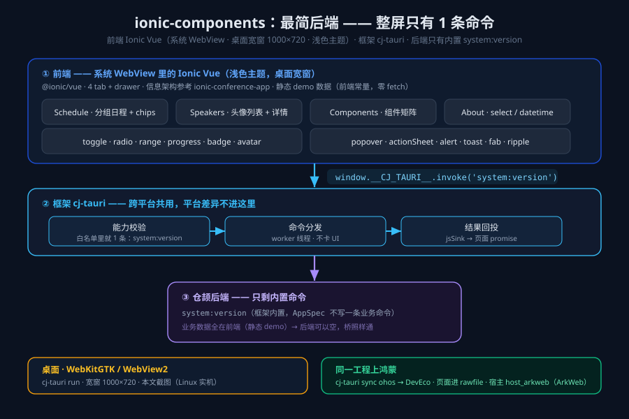

# 把组件库翻一遍：Ionic 组件陈列馆

> 系列下篇 · 示例工程 `examples/ionic-components` · 框架 cj-tauri（仓颉版混合开发框架）
> 系列上篇：[用 Ionic 写界面、仓颉写后端：一台鸿蒙上的音乐播放器](./Ionic-仓颉-鸿蒙音乐播放器.md) ·
> 系列中篇：[换成在线播片：Ionic 前端 + 仓颉后端的观影 App](./Ionic-仓颉-鸿蒙观影应用.md)

上两篇的后端都不轻：音乐篇打真实音乐接口、收藏落盘，观影篇对接豆瓣上游还接了 hls.js 播 m3u8。这篇把问题反过来问：**如果页面的数据全是静态 demo，仓颉后端除了一条内置的 `system:version` 之外是空的——这套「Ionic + cj-tauri」还成立吗？**

成立。而且这个工程验证的是另一件事——**框架对前端「零约束」的下限**：组件矩阵能铺多宽（一屏塞多少种组件）、drawer / 浅色主题 / 桌面宽窗这些形态由应用自己定、以及后端空到只剩一条命令时，「桥通了」这件事拿什么证明。

信息架构参考的是 Ionic 官方的 `ionic-conference-app`（会议 App 样板）：四个 tab（Schedule / Speakers / Components / About）加一个全局 drawer 菜单，数据是照着它那份 `data.json` 改的静态 demo。

## 先看成品

四个 tab，桌面宽窗 **1000×720**、**浅色主题**——前两篇是手机比例竖窗 + 深色，这篇故意反过来：形态（窗口比例、深浅色）是应用自己定的，框架不插手。

Schedule：按时间分组的日程，track 色左边条 + 收藏心形，顶部 track 筛选 chips：



Speakers：搜索框 + 头像列表（首字头像、职位、城市），点头像弹详情：



Components：一整个组件矩阵（按钮、徽章、头像、chip、开关、单选、滑块、进度、弹层……），这篇的主角：



About：城市 `select`、`datetime` 日历、以及关于卡片——卡片里那行版本号就是经桥从仓颉侧取回的 `system:version`：


## 这张工程里，桥只剩一条命令

```
Ionic 组件  ──invoke('system:version')──▶  cj-tauri（能力校验 → 命令分发 → 回投）  ──▶  框架内置命令  ──▶  About 页版本号
```

画细一点：



## 一、为什么「后端可以空」

前两篇的 `src/main.cj` 都在 `wire` 里注册了一排命令（音乐篇 11 条 + 收藏存储）。这个工程的 `build(): AppSpec` **一条业务命令都不注册**，`wire` 干脆不写（它是可选的）：

```cangjie
// examples/ionic-components/src/main.cj（全部业务代码）
public func build(): AppSpec {
    let winCfg = WindowConfig(title: "Ionic 组件陈列馆 · cj-tauri", width: 1000, height: 720)
    return AppSpec().window(winCfg)   // 没有 .wire() —— 没有业务命令
}
```

能力清单也就只有一行：

```jsonc
// assets/capabilities/default.json
{
  "identifier": "default",
  "windows": ["main"],
  "commands": ["system:version"],
  "events": []
}
```

这说明了什么？**cj-tauri 不是「必须写后端」的框架，而是「想写后端时三处联动在、不想写时不挡路」**。页面可以是纯静态 SPA，框架照跑；哪天要接真数据了，命令、register、能力清单三处补齐就行，前端一行不改（把 `$invoke('music:hot')` 换个命令名而已）。

`system:version` 是框架内置命令（`src/api_system.cj`，`TauriApp.run()` 里统一注册），返回 `{name, version, protocol, cangjie, platform}`。它在这个工程里有一个**取证**用途：页面是纯静态 demo，没有业务命令可以数调用次数，「桥死了」和「页面没跑起来」在现象上分不开——留这一条往返，桥的 stderr 里就会出现 `[cj-bridge] js -> native (73 bytes)`，页面 About 页就出现版本号，两边一对，桥通没通立刻见分晓。**纯前端项目也留一条桥往返，是这类混合工程的好习惯。**

## 二、组件矩阵：一屏能塞多少

Components tab 就是把 `@ionic/vue` 的常用组件按类别排开，一屏能滚到底（上面第三张截图是它的上半部分）：

| 类别 | 组件 | 说明 |
|---|---|---|
| Buttons & Ripple | `<ion-button>` | small / outline / ghost / danger 四个 fill 并排，外加一个带 `ion-ripple-effect` 的按钮（MD 点击波纹） |
| Badges / Avatars / Chips | `<ion-badge>` `<ion-avatar>` `<ion-chip>` | badge 五种形态（数字、NEW、Beta、感叹号）；avatar 首字与图标两种；chip 可点可关 |
| 表单控件 | `<ion-toggle>` `<ion-radio-group>` `<ion-range>` `<ion-progress-bar>` `<ion-select>` | 开关、单选组、双端滑块、两种颜色的进度条、下拉选择 |
| 弹层 | `<ion-popover>` `<ion-modal>`、`alertController` / `actionSheetController` / `toastController` | 触发方式分两种，见下 |
| 导航与辅助 | `<ion-segment>` `<ion-fab>` `<ion-item-sliding>` `<ion-skeleton-text>` | 分段控件、悬浮按钮、左滑操作、骨架屏 |

弹层这块有一组我反复强调的**稳健写法**，工程头部的注释就写在最前面：

```
弹层全走稳健写法：alert / actionSheet / toast 用 controller（收按钮数组），
modal 用声明式 <ion-modal>（:is-open 切换）、popover 用声明式 <ion-popover>（trigger 锚定）
——都不依赖运行时模板编译或 h() 渲染，单文件 SFC 里最不容易翻车。
```

为什么单列这一段？因为 Vue 3 的 SFC 里，模板是**编译期**转成渲染函数的——你在 `h()` 里手拼模板字符串、或者指望运行时编译一段 `<template>`，都得额外引入 `vue/compiler-dom`，漏引时的报错非常偏（渲染出来一片空白，控制台只有一句看不懂的 warning）。而 Ionic 的 controller API 收的是**按钮数组**（纯数据，不涉模板）、`<ion-modal>` / `<ion-popover>` 是正经组件（走 SFC 正常编译）——绕开运行时编译，单文件产物里就稳了。

两个「文档和实际对不上」的小坑，都是这次翻组件库翻出来的：

- **`IonProgressCircular` 在 `@ionic/vue` 里没导出**——`@ionic/core` 文档里环形进度是有的，但 vue 包装层没这个导出，`import { IonProgressCircular }` 直接报 unresolved import。换 `IonProgressBar` 摆两种颜色替代，效果够用。
- **ionicons 不是「文档里有就导得出」**：`componentsOutline` / `sunOutline` 这两个名字在包里不存在，换 `appsOutline` / `moonOutline` 就有了。图标名报错时先怀疑名字本身，别怀疑安装。

这个 gallery 真正的用途是**验收清单**：cj-tauri 的宿主换过平台（WebKitGTK / WebView2 / ArkWeb），Ionic 的样式靠 WebView 的 CSS 引擎渲染——每换一次宿主、每升一次 WebView，把这页翻一遍，哪些组件画歪了、哪些弹层位置不对，当场见分晓。一屏铺全，就是为了不用去翻文档回忆「还有哪类组件没验过」。

## 三、桌面宽窗 + 浅色主题 + drawer

这篇和前两篇的形态刻意相反，三处决定：

1. **宽窗 1000×720**。前两篇是 400×820 竖窗（移动端形态）；这个示例是桌面形态——`cj-tauri.toml` 的 `[[windows]]` 写多大就是多大，框架不做任何「按屏幕自适应」（这个能力曾经有过，用户裁定撤了，实测不如固定尺寸舒服）。宽窗下前两篇的窄屏坑（三栏标题折行）自然不存在，但多了一个东西：**drawer**。
2. **浅色主题**。Ionic 默认就是浅色——`ion-palette-light` 是默认态，一行 class 都不用挂。这和上篇的坑正好互为镜像：深色要挂 `ion-palette-dark` class 才生效，浅色不挂就是它。写浅色 App 的「坑」就是**别多挂**。
3. **全局 drawer 菜单**（`ion-menu`）。参考 conference 的 `Menu.vue`：分组菜单 + 选中态高亮 + 底部深色开关。选中态那条是 conference 的标志性样式——MD 药丸，只圆右半边：

```css
/* drawer 菜单：MD 药丸选中态（conference 的标志性样式） */
ion-menu ion-item[aria-selected="true"] {
  --background: rgba(56, 128, 255, 0.14);
  --border-radius: 0 50px 50px 0;
}
```

`ion-menu` 要和主内容配对：内容区给 `id="main-content"`，菜单写 `content-id="main-content"`——push 手势、动画、遮罩都是围绕这个配对做的，少一个属性菜单就变成「盖在内容上的浮层」，推不动也关不掉。深色开关是个 `dark` 状态位：置位后把 `ion-palette-dark` 同时挂到 `<html>` 和 `<ion-menu>` 上，整页翻面——浅色/深色一套代码都行，取决于挂哪个 class，这就是上篇那条「class 选择器」坑的正面用法。

Schedule 页的交互全是纯前端逻辑：搜索框过滤 + track 筛选 chips（`TRACKS` 六个轨道），日程按时间分组、卡片左边条取 track 色、收藏心形存前端状态——**一条后端命令都不碰**，这正好是「后端可以空」的活例子：整个页签的增删改查都在页面内存里完成，刷新就没了，而没人需要它持久化（它只是 demo 数据）。

## 四、唯一的一条桥往返：`system:version` 怎么取、怎么验

About 页那行版本号的全部代码：

```js
async function loadVersion() {
  try {
    const v = await $invoke('system:version', {})
    appVersion.value = typeof v === 'string' ? v : (v.version || '')
  } catch (e) { appVersion.value = '' }
}
```

`$invoke` 是页面里对 `window.__CJ_TAURI__.invoke` 的包装（和上两篇同一个 `waitForBridge`——桥是 document-start 注入的，可能晚于本页脚本，纯前端项目也一样要等）。拿回来的是 `{name, version, protocol, cangjie, platform}`，页面只取 `version` 显示在卡片里，卡片文案自己把话说全了：

> 这是一个纯前端的 Ionic 组件陈列……唯一用到的后端命令是 `system:version`——下面这行版本号就是前端经 `window.__CJ_TAURI__` 从仓颉侧取回来的，说明桥是通的。

验证这条链路，看两个读数：

1. **桥的 stderr**：`[cj-bridge] js -> native (73 bytes)`——`{"cmd":"system:version",...}` 这个请求进到了原生侧。
2. **页面回显**：About 卡片里的版本号（桌面实机上稳定出现；无头环境里单文件页模块执行慢，截图里这行可能来不及渲染——以 stderr 那行为准，别拿截图空行判桥死）。

这一条往返同时覆盖了「能力校验」（`system:version` 在清单里）、「命令分发」（worker 线程执行）、「结果回投」（jsSink 回页面 promise）三段——框架的完整链路，用最小的一条命令走了一遍。

## 五、上鸿蒙 & 系列小结

上鸿蒙的路径和前两篇一字不差：

```bash
cj-tauri sync ohos     # 从 cj-tauri.toml 派生 targets/ohos 的 DevEco 工程
# 页面（ui/dist/index.html）进 hap 的 rawfile，清单 id 即 bundleName
# 构建走 build-hap.sh / build-hap.bat（Windows），或 DevEco IDE 直接 Build
```

鸿蒙侧现状如实说：宿主建窗 / 页面装载 / 桥注入 / `system:version` 往返已真机闭环，菜单能力位已真机取证，其余能力位为 0；https 走系统栈 `ohos.net.http`。这个纯前端工程上鸿蒙后，四条 tab 与全部弹层都在 ArkWeb 里渲染——**它同时就是鸿蒙侧的「组件验收清单」**：哪类组件在 ArkWeb 下画歪了，这页翻一遍就知道。

三篇合起来，是同一个框架的三种后端深度：

| 篇 | 工程 | 后端深度 | 验证的问题 |
|---|---|---|---|
| 上篇 | ionic-music | 11 条业务命令 + 收藏落盘 | 真实数据、防盗链、LRC 归一化、移动端竖窗形态 |
| 中篇 | ionic-movie | 影视上游 + m3u8/hls.js | 视频引擎、缓存与限流、新形态工程（`build(): AppSpec`） |
| 下篇 | ionic-components | 0 条业务命令（仅内置 `system:version`） | 组件矩阵验收、宽窗/drawer/浅色形态、桥的最简往返 |

后端可以从「11 条命令 + 存储」一路减到「一条都不写」，前端始终是那套 Ionic Vue、同一份桥契约、同一份 `waitForBridge`；桌面跑通的工程 `cj-tauri sync ohos` 一键派生鸿蒙。三个工程都在仓里（`examples/` 下），能直接跑。
