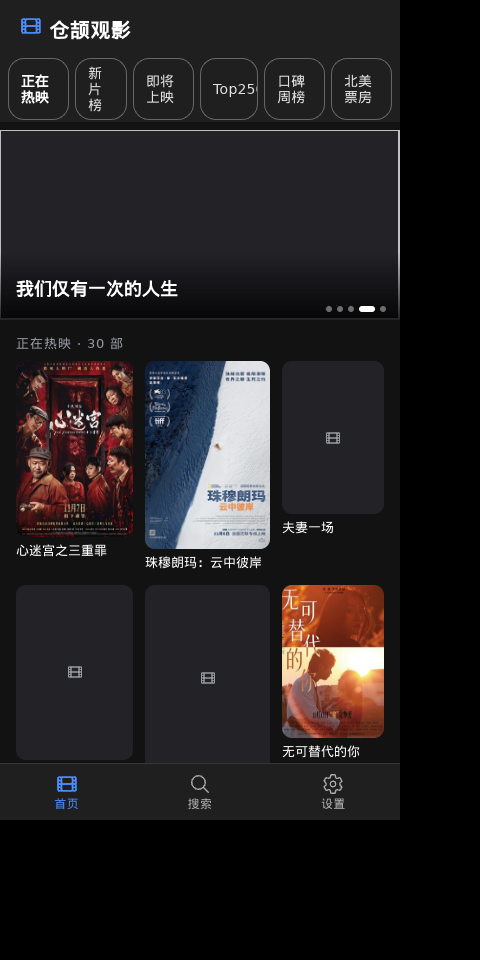
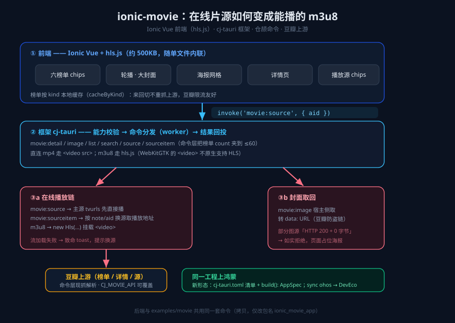

# 换成在线播片：Ionic 前端 + 仓颉后端的观影 App

> 系列中篇 · 示例工程 `examples/ionic-movie` · 框架 cj-tauri（仓颉版混合开发框架）
> 系列上篇：[用 Ionic 写界面、仓颉写后端：一台鸿蒙上的音乐播放器](./Ionic-仓颉-鸿蒙音乐播放器.md) ·
> 系列下篇：[把组件库翻一遍：Ionic 组件陈列馆](./Ionic-仓颉-鸿蒙组件陈列馆.md)

上篇做音乐，这篇换一类数据：**在线影视**。界面还是 Ionic Vue，后端还是仓颉命令，多出来的东西是一个视频引擎——**hls.js**，用来播 `m3u8`。因为 WebKitGTK 的 `<video>` 不原生支持 HLS，在线片源大多是 m3u8 流，这块前端必须自己接。

后端这套命令直接**复用**了 `examples/movie` 的那一份（源码拷贝，只把包名改成 `ionic_movie_app`）——这也是 cj-tauri「框架对前端零约束」的一个直接证据：同一个仓颉后端，UI 从原生 JS 单页换成 Ionic Vue，后端一行不动。

## 先看成品

这是 ionic-movie 的首页：顶部一排**六个榜单** chips（正在热映 / 新片榜 / 即将上映 / Top250 / 口碑周榜 / 北美票房，点哪个看哪个，本地缓存来回切不重抓），中间是**轮播**（榜单前 5 部大封面、3.5 秒自动翻页），下面**海报网格**（带评分角标，取不到封面的显示占位图）。底部三个页签（首页 / 搜索 / 设置）。整屏深色，竖屏 400×820。



点任意一张海报进**详情页**：大封面 + 标题 + 简介 + 播放区。下面这张就是实机打开《心迷宫之三重罪》的真实状态——这部片**没有可取的播放源**，简介上游也刚好缺失，产品如实显示「暂无可用的播放源」「简介暂缺（豆瓣源偶发）」，不装没事发生：


## 一条命令从页面走到豆瓣再回来

```
Ionic 组件  ──invoke──▶  cj-tauri（能力校验 → 命令分发 → 回投）  ──▶  仓颉命令  ──▶  豆瓣上游
```

画细一点，注意右侧两个分支——**在线播放链**和**封面取回**——是这篇的两个重点：



## 一、首页：六个榜单 + 本地缓存 + 海报网格

首页的信息架构是「榜单 chips → 轮播 → 海报网格」。三个榜单相关的命令：

| 命令 | 干什么 |
|---|---|
| `movie:list` | 拉某个 kind 的榜单（正在热映 / 新片 / Top250 …），命令层把 `count` 夹到 ≤60 |
| `movie:search` | 关键词搜片，结果进**同一个**海报网格 |
| `movie:detail` | 点进某部片的详情（大封面 + 简介） |

这里我特意做了一件事：**榜单按 kind 做本地缓存**（页面里的 `cacheByKind`）。你在「正在热映」和「口碑周榜」之间来回切，不会每次都重新打上游——上游是豆瓣，**限流友好**这件事是命令层和页面层一起守的：命令层把 `count` 夹到上限，页面层缓存已经拉过的 kind。两个层面叠起来，别拿高频轮询去打豆瓣。

海报网格是纯前端渲染：每张海报走 `movie:image` 取回（见下文「封面取回」），评分角标是前端叠上去的。点海报进详情页。

## 二、详情 + 在线播放：m3u8 怎么变成能播的

点海报进详情页：大封面（500px）+ 简介（`movie:detail`）+ **一排播放源 chips**。

播放这块是这篇的核心。片源由后台**现抓上游解析**，两个命令配合：

- `movie:source` —— 拿到这部片的**主源** `tvurls`，先直接播；
- `movie:sourceitem` —— 按 `note`/`aid` **换源**，取对应播放源的地址（源站偶尔抽风，换一个 chips 就能续上）。

拿到的播放地址可能是两种形态，前端分两条路：

```js
// 详情页播放（前端）
async function playUrl(url) {
  const video = document.querySelector('video')
  if (url.endsWith('.m3u8')) {
    // WebKitGTK 的 <video> 不原生支持 HLS → 走 hls.js
    if (Hls.isSupported()) {
      const hls = new Hls()
      hls.loadSource(url)
      hls.attachMedia(video)
      // 流加载失败 → 致命错误 toast，提示换源
    }
  } else {
    video.src = url   // 直链 mp4 直接 src，不走 hls.js
  }
}
```

两个事实值得记：

1. **hls.js 约 500KB，随单文件产物内联**。`vite-plugin-singlefile` 把它和其它 JS 一起打进 `assets/ui/dist/index.html`——所以这页比音乐那页大，前面打包时撞过的「WebView2 内联页 ~2MB 上限」就是这么冒出来的（movie 页 1.8MB，超限走 `file://` 导航）。
2. **m3u8 失败是致命的、要让用户换源**。流加载失败不是「再试一次就好」，得 toast 明确告诉用户「这个源挂了，换一个」——因为在线片源本来就是「哪个能用播哪个」的。

还有一句实话：我实机取证那轮，**榜单前几部片都没有合法片源**（上游源池有限），详情页打开都是开头那张图里的「暂无可用的播放源」。这不是 bug，是产品的常态——取到源，`startPlay` 自动按 m3u8 / 直链两条路起播；取不到，就占位 + 提示，页面不假装在播。「换源」chips 服务的是另一种情况：源能取到、但源站抽风，点另一个源接上。

## 三、封面取回，以及「HTTP 200 + 0 字节」

和音乐篇同一套逻辑：豆瓣图源防盗链，页面直连必然「HTTP 200 + 0 字节」。封面走宿主命令 `movie:image` 取回转 `data:` URL，网格 200px、详情 500px 懒加载。

但 movie 比 music 多一种**诚实的失败**：部分豆瓣封面**连宿主侧都只能拿到「HTTP 200 + 0 字节」**（图源防盗链更严，或者片已下架）。这时候命令层**如实拒绝**——stderr 留一行 `command rejected (movie:image)`，命令返回失败，页面显示**占位海报**，而不是假装成功、硬塞一张坏图。

这个口径我认为是这类 App 最该守住的一条：**取不到就如实说取不到**，别为了界面好看把失败伪装成成功。取证的时候，「占位海报 + 那一行 rejected」正好能对上。

## 四、新形态工程：清单 + build(): AppSpec

ionic-movie 是**新形态**工程（相对 `examples/movie` 的老形态），区别就三处：

| | examples/movie（老形态） | ionic-movie（新形态） |
|---|---|---|
| 工程 | 无清单，页面 `ui/index.html` 内联读取 | `cj-tauri.toml` 清单 + `assets/ui` Vite 工程 + 骨架派生 |
| 业务入口 | `main()` 可执行 | `public func build(): AppSpec`（业务 static 包，骨架 launcher 调用） |
| 前端 | 原生 JS 单页 | Ionic Vue + hls.js |
| 命令层 | 相同（拷贝，仅包名不同） | 相同 |

业务入口从「写一个 `main()`」变成「**装配一个 `AppSpec`**」——前端页面、窗口配置、能力都声明在一个 `build()` 里返回，骨架的 launcher 负责真正 `run`。这让「应用装配结果」和「谁来跑」分开，也是 `cj-tauri sync` 能从清单派生 desktop / ohos 两份骨架的前提。

```toml
# cj-tauri.toml
[app]
  name = "ionic-movie"
  id = "com.example.ionic_movie_app"   # 鸿蒙下即 bundleName
  package = "ionic_movie_app"
[[windows]]
  label = "main"
  width = 400
  height = 820
[assets]
  page = "ui/dist/index.html"
```

## 五、上鸿蒙 & 小结

和音乐篇完全同一条路：`cj-tauri sync ohos` 派生 DevEco 工程，页面（`ui/dist/index.html`）进 rawfile，清单 `id` 即 bundleName，命令行走 `build-hap.sh`（Windows 走 `build-hap.bat`，cmd / PowerShell 窗口都能跑）或直接在 DevEco 里 Build。前端与仓颉命令**同一份**，平台差异挡在鸿蒙宿主那一层（ArkWeb，仓颉侧实现、不走 C 桥）。

同样把「已真机闭环」和「现状」分开说：鸿蒙侧**已真机闭环**的是宿主建窗 / 页面装载 / 桥脚本注入 / `system:version` 往返，**菜单能力位**已真机取证；其余能力位为 0，**https 走系统栈 `ohos.net.http`**。在线播放（m3u8）依赖宿主侧取回片源地址——这条链路在鸿蒙上要按系统网络栈走，属于「同一套命令、平台差异在宿主」的常规范畴。

**这篇做下来的结论**：

- **换数据、加视频引擎，结构不用动**——榜单/海报/详情是命令 + 前端渲染，m3u8 是前端多接一个 hls.js。
- **本地缓存是豆瓣限流友好的关键**（页面 `cacheByKind` + 命令层夹 count）。
- **取不到就如实说**——「HTTP 200 + 0 字节」的封面如实拒绝、显示占位海报，不伪装成功。
- **新形态 = 清单 + `build(): AppSpec`**——装配结果与「谁来跑」分开，`sync` 才能派生多平台骨架。

**下篇**换个问法：如果后端几乎为空——整屏只留一条内置命令——这套「Ionic + cj-tauri」还成立吗？[《把组件库翻一遍：Ionic 组件陈列馆》](./Ionic-仓颉-鸿蒙组件陈列馆.md) 用一整个组件矩阵回答，顺带验证「框架对前端零约束」的下限，以及「后端可以空到只剩 `system:version`」这件事。

三篇合起来就是 cj-tauri 的一个完整范式：**前端用你最熟的（Ionic），后端是仓颉命令（三处联动 + 边界校验，也可以一条业务命令都不写），难活下沉宿主（Referer 取封面 / LRC 归一化 / m3u8 取片源），桌面鸿蒙一份工程（`sync ohos`）**。

