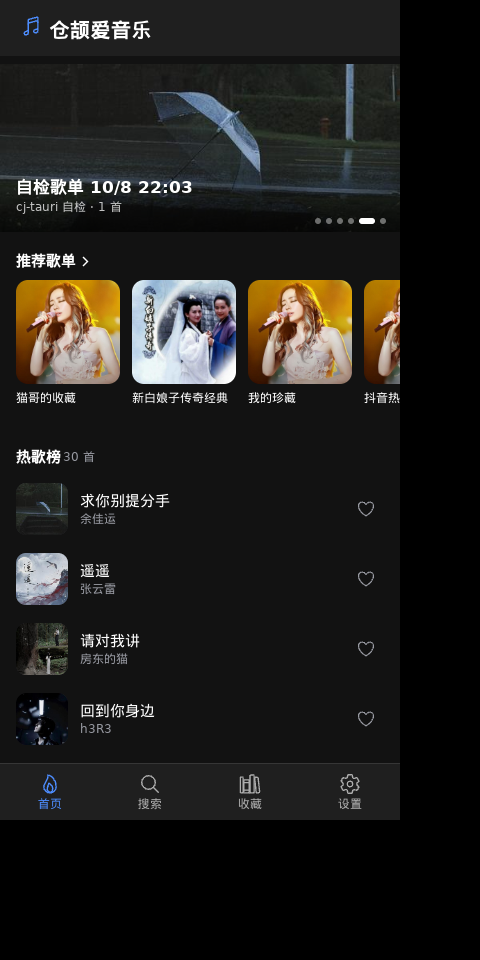
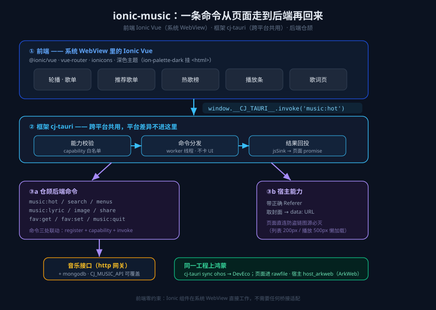

# 用 Ionic 写界面、仓颉写后端：一台鸿蒙上的音乐播放器

> 系列上篇 · 示例工程 `examples/ionic-music` · 框架 cj-tauri（仓颉版混合开发框架）

我做 cj-tauri 的时候，总想回答一个问题：**能不能让一个写前端的人，用他最熟的组件库写界面，而把重活——网络、文件、系统能力——交给仓颉后端，最后还能落到鸿蒙上去跑？**

`examples/ionic-music` 就是我对这个问题的一份答卷：界面是 **Ionic Vue** 写的（`@ionic/vue` 那一套移动端组件，你见过的那些卡片、轮播、底部 tab），后端是**仓颉**写的一组命令，中间用 **cj-tauri** 缝起来。它先在桌面实机跑通（下面这张截图就是桌面一个 400×820 的竖窗，比例照着手机给的），再用 `cj-tauri sync ohos` 一键派生成鸿蒙的 DevEco 工程——**同一份页面、同一套命令**，换到 ArkWeb 宿主里继续跑。

这篇文章按「前端怎么落 → 后端怎么写 → 哪些活只有宿主能干 → 怎么上鸿蒙」的顺序走，全程真人口吻，踩过的坑都写出来。

## 先看成品

这是 ionic-music 的首页：顶部轮播（歌单封面横滑、3 秒自动翻页、带指示点），中间是「推荐歌单」横滑卡片和「热歌榜」列表，底部四个页签（首页 / 搜索 / 收藏 / 设置）。整屏深色，`@ionic/vue` 的组件在这个窄宽度下是铺满的。



## 一张图看懂数据怎么流

页面里任何一个动作（点一首歌、切一个歌单），走的都是同一条路：

```
Ionic 组件  ──invoke──▶  cj-tauri（能力校验 → 命令分发 → 回投）  ──▶  仓颉命令 / 宿主能力  ──▶  音乐接口
```

把它画细一点：



三个关键事实，后面每一节都会展开：

1. **前端零约束**——Ionic 组件就在系统 WebView 里直接工作，不需要任何桥接适配。
2. **框架跨平台共用**——能力校验、命令分发、回投这套逻辑桌面和鸿蒙是同一份代码，平台差异不往这里渗。
3. **后端是仓颉命令**——一条 `music:hot` 从页面走到底，再走回来，中间有明确的「三处联动」。

## 一、前端：Ionic Vue 怎么落进 cj-tauri

工程是标准 Vite + Vue 3，但 UI 库换成了 Ionic。前端产物是 `assets/ui/dist/index.html` **一个文件**（`vite-plugin-singlefile` 把 CSS/JS 全内联进去，约 1.2MB），清单 `[assets] page` 指的就是它。

**依赖上比纯 Vue 模板多三样**，这三样是Ionic能跑起来的前提：

```jsonc
// package.json —— 相对 app-vue 模板多出来的
{
  "dependencies": {
    "@ionic/vue": "...",   // 自带 @ionic/core
    "vue-router": "...",   // @ionic/vue 的硬依赖！缺它 vite build 直接失败
    "ionicons": "..."      // 图标
  }
}
```

这里有两个我实际踩过的坑，直接写出来：

- **`vue-router` 是 `@ionic/vue` 的硬依赖**。你以为 Ionic 只是套组件，其实它内部就假设路由在——`npm run build` 会一路报下来最后才在 rollup 那儿失败，报错指向很偏。先把它装上，省得排查半天。
- **ionicons 的导出名是小驼峰**。要 `<musical-notes-outline />` 对应的 JS 图标，写 `musicalNotesOutline`；写成 `MusicalNotesOutline`（首字母大写）会报 rollup unresolved import。

**深色主题要挂 class，光引 CSS 没用。** Ionic 的深色调色板 `dark.class.css` 是 **class 选择器**——它只在你给元素挂上 `ion-palette-dark` 这个 class 时才对那棵子树生效。我在 `main.js` 里引了 CSS 却没挂 class，结果第一版界面发白，组件全是浅色默认值，折腾半天才发现是 class 没挂。

```js
// main.js —— 引 Ionic 基础样式
import { createApp } from 'vue'
import App from './App.vue'
import { IonicVue } from '@ionic/vue'
import '@ionic/vue/css/core.css'
import '@ionic/vue/css/normalize.css'
import '@ionic/vue/css/structure.css'
import '@ionic/vue/css/typography.css'
import '@ionic/vue/css/palettes/dark.class.css' // 深色是 class 选择器，见下

document.documentElement.classList.add('ion-palette-dark') // 挂到 <html> 上才生效
createApp(App).use(IonicVue).mount('#app')
```

**页面调用后端，只走 `window.__CJ_TAURI__` 的 `invoke`，不要自己 `postMessage`。** 而且页面是内联进 WebView 的，脚本执行时桥可能还没注入好，所以模板里有个 `waitForBridge`——等桥出现再调 invoke。我所有示例都照抄这一段：

```js
// 等桥出现（内联来源里桥是 document-start 注入的，可能晚于本页脚本）
function waitForBridge() {
  return new Promise((resolve) => {
    if (window.__CJ_TAURI__) return resolve(window.__CJ_TAURI__)
    const t = setInterval(() => {
      if (window.__CJ_TAURI__) { clearInterval(t); resolve(window.__CJ_TAURI__) }
    }, 30)
    setTimeout(() => clearInterval(t), 5000)
  })
}

async function loadHot() {
  const { invoke } = await waitForBridge()
  const songs = await invoke('music:hot')   // 一条命令，走到底
  // ... 渲染热歌榜
}
```

`invoke('music:hot')` 这一行，就是前端和仓颉后端的整个边界——它不是 HTTP，不是 JSON-RPC，是框架给的强类型通道，命令名就是后端 `register` 的那个键。

## 二、后端：仓颉命令，以及「三处联动」

后端是一组 `CommandHandler`。以 `music:hot`（拉热歌榜）为例，真实代码长这样：

```cangjie
// examples/ionic-music/src/commands.cj
public class MusicHotCommand <: CommandHandler {
    public init() {}

    public func handle(cmd: String, args: JsonObject, ipc: IpcContext): JsonValue {
        let _ = cmd
        let _ = ipc
        let (start, count) = pagedArgs(argInt(args, "start", 0), argInt(args, "count", MUSIC_PAGE_SIZE), 50)
        var body = JsonObject()
        body.put("kind", JsonString(MUSIC_HOT_KIND))   // 后台只认 topWyMusic，不暴露给页面
        body.put("start", JsonInt(start))
        body.put("count", JsonInt(count))
        return musicApiCall("/api/v1/musicmenus", Some(body))
    }
}
```

注意两处细节，都是这个项目里反复强调的口径：

- **`let _ = cmd` / `let _ = ipc`**——接口签名要求这两个参数，但这条命令用不上。仓颉不让你偷偷改接口签名，就地显式弃用（`let _ =`）是仓库约定，零警告门禁下这是唯一干净的写法。
- **`pagedArgs` 把 `start`/`count` 夹到合法区间**——这两个值是**页面可控**的，命令层是系统边界。不夹就是给后台开了「任意参数」的口子。后面 `isSafeSid`（sid 只放行数字）、`clipText`（按字节截断且不切断汉字）都是同一件事：**凡是页面能给进来的字符串，在进 URL / 落盘 / 提交后台之前，都先过一道边界。**

一条命令要能用，得同时满足三处，漏一处就是「没反应」：

| # | 在哪 | 做什么 | 漏了报什么 |
|---|---|---|---|
| 1 | `commands.cj` | 实现 `CommandHandler` | —— |
| 2 | `main.cj` | `app.register("music:hot", MusicHotCommand())` | `command not registered` |
| 3 | `assets/capabilities/default.json` | `commands` 里声明 `"music:hot"` | `command not allowed` |

`main.cj` 的注册段和清单是这样的（清单是**整个工程的单一真相**，`cj-tauri sync` 从它派生骨架）：

```cangjie
// examples/ionic-music/src/main.cj（节选）
app.register("music:hot",    MusicHotCommand())
app.register("music:search", MusicSearchCommand())
app.register("music:menus",  MusicMenusCommand())
app.register("music:lyric",  MusicLyricCommand())
app.register("music:image",  MusicImageCommand())
app.register("fav:get",      FavGetCommand(store))
app.register("fav:set",      FavSetCommand(store))
```

```toml
# cj-tauri.toml —— 新形态工程的清单
[app]
  name = "ionic-music"
  id = "com.example.ionic_music"     # 鸿蒙下这就是 bundleName
  package = "ionic_music"

[[windows]]
  label = "main"
  title = "仓颉爱音乐 Ionic · cj-tauri"
  width = 400                          # 移动端形态：竖屏窄窗
  height = 820

[assets]
  page = "ui/dist/index.html"          # Vite 单文件产物

[capabilities]
  dir = "assets/capabilities"
```

```jsonc
// assets/capabilities/default.json —— 只放行声明过的命令
{
  "identifier": "default",
  "windows": ["main"],
  "commands": [
    "music:hot", "music:search", "music:menus", "music:lyric", "music:image",
    "music:share", "fav:get", "fav:set", "music:config", "music:quit",
    "report", "system:version"
  ],
  "events": []
}
```

这套「最小权限」不是装饰：页面就算被注入、就算前端代码写错了，它也只能调清单里这十几个命令，碰不到文件系统的任何角落。能力校验在框架层、跨平台共用——桌面和鸿蒙是**同一份**判定逻辑。

## 三、两个「只有宿主能干的活」

音乐 App 有两个地方，页面自己在 WebView 里是做不到的，必须下沉到宿主。这两个最能说明「为什么 UI 用现成的 Ionic、而把难活交给仓颉后端」。

### 1. 防盗链封面：页面直连必然全灭

后台给的歌封面都是**防盗链**图源（按 `Referer` 放行）。页面侧 `` 直连，来源是 opaque（`Origin: null`、没有 Referer），结果是「HTTP 200 + 0 字节」——图床礼貌地返回了，但内容一个字都没有。这不是 bug，是防盗链的设计。

页面侧没有解法（`Referrer-Policy` 只能减少 Referer、不能替换）。所以封面走一条宿主命令 `music:image`：**把地址交给仓颉侧，由宿主带着正确的 `Referer` 取回，再转成 `data:` URL 交还页面**：

```cangjie
// commands.cj —— music:image：宿主侧取封面，转 data: URL
public class MusicImageCommand <: CommandHandler {
    public func handle(cmd: String, args: JsonObject, ipc: IpcContext): JsonValue {
        let _ = cmd; let _ = ipc
        let url = argString(args, "url", "")
        if (url.size == 0) { throw CommandException("缺少封面地址") }
        let size = clampImageSize(argInt(args, "size", 0))
        return JsonString(fetchCoverDataUrl(url, size))   // 带 Referer 取回 → base64 data: URL
    }
}
```

这里还有个**体积**的细节：`size` 是要的边长。列表缩略图一张 4 KB，原图一张 700 KB——30 首的榜单按原图取就是 ~21 MB 的 base64，页面直接卡死。所以列表传 `size=200`、正在播放的大图传 `size=500`，按用途取不同分辨率。

> 安全提醒：这类命令的参数是页面可控字符串，地址要过白名单 / 校验，否则等于开放了 SSRF。

### 2. 歌词：页面只该做「按进度高亮」这一件事

LRC 歌词的语法边角不少——`[by:xxx]` 元信息行、一行多个时间戳 `[00:12.34][00:45.67]`、1/2/3 位小数。如果让页面去解析，前端就得背一套 LRC 解析器。

我的做法是**在仓颉侧归一化**：`music:lyric` 拿回后台的原始 LRC，在仓颉侧用一套纯函数（`src/lrc.cj`）解析成干净的 `lines: [{at, text}…]`，页面只负责「按播放进度找到当前行、高亮、自动滚动居中」。页面收到的是已经解析好的毫秒时间轴，一行都不用来解析。

```cangjie
// commands.cj —— music:lyric：在仓颉侧把 LRC 归一化成时间轴
// 返回 {sid, ver, lyric, lines: [{at, text}…], found, message}
// 「这首歌没有歌词」是正常状态（found: false），不抛异常——
// 抛了页面只能弹失败提示，而「暂无歌词」本来就该友好显示。
```

顺带一个小习惯：每条命令在 stderr 留一行 `[music] …`（比如 `lyric sid=… found=true lines=42`）。**这个项目的实机取证以 stderr 为准**——页面跑在 WebView 里，不开 devtools 就看不见它，桥的日志就是那个出口。

## 四、移动端形态：竖屏窄窗 + 信息架构

这个示例故意把窗口开成 **400×820**（手机比例的竖屏），信息架构也照移动端音乐 App 的惯例组织：

```
首页（轮播 → 推荐歌单 → 热歌榜）   搜索   收藏（底部 tab 带数量徽标）   设置
        └──────────────── 底部常驻播放条（封面 + 上一首/播放/下一首 + 可拖进度）────────────────┘
                                └ 点封面/标题 → 全屏歌词页（逐行高亮、自动滚动居中）┘
```

一个值得记的点：**「正在播的那份列表」由播放上下文记忆**。在热歌榜里点一首，就顺着榜切歌；在歌单详情里点一首，就顺着歌单切。这不是Ionic自带的能力，是页面自己用一个小状态记下来的——移动端交互里这种「当前在哪个上下文」的连续性，比功能本身更影响手感。

## 五、同一份工程，怎么上鸿蒙

上面所有东西，**鸿蒙侧一行前端都不用改**。cj-tauri 的鸿蒙宿主（`host_arkweb.cj`，ArkWeb）在仓颉侧实现，不走 C 桥；命令层、能力校验、IPC 分发都是跨平台共用的同一份代码。上鸿蒙的路径是：

```bash
cj-tauri sync ohos     # 从 cj-tauri.toml 派生 targets/ohos 的 DevEco 工程
# 页面（ui/dist/index.html）进 hap 的 rawfile，清单里的 id 就是 bundleName
# 命令行构建走 build-hap.sh（Windows/PowerShell 走 build-hap.ps1），或直接在 DevEco IDE 里 Build
```

这里我把**已经真机闭环的**和**还在路上的**分开说，不夸大：

- **已真机闭环**（有实机证据）：鸿蒙宿主建窗、页面装载、document-start 桥脚本注入，以及页面自己发起的一次 `system:version` 往返；**菜单能力位**也已真机取证（点得动菜单项、原生回投、页面收到 `menu:click`）。
- **能力位现状**：鸿蒙宿主的能力位**只有菜单置 1，其余为 0**——`CJ_CAP_MENU` 是真机跑出来的，别的不会因为「代码里写了」就变成 1（没有实机证据的能力位不许上报）。对话框不占能力位、走应用侧 overlay 渲染；剪贴板写通、读被 `READ_PASTEBOARD` 挡住；**https 走系统网络栈 `ohos.net.http`**（鸿蒙上仓颉运行时装不了 OpenSSL）。

也就是说：这套「Ionic 前端 + 仓颉命令」的工程，桌面 `cj-tauri run` 直接跑（本文截图就是桌面实机），`cj-tauri sync ohos` 派生成鸿蒙工程后跑在 ArkWeb 里；前端页面（rawfile）和仓颉命令都是同一份，平台差异被挡在宿主那一层。

## 小结 + 下篇预告

这篇做下来的结论：

- **前端用你最熟的**——Ionic Vue 在系统 WebView 里零适配地跑，`vue-router` 硬依赖、ionicons 小驼峰、深色挂 class 三个坑绕过去就行。
- **后端是仓颉命令**——三处联动（实现 + register + 能力清单），页面可控的值一律在命令层过边界。
- **难活下沉宿主**——防盗链封面带 Referer 取回、LRC 在仓颉侧归一化，都是「页面做不到 / 不该做」的活。
- **桌面鸿蒙一份工程**——`sync ohos` 派生，前端与命令不动。

下篇我把后端换成**在线影视**：六榜单 + 海报网格 + 详情页 + **m3u8 经 hls.js 在线播放**，看看换一类数据、多一个视频引擎，这套「Ionic + 仓颉 + cj-tauri」的结构怎么复用，又会冒出哪些新坑。


