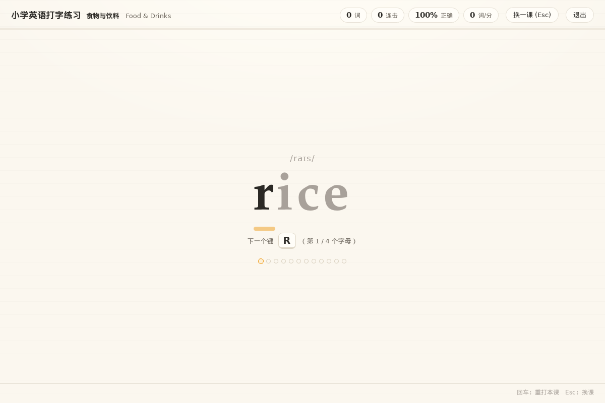
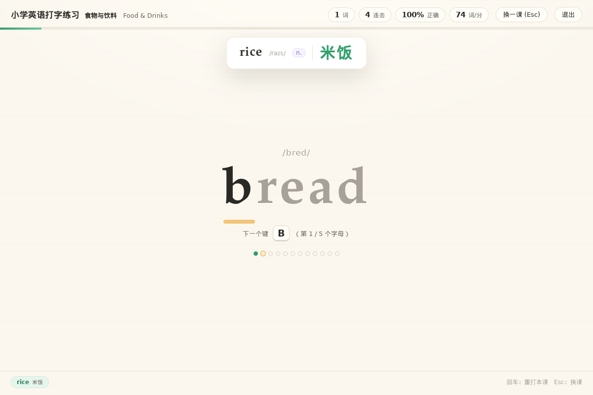
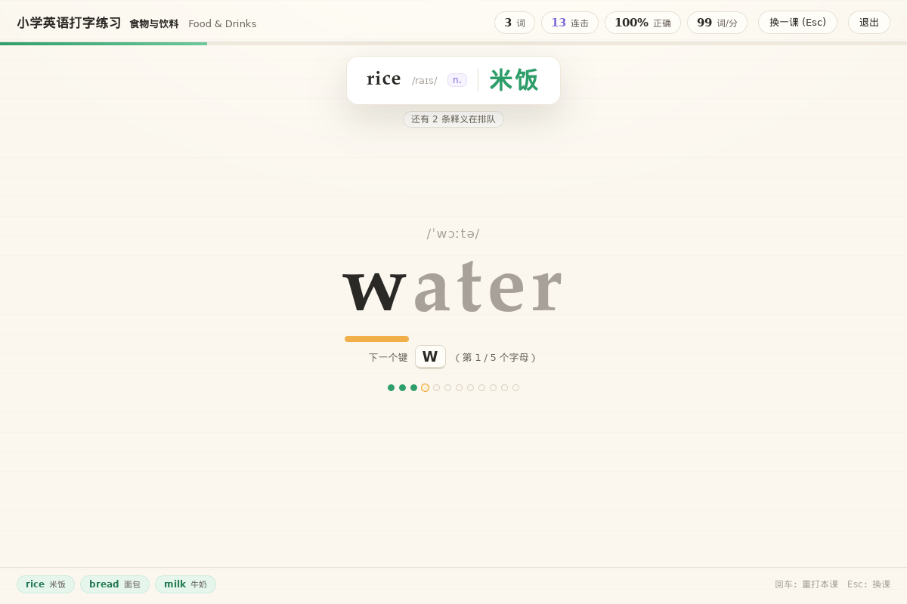

# 我给女儿写了个打字练习：一边敲键盘，一边把小学英语单词记牢

> 一个用仓颉写的桌面小程序，代码在 [cj-tauri 仓库](https://atomgit.com/qq8864/cj-tauri) 的
> `examples/typing-english/` 里。
> 这篇文章讲它为什么长成这样、背后那套框架是什么，以及哪些地方我还没验证。

## 起因：抄二十遍这件事本身没意思

女儿三年级，英语默写老是错几个。老师的建议很常规：多读、多写、多抄。我试过单词 App、
闪卡、点读笔，没有一样撑过三天。

不是她不爱学。是"抄二十遍"这个动作本身没意思——手在动，脑子在旁边看风景。

但我自己每天写代码，键盘敲起来是有瘾的：敲对一个字的即时反馈、一串字连起来的节奏感。
那不如让她**打**单词。屏幕中间出一个词，敲对哪个字母，哪个字母就亮起来；整个词打完，
屏幕上"啪"地浮出它的中文意思。

一开始这只是个网页。后来我想让它变成能双击打开、不用装浏览器、不用连网的桌面小程序——
于是就有了这个示例，也顺带用上了我在写的那个框架。

## 一、它长什么样



开场的画面很朴素：中间一个大单词 `rice`，上面一行音标 `/raɪs/`，下面一行
"下一个键 **R**（第 1/4 个字母）"，再底下十个小圆点，代表这一课的进度。

顶栏一行就是全部统计：打了几词、连击几次、正确率、速度（词/分），右边是**换一课（Esc）**和**退出**。

这里有两个决定是我特意做的：

- **只认 a–z。** 中文输入法开着也不影响，别的键一律当没按。
- **打错不弹窗、不扣命。** 只是连击清零、进度条往回退一点。没有红色警告，没有"你错了"的提示音。
  小孩打字本来就慢，被系统凶两次就不想玩了。

打完一个完整的词，才是它真正想给你看的那一刻：



正上方浮出一张卡：`rice` `/raɪs/` `n.` **米饭**。停留两秒六，淡出。左下角的"已学"里多了一条
`rice 米饭`。

**见词、见音、见义，三件事在同一瞬间发生。** 这是整个应用唯一的设计重点，
其余全是围着它转的配套。

而孩子打快了之后，画面会变成这样：



场上还是 `rice` 那张，没被顶掉。卡片底下多了一行小字：**还有 2 条释义在排队**。
左下角已经攒了三条：`rice 米饭`、`bread 面包`、`milk 牛奶`。

这个画面是我最想要的状态——她打得比卡片走得快，说明她正在状态里。

## 二、一张卡片的纪律：队列 + 单展厅

说实话，这个示例的技术难点只有一个，而且不在仓颉侧，在页面上：**打完词该什么时候把释义收走**。

最直觉的写法是错的：每打对一个词，就往浮层里塞一张卡、各起一个 `setTimeout` 到点删掉。
连着打三个词，三张卡同时冒出来、又各自错位消失，屏幕上糊成一团，小朋友一个字都来不及读。

所以我按"**队列 + 单展厅**"来写：任意时刻页面上**最多一张**释义卡，后来者排队等它退场。

```
打完词 ──▶ enqueuePop(word)
             │
             ├─ 没在展示 ──▶ drainPop()：取队首 → 挂上浮层 → 起 popMs 计时
             │                                  └─ 计时到 → 退场 → 再看队里有没有下一条
             └─ 正在展示 ──▶ 只入队，不动场上那张
                             └─ 立刻刷新「还有 N 条释义在排队」
```

三条约束，都锁在同一处代码里：

1. **不覆盖。** 正在展示时入队只 push，绝不替换当前卡片——先出现的那条必须被读完。
2. **依次展示。** 排空循环是用 `setTimeout` 一条接一条串起来的（不是 `setInterval` 定时清空），
   前一张完全退场之后才挂下一张。所以"依次"是结构上保证的，不靠时间去对齐。
3. **停留可见。** 进场 220 毫秒、停留 `popMs`（默认 2600，可调 600–12000）、退场 220 毫秒。

页脚那行"还有 N 条"的小字，我一开始只在排空循环末尾刷新，于是"正在展示时新来了一个词"这一刻
漏掉了：词进了队，提示条却不出现。自检里"排队提示条出现"那条断言当场就红了。
入队和排空两处都得刷——这种少一处的 bug，人眼在写的时候真的看不出来。

## 三、为什么是仓颉：顺带说清楚 cj-tauri 是什么

动手之前我想清楚三件事：**别让她电脑上装一堆东西**、**别拖一个几百兆的浏览器内核**、
**双击就能跑，断网也能玩**。

cj-tauri 的做法正好对得上：**前端仍然写 HTML/CSS/JS，后端是静态编译的仓颉程序**，
界面交给系统自带的 WebView 去渲染，不内嵌浏览器内核。于是打包出来是单个可执行文件——
仓库里十个成品实测在 4.7–32.8 MB 之间，双击即走；typing-english 这份 5 MB 出头。

它是这么拼起来的：

| 层 | 是谁 | 干什么 |
| --- | --- | --- |
| 前端 | HTML / CSS / JS | 页面、动效、全部交互 |
| IPC 桥 | 仓颉 + C 桥 | `invoke` / `listen` / `emit`，双向 |
| 后端 | 仓颉（静态编译） | 窗口、命令分发、能力校验、落盘 |
| 平台适配 | C 桥按平台一份 | 与系统 WebView 打交道（WebView2 / WebKitGTK / ArkWeb） |

平台差异只允许落在两处——仓颉侧的条件编译和 C 桥的平台实现，上层的命令、IPC、能力校验跨平台共用。
所以这个练习页和它那六条命令，在 Windows、Linux、鸿蒙 PC 上是**同一份源码**。

**给家长看的那部分安全线**：能力白名单有四道闸——命令、事件、路径、出网。页面能调什么，
是清单里写死的；清单里没有的命令，就算后端实现了也一律拒。

typing-english 的清单只开了这几个名字：

```json
{
  "windows": ["main"],
  "commands": [
    "word:list", "score:save", "score:list",
    "typing:config", "typing:quit", "report",
    "system:version", "word:nope"
  ],
  "events": []
}
```

里面那个 `word:nope` 是**故意登记、也故意没实现**的：自检拿它验证"清单写了也会被拒成
`command not registered`"，另一半用"实现了但清单没写"的命令验证 `command not allowed`。
这种"安全线到底拦没拦住"的事，我不喜欢只靠说的。

成绩这一块更干脆：只写本机一个 JSON（`typing-english-scores.local.json`），不排行、不联网、
不上传。给小孩用的东西，我一句网都不想连。

框架当前版本 2.1.3，MIT 许可，仓颉 SDK 1.2.0+；Windows（WebView2）、Linux（WebKitGTK）、
鸿蒙 PC（2in1）三处都实机跑过。

## 四、想自己跑一遍

Windows：

```bat
cd examples\typing-english
run.bat                :: 正常开窗玩
run.bat selfcheck      :: 无人值守：页面自己把一课打完，回投 38 条断言后退出
```

Linux（本机就是这么跑的）：

```bash
cd examples/typing-english
export LD_LIBRARY_PATH=<stdx>/dynamic/stdx:<仓颉SDK>/runtime/lib/linux_x86_64_cjnative:<仓库>/native:$LD_LIBRARY_PATH
./target/release/bin/main
```

三个环境变量，只在诊断和取图时用，日常玩不需要：

| 变量 | 作用 |
| --- | --- |
| `CJ_TYPING_SELFCHECK=1` | 页面自己把一课打完、回投 38 条断言，然后退出 |
| `CJ_TYPING_LESSON=food` | 跳过选课面板直奔某一课，截图对照用 |
| `CJ_TYPING_POP_MS=900` | 释义卡停留时长，600–12000，默认 2600 |

## 五、我把话说清楚：验到了哪一步

**已经验证的**：`cjpm build` 零警告；页面自检 `DONE passed=38 failed=0`；
本文这三张截图是**真按键**打出来的——用 `xdotool type` 逐字敲进 WebView，不是脚本直接改状态，
所以"打完一个词才浮"这件事确实是在真的打字路径上成立的。

**没有验证的**：Windows 实机截图。本机只有 Linux；页面和命令层跨平台共用，但字体渲染的差别
只有在 Windows 上才看得见。要在 Windows 出图，跑 `run.bat`，并用 `CJ_TYPING_LESSON=food`
固定课次——两次截图同一课，才谈得上对照。

还有个现象得提前说，免得别人踩到以为是自己的 bug：本机 Linux 上这个程序退出时，
进程以 `SIGABRT`(134) 结束，日志停在 `gtk_main_quit: assertion 'main_loops != NULL' failed`。
它不独有——`examples/hello` 在本机同样 134，是框架在本机 Linux 上的收尾形态，跟业务逻辑无关。
功能证据以自检和截图为准，不看退出码。

## 六、想改成自己要背的那一册，很轻

词库 8 课 112 个词，取自三四年级常用词：数字与颜色、动物、食物与饮料、家人与职业、
学校与文具、身体与衣物、天气与自然、动作与形容。每个词带上音标、词性、中文释义三样。

加词只改 `src/words.cj` 一个文件，一个词一行、三样东西；启动时有个素材自检会核一遍
每课的词数、音标字段有没有漏写。想换成自己孩子正在背的那一册，动这一个文件就够了。

星级门槛是我跟她一起对过的：正确率 ≥95% **且**速度 ≥12 词/分才给三星，二星放宽到 85% / 8。
标准一松，她就只求快、不求对。

顺带一句：练汉字和拼音的姊妹示例是 `examples/typing-poem`，那个是 3D 卡面；
这个刻意不引任何第三方前端库，纯 2D，体积小一个数量级，重点全在"打完词 → 中文上浮"这一条上。

## 最后

仓库在 AtomGit：[**atomgit.com/qq8864/cj-tauri**](https://atomgit.com/qq8864/cj-tauri)，
这个示例在 [`examples/typing-english/`](https://atomgit.com/qq8864/cj-tauri/tree/main/examples/typing-english)，
同一棵树里还有二十来个能直接跑的示例和 14 个官方插件。

如果它能让你家孩子多敲十分钟键盘、少抄两遍单词，这个项目就没白写。

---

> 文中截图均为 Linux（Xvfb）实机运行所得，窗口尺寸 1200×800；
> 用 `CJ_TYPING_LESSON=food` 固定在"食物与饮料"这一课，便于复现。
