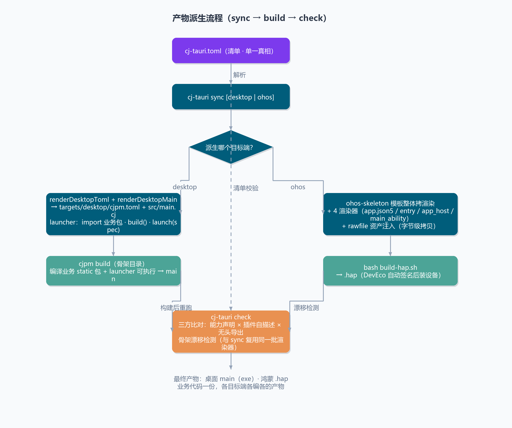
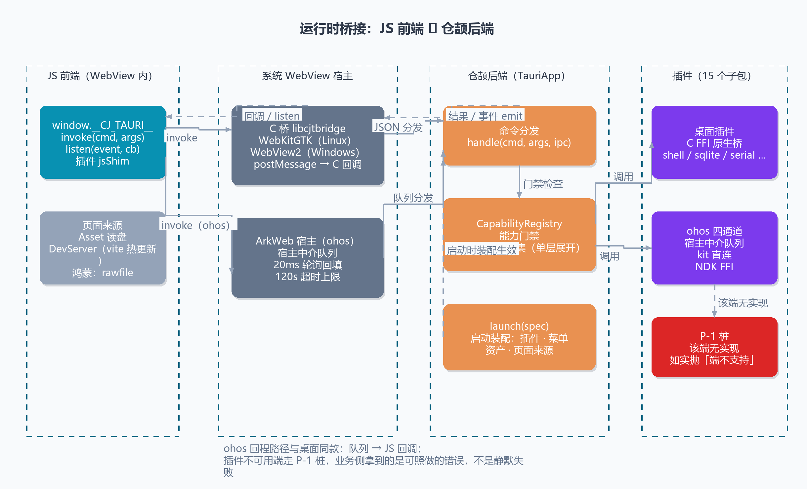

# cj-tauri 使用文档

> 面向使用者的完整指南：环境准备 → 创建应用 → 开发 → 运行 → 排障。
> 框架原理与可行性论证见 [技术方案.md](技术方案.md)、[踩坑与实施记录.md](踩坑与实施记录.md)。

## 1. 这是什么

cj-tauri 是**仓颉版的 Tauri**：后端用仓颉（静态编译），前端用任意 Web 技术，
中间由「系统 WebView 宿主 + IPC 双向桥 + 能力安全模型」连接。

```
前端 HTML/CSS/JS  ←→  window.__CJ_TAURI__.invoke / listen / emit
      │  JSON over postMessage
IPC 桥（src/ipc_hub.cj）→ 能力校验（src/capability.cj）→ 你的命令（CommandHandler）
      ▼
WebView 宿主：Windows = WebView2（native/platforms/windows/bridge_win.c）｜ Linux = webkit2gtk-4.1（native/platforms/linux/bridge_linux.c）
```

一次 `cj-tauri create` 得到的应用，就是「仓颉后端 + WebView 前端」的最小可运行工程。

## 2. 环境准备

### 2.1 仓颉 SDK（必需）

1. 安装仓颉 SDK（本仓库验证版本：**1.2.0**，目标三元组 `x86_64-w64-mingw32` / `x86_64-unknown-linux-gnu`）。
2. 设置 SDK 根目录，并把官方 `envsetup` 里的目录布局加进 PATH：

| 平台 | 必须加入 PATH 的目录（缺一不可） |
|---|---|
| Windows | `<SDK>\runtime\lib\windows_x86_64_cjnative`、`<SDK>\bin`、`<SDK>\tools\bin`、`<SDK>\tools\lib` |
| Linux | `<SDK>/runtime/lib/linux_x86_64_cjnative`、`<SDK>/bin`、`<SDK>/tools/bin`、`<SDK>/tools/lib` |

```bash
# Linux / macOS / Git Bash：source SDK 自带脚本最省事
source <SDK>/envsetup.sh
# 没装 cjpm 或不想改全局环境时，只要保证 CANGJIE_HOME 指向 SDK 根目录即可，
# cj-tauri 会自动补 tools/bin、tools/lib、runtime/lib。
export CANGJIE_HOME=/path/to/Cangjie
```

```bat
REM Windows cmd
REM 方式一：调用 SDK 自带脚本
call "D:\Program Files (x86)\Cangjie\envsetup.bat"
REM 方式二：只设 CANGJIE_HOME，由 cj-tauri.bat 补 PATH
set "CANGJIE_HOME=D:\Program Files (x86)\Cangjie"
```

> **PATH 不全会踩的坑**：`runtime\lib\...` 不在 PATH 时原生进程起不来；
> `tools\bin` 不在 PATH 时找不到 `cjpm`；`tools\lib` 缺失时 `cjpm build` 可能直接返回 127 且无任何输出。

### 2.2 stdx（必需）

应用与框架都依赖仓颉扩展库 **stdx**（JSON：`stdx.encoding.json`）。
`cj-tauri create` 会把 stdx 路径写进生成的 `cjpm.toml`，取路径顺序为：

1. 环境变量 `CANGJIE_STDX`
2. 当前项目 `cjpm.toml` 的 `[target.<triple>.bin-dependencies] path-option`
3. 框架仓库 `cjpm.toml` 的同名字段

> 源码仓内的 `cjpm.toml`（根与 `examples/*`）把 `path-option` 统一写成环境变量引用
> `${CANGJIE_STDX}`（机器无关，clone 后无需改文件即可构建），由 cjpm 按进程环境变量展开；
> 而 `cj-tauri create` 生成的工程仍由脚手架把探测到的绝对路径写死进 toml。

```bash
export CANGJIE_STDX=D:/cangjie-stdx/windows_x86_64_cjnative/dynamic/stdx   # Windows
export CANGJIE_STDX=/opt/cangjie-stdx/linux_x86_64_cjnative/dynamic/stdx   # Linux
```

### 2.3 平台依赖

| 平台 | 依赖 |
|---|---|
| Windows | mingw gcc（编译 C 桥）、**WebView2 Runtime**（Win11 自带；Win10 需安装 Evergreen Runtime）、**WebView2 SDK**（仅编译桥时需要，见下） |
| Linux | `libwebkit2gtk-4.1-dev`、`libgtk-3-dev`（`pkg-config --cflags --libs webkit2gtk-4.1` 能过即可） |

Windows 上 **桥所用 WebView2 SDK 的版本不得高于本机 Runtime 版本**，否则会出现窗口空白、
`ExecuteScript` 返回 `0x8007139F` 等诡异现象。查询本机 Runtime 版本：

```bat
reg query "HKLM\SOFTWARE\WOW6432Node\Microsoft\EdgeUpdate\Clients\{F3017226-FE2A-4295-8BDF-00C3A9A7E4C5}" /v pv
```

本仓库验证组合：Runtime 122.0.2365.106 + SDK 1.0.2365.46（`native/build_win.bat` 的默认值）。
换 SDK 时改 `build_win.bat` 顶部的 `WEBVIEW2_SDK_ROOT` 即可；脚本会自动把**同版本**的
`WebView2Loader.dll`（x64）同步到 `native/webview2/`。

## 3. 拿到框架并构建 CLI

```bash
git clone <本仓库地址> cj-tauri
cd cj-tauri
```

CLI 本体是仓颉程序（`cli/`），首次运行会自动 `cjpm build`；也可手动构建：

```bash
# Linux / macOS / Git Bash
./cli/cj-tauri.sh --version
```
```bat
REM Windows cmd
cli\cj-tauri.bat --version
```

首次运行会打印 `first run: building the CLI itself ...`，产物在 `cli/target/release/bin/main.exe`。
想省事可以把 `cli` 目录加入 PATH，之后直接敲 `cj-tauri`。

不想 clone、也想在任意目录直接用，可以改用 npm 包（同样需要先装仓颉 SDK）：

```bash
npx cj-tauri --version            # 免安装直接跑
npm i -g cj-tauri                 # 或全局安装，之后直接 cj-tauri <子命令>
```

npm 包把平台差异与 CLI 本体的获取都收进了一个入口：Windows / Linux / Git Bash 同一条命令；
CLI 本体优先用包内预编译二进制（`prebuilt/<平台-架构>/`），没有就用本机 `cjpm` 构建一次并缓存到
`~/.cache/cj-tauri/<版本>/`（Windows 为 `%LOCALAPPDATA%\cj-tauri`）。装好后第一件事同样是跑 `cj-tauri info`。
打包脚本在 `scripts/npm-pack.sh`（`--publish` 发布，固定走官方 registry 并先做登录预检；本机 npm 常配成
npmmirror 镜像，别直接 `npm publish`）。
首版必须手工发一次（npm 只允许给已存在的包配置 trusted publisher），发法走 **staged publishing**：
`npx --yes npm@latest stage publish ./dist-npm/cj-tauri-<版本>.tgz`（staging 不要 2FA），再到 npmjs.com 的
Staged Packages 页用 2FA 批准。**别用 `--publish --otp <码>` 直发**——npm 已停用新 TOTP 动态码绑定，
passkey 账号拿不到 6 位码，拿 2FA 恢复码去填会触发 72 小时只读持有（详见 `AGENTS.md` §4 / §6）。
之后推 `v*` tag 由 `.github/workflows/npm-publish.yml` 用 npm trusted publishing（OIDC，不需要 token）自动发布；
绑定步骤与「CI 打的包不含预编译 CLI」的说明见 `AGENTS.md` §6。

## 4. 创建第一个应用

```bash
cd ~/projects
/path/to/cj-tauri/cli/cj-tauri.sh create myapp
cd myapp
/path/to/cj-tauri/cli/cj-tauri.sh dev
```

```bat
cd /d %USERPROFILE%\projects
D:\path\to\cj-tauri\cli\cj-tauri.bat create myapp
cd myapp
D:\path\to\cj-tauri\cli\cj-tauri.bat dev
```

生成的工程：

```
myapp/
├── cjpm.toml                  # 构建配置：依赖框架 + 桥链接参数 + stdx 路径
├── src/main.cj                # 仓颉入口：窗口配置 + 命令注册 + 启动
├── ui/index.html              # 前端页面（任意 Web 技术栈）
├── capabilities/default.json  # 能力白名单（命令/事件）
├── README.md
└── .gitignore
```

> `create` 会把**框架与本机 stdx 的绝对路径**写进 `cjpm.toml`（`cjc-version` 写的是最低要求
> `1.0.5`，对更高版本 SDK 同样有效）。因此生成的工程换机器/换目录后，需要重跑 `create`，
> 或手改 `cjpm.toml` 里的 `cjTauri` 依赖路径与 `path-option`。

## 5. CLI 命令参考

清单 → 骨架派生 → 各端构建这条流水（`sync` 派生、`check` 只读比对、业务代码始终只留在工程根）：



| 命令 | 作用 |
|---|---|
| `cj-tauri create <项目名>` | 生成新工程（名字会转成仓颉包名：`my-app` → `myApp`） |
| `cj-tauri dev` | 构建 C 桥 → `cjpm build` → 启动窗口（阻塞到窗口关闭） |
| `cj-tauri build` | 构建 C 桥 + `cjpm build`，产物 `target/release/bin/main[.exe]` |
| `cj-tauri run` | 只运行已构建产物 |
| `cj-tauri info` | 环境自检：框架/项目/stdx/SDK/cjpm/桥 的解析结果 + 末段列出已装配插件（排障第一步） |
| `cj-tauri info --json` | 只输出插件清单 JSON（`describePluginsJson` 形态），给工具 / CI 管道用 |
| `cj-tauri doctor` | **环境自检逐行给结论**（`ok` / `warn` / `FAIL`），失败行附「缺了就怎么办」；退出码 0 = 必需项全过，1 = 有 FAIL（新机器第一件事跑它） |
| `cj-tauri help` | 帮助 |

环境变量：

| 变量 | 含义 | 默认 |
|---|---|---|
| `CJ_TAURI_ROOT` | 框架仓库根目录 | 从当前目录（或 CLI 所在目录）向上查找 |
| `CANGJIE_HOME` | 仓颉 SDK 根目录 | 从 PATH 里的 `cjc` 反推 |
| `CANGJIE_STDX` | stdx 动态库目录 | 从框架/项目 `cjpm.toml` 读取 |
| `CJ_TAURI_MANIFEST` | `json` / `text`：应用装配完就打印插件清单并返回，**不创建窗口** | 不设（正常启动窗口）；仅 `cj-tauri info` 会设置 |

`cj-tauri info` 末段那份插件清单就是这么取的：CLI 设这个变量启动应用，应用装配完（能力清单已加载、
插件命令已注册）立刻打印清单并退出，**不创建窗口**——没有 X 显示 / 没装 WebView2 Runtime 的机器也能看到
真实的装配结果（前缀名、权限集展开、`hasShim`）。应用产物比框架源码旧（改了框架没重建）时会跳过并提示，
先 `cj-tauri build` 再跑。

`dev`/`build`/`run` 会自动为子进程准备好动态库搜索路径：
「框架 `native/` + `native/webview2/`（Windows）+ stdx + 仓颉运行时」，
所以不需要像手动运行那样自己拼 `LD_LIBRARY_PATH` / `PATH`。

### 手动构建运行（不用 CLI）

```bash
# 1) 编译 C 桥（只需一次；桥更新后重跑）
cd native && ./build_linux.sh && cd ..          # Linux
cd native && build_win.bat && cd ..             # Windows

# 2) 编译应用
cd myapp && cjpm build

# 3) 运行（注意：应用以「项目根目录」为工作目录，capabilities/ 与 ui/ 都按相对路径读取）
LD_LIBRARY_PATH=<框架>/native:<stdx>:$LD_LIBRARY_PATH ./target/release/bin/main     # Linux
```
```bat
REM Windows
set "PATH=<框架>\native;<框架>\native\webview2;<stdx>;%CANGJIE_HOME%\runtime\lib\windows_x86_64_cjnative;%PATH%"
target\release\bin\main.exe
```

## 6. 开发应用

> 第一次接触 cj-tauri、想按步骤做出一个能跑的应用，请先看[前端入门教程](前端入门教程.md)；
> 本节是**参考手册**，按主题查阅即可。

### 6.1 加一个命令

```cangjie
public class PingCommand <: CommandHandler {
    public init() {}
    public func handle(cmd: String, args: JsonObject, ipc: IpcContext): JsonValue {
        return JsonString("pong")
    }
}
```

1. 在 `src/main.cj` 里实现（`CommandHandler.handle` 的 `cmd` 是命令名，可被多个命令共用；不用的参数编译期会有 unused 警告，忽略即可）；
2. 装配处注册：`.register("ping", PingCommand())`；
3. **在 `capabilities/default.json` 的 `commands` 里声明 `"ping"`**（不声明一律拒绝）；
4. 前端调用：`window.__CJ_TAURI__.invoke('ping').then(console.log)`。

内置命令：`system:version`、`system:ping`、`system:echo`、`system:devtools`（打开开发者工具）、
`system:host`（本机宿主能力位，返回 `{platform, menu, tray, dragDrop, notification, hotkey, subtitle}`
外加进程级的 `logFile`；同样需要在能力清单里声明）。

### 6.2 后端推事件 / 前端监听

```cangjie
var payload = JsonObject()
payload.put("n", JsonInt(1))
ipc.emit("tick", payload)      // 需在 capabilities 的 events 中声明 "tick"
```

```js
window.__CJ_TAURI__.listen('tick', function (payload) { console.log(payload.n); });
```

**高频事件用 `emitLatest`**：进度 / 动画 / 滚动位置这类「中间值没有意义」的事件，同一帧内同名事件
只投最后一次 payload（中间值丢弃，尾值必达），页面监听器写法完全不变；默认的 `emit` **不合并**，
需要每条都到达的场合继续用它。两者共用同一套 `events` 能力白名单。

```cangjie
ipc.emitLatest("progress", payload)   // 合并语义；页面的 listen('progress', …) 不变
```

反方向（前端 → 后端）用 `emit`，后端用 `app.listenEvent` 订阅：

```js
// 返回 Promise：后端受理后 resolve；事件未在能力清单里则 reject("event not allowed: …")
await window.__CJ_TAURI__.emit('save-done', { path: p });
```

```cangjie
app.listenEvent("save-done", { payload =>
    eprintln("前端报告保存完成：${payload}")   // 装配期注册（run()/runUrl() 之前或插件 setup() 里）
})
```

注意这个方向**只投后端监听器，不回投任何页面**：单窗口下"广播"会退化成自己发自己收，
页面内广播请继续用原生 `CustomEvent`；多窗口广播是未实现项（`docs/IPC-通信机制.md` §7 限制 2）。

### 6.3 前端桥 API

| API | 方向 | 说明 |
|---|---|---|
| `window.__CJ_TAURI__.invoke(cmd, args)` | JS → 仓颉 | 返回 Promise，命令需已注册且在能力清单内 |
| `window.__CJ_TAURI__.listen(event, cb)` | 仓颉 → JS | 订阅事件，事件需在能力清单的 `events` 内 |
| `window.__CJ_TAURI__.emit(event, payload)` | JS → 仓颉 | 返回 Promise；事件需在能力清单的 `events` 内（否则 reject `event not allowed: …`）。**只投给后端监听器**（`app.listenEvent`），不回投任何页面——页面内广播仍用原生 `CustomEvent` |
| `window.__CJ_TAURI__.reload()` | — | 整页重新加载：作为宿主控制消息被拦截，不进 IPC hub（见 §6.6） |

页面加载：模板在 `main.cj` 里读 `ui/index.html` 后 `app.run(html)`；
想换页面直接改 `ui/index.html`（或把任意构建产物拷进去）即可；
要让页面来自真实 URL（dev server、`file://`、线上地址），改用 `app.runUrl(url)`——见 §6.6。

> **想深入理解这套 IPC**（报文格式、一次 invoke 的完整时序、两平台差异、实测性能、
> 与 WebSocket / 裸 TCP 的对照、已知限制与优化空间）见 [IPC-通信机制.md](IPC-通信机制.md)；
> 上表 `emit` 的定位、非法报文为什么只对「带 id」的回包、以及无超时 / 取消 / 背压、多窗口寻址
> 这些限制，在那份文档 §7 逐条写清了。

### 6.3.1 后端侧的宿主 API（退出、跨窗口查表）

`TauriApp` 现在是**应用级宿主**（`AppHost`），同时按 label 持有各窗口的 per-window 宿主：

| API | 说明 |
|---|---|
| `app.quit()` | 收掉注册表里**所有窗口**的事件循环；此后 `run()` / `runUrl()` 返回，收尾照常执行。页面侧触发是常见用法——命令处理器里捕获 `TauriApp` 引用后调用它 |
| `app.waitForExit()` | 阻塞到退出（把旧 `shouldQuit()` 的轮询收进宿主内部） |
| `app.hostOf(label)` | 按 label 取窗口宿主，返回 `Option<WebViewHost>`（未注册即 `None`）；对应 Tauri 的 `app.get_webview_window(label)` |
| `host.label()` | 本窗口的 label（缺省 `"main"`）——`IpcContext.window` 与它同源 |
| `host.setDestroyHandler(handler)` | 装**本窗口**的销毁钩子（回调**不带参数**——是哪扇窗在装配时就已确定，逐窗用 `app.hostOf(label)` 装即可）。每宿主各存各的、按句柄派发，互不覆盖。**此前 `onDestroy` 只是两个宿主实现类上的字段、不在接口上**，应用侧装不进去（恒 no-op 的死钩子）；框架自身退出仍走 `shouldQuit()` 轮询，这个钩子用于应用想「窗口真没了」时收尾 |

`WebViewHost.quit()` / `shouldQuit()` 仍然在（单窗口循环的低层原语，**新代码不要用**）：
事件循环归宿主所有，上层自己拼收尾顺序容易把两边都卡住（踩坑见 `AGENTS.md` §4）。
页面侧还能读到宿主注入的 `window.__CJ_TAURI_LABEL__`（本窗口 label，缺省 `"main"`）——单窗口下不必依赖它。

多窗口寻址的现状与边界（label 路由、按句柄的回调身份、为什么「单主循环」是 Linux 专属前置）见
[架构演进-多平台与多窗口.md](架构演进-多平台与多窗口.md) §7–§8。

### 6.4 能力清单（默认最小权限）

```json
{
  "identifier": "default",
  "windows": ["main"],
  "commands": ["greet", "timer", "system:version"],
  "events": ["tick"]
}
```

- 未声明的命令返回 `command not allowed: xxx`；
- 未声明的事件不会投递到页面；
- 校验逻辑独立于 WebView 后端，Windows/Linux（以及未来的鸿蒙 ArkWeb）共用同一套。

清单从哪里来（对应 Tauri 的 capability 目录）：

```cangjie
let app = TauriApp()
    .register("greet", GreetCommand())

// 方式一（默认）：不用写 —— run() 时自动扫描工作目录下 capabilities/ 里的所有 json
// 方式二：显式指定目录
// app.loadCapabilities("config/capabilities")
// 方式三：内联 JSON（早期写法，保留兼容）
// app.addCapabilityJson(JsonValue.fromStr(...))
```

只要用了方式二或方式三（注册表非空），`run()` 就不再扫描 `capabilities/`；
目录不存在又没显式挂载时，框架会在 stderr 提示，并且**所有 invoke 都会被拒绝**。

### 6.5 窗口配置与开发者工具

```cangjie
let app = TauriApp()
    .window(WindowConfig("我的应用", 1200, 800))   // 标题 / 宽 / 高
    .register("greet", GreetCommand())

// 要设 devTools / 窗口图标时，先改配置对象再交给 window()：
// var cfg = WindowConfig("我的应用", 1200, 800)
// cfg.devTools = false          // 默认 true；关掉后 WebView 不允许打开开发者工具
// cfg.iconPath = "icon.ico"     // 默认 ""（系统默认图标）；Windows 只认 .ico，Linux 走 GTK
// var app = TauriApp().window(cfg)
```

| 能力 | 后端写法 | 前端写法 |
|---|---|---|
| 窗口标题 / 尺寸 | `WindowConfig(title, width, height)`（`start()` 前生效） | — |
| 窗口图标 | `cfg.iconPath = "icon.ico"`（`start()` 前生效；空串 = 系统默认） | — |
| 打开开发者工具 | `app.openDevTools()`，或命令里 `ipc.openDevTools()` | `invoke('system:devtools')`（需在能力清单声明） |
| 禁用开发者工具 | `cfg.devTools = false` | — |

`WindowConfig` 的默认值与此前桥内硬编码一致（标题 `cj-tauri`、900×640、开发者工具开启、图标为空），
所以不配置窗口的应用行为不变。

**窗口尺寸不随屏幕自适应**：`WindowConfig(title, width, height)` 给的就是最终尺寸，框架不做
「按屏幕工作区算窗口尺寸」这件事——早期试过一版（按工作区百分比算 + min/max 夹取），
用户实测反馈「等比放大后不如固定尺寸舒服」，故**整套已从框架撤除**（连平台侧的工作区读取一并删掉）。
要按屏幕定档的应用自己在页面侧做。

页面侧的「字号与控件也跟着屏幕走」由应用自己实现，框架不插手：做法是按 `screen.availWidth` 定一档 `--z`
交给 `html { zoom: var(--z) }`，并把页面里所有视口单位（`100vh` / `86vw` …）按 `1/--z` 反向补偿
（坑与探测顺序见 `AGENTS.md` §4）。**要不要这么做由应用定**——`examples/ai-chat` 试过这一套后已撤回
（实测反馈是不如原来的字号舒服），现在窗口固定 `1080x760`、页面不做整页缩放。

图标路径按**运行目录**解析（与 `capabilities/`、`ui/` 的约定一致），一般就写相对路径 `icon.ico`。
Windows 侧用 Win32 的 `LoadImageW(..., LR_LOADFROMFILE)` 从文件加载，**只认 `.ico`**，并且大
（`SM_CXICON`）/小（`SM_CXSMICON`）两个尺寸各取一次；窗口类图标与 `WM_SETICON` 都设置，标题栏、
任务栏、Alt-Tab 用的是同一张图。加载失败只是回退到系统默认图标，不会阻断启动，stderr 会留下
`[cj-bridge] window icon FAILED: ...`。Linux 侧是 GTK 的 `gtk_window_set_icon_from_file`（png/ico 都行）。
**Windows 端已实机验证；Linux 端只写了实现，本机没有 GTK/WebKit 工具链，尚未验证。**

Windows 的开发者工具走 WebView2 的 `OpenDevToolsWindow`，Linux 走 WebKit Inspector；
两条路径都会把调用投递到宿主的 UI 线程执行，仓颉线程不直接触碰 WebView 对象。

### 6.6 按 URL 加载页面（dev server / 热重载）

`run(html)` 是把 HTML **字符串**交给 WebView：页面没有来源，相对路径资源、动态 `import`、前端路由都不成立。
`runUrl(url)` 让 WebView 真的导航到 `http(s)://` 或 `file://`，这时相对路径与前端 dev server 的 HMR 才谈得上：

```cangjie
let app = TauriApp().window(WindowConfig("我的应用", 1200, 800))

if (let Some(url) <- TauriApp.devUrl()) {   // 读环境变量 CJ_TAURI_DEV_URL
    app.runUrl(url)                         // 开发：指向前端 dev server
} else {
    app.run(html)                           // 发布：单文件 HTML
}

app.reload()                                // 运行期整页刷新（前端也可调 __CJ_TAURI__.reload()）
```

| API | 说明 |
|---|---|
| `TauriApp.runUrl(url)` | 按 URL 启动，与 `run(html)` 平行（同一段装配，只是页面来源不同） |
| `TauriApp.devUrl()` | 读环境变量 `CJ_TAURI_DEV_URL`，没有或为空返回 `None` |
| `TauriApp.reload()` | 整页 reload，等价浏览器刷新（`file://`、`http://` 都适用） |
| `__CJ_TAURI__.reload()` | 前端侧的同一个动作，走宿主控制消息，不经过 IPC hub |

几条**已实机验证**过的事实：桥接脚本是**逐文档注入**的，且两个平台都在**页面脚本之前**就位
（Linux `WEBKIT_USER_SCRIPT_INJECT_AT_DOCUMENT_START`｜Windows `AddScriptToExecuteOnDocumentCreated`），
所以 URL 页面里 `window.__CJ_TAURI__` 照样在页面脚本之前就位，`invoke` 直接可用；
权限模型完全不变——URL 页面同样受 `capabilities/` 约束，未声明的命令一样被拒。

**注意**：即便注入时机已对齐，前端也不要在模块作用域直接读桥——注入时机是宿主实现细节，
发行态单文件里的内联 `<script type="module">` 与新宿主实现之间谁先谁后，不该由应用来赌。
稳妥写法是初始化时**等桥出现**（模板 `app-vue` / `app-react` 里的 `waitForBridge` 就是范例：每 20ms 探一次、3s 上限）：

```js
const t = await waitForBridge();          // 拿到再 listen / invoke
if (!t) { /* 不是由 cj-tauri 载入的页面 */ }
```
Windows 上的日志形态（`runUrl` + 前端 `reload`）：

```text
[cj-bridge] load url: http://127.0.0.1:8123/
[cj-bridge] Navigate -> hr=0x00000000
[cj-bridge] js -> native (101 bytes)          <- URL 页面里的 invoke 到后端
[cj-bridge] frontend requested reload
[cj-bridge] Reload -> hr=0x00000000
[cj-bridge] js -> native (101 bytes)          <- reload 后页面重新加载，再次 invoke
```

两个坑：`file://` 页面被 Chromium 禁止 `fetch`/XHR（`http://` 没这个限制）；`reload()` 在窗口就绪前调用
会被忽略，stderr 留 `[cj-bridge] reload ignored: window not ready`。

#### 6.6.1 交给 `cj-tauri dev` 自动做（推荐）

`create --template vue` / `--template react` 生成的工程带 `ui/` 前端工程，`cj-tauri dev` 会接管它：

1. `ui/node_modules` 不存在时先 `npm install`；
2. 后台起 `npm run dev`，输出重定向到 `ui/dev-server.log`；
3. 等日志里出现 Vite 的 `Local:` 行（最多 180 秒）——用「日志探活」而不是固定 sleep 等，慢机器上也不会误判；
4. 注入 `CJ_TAURI_DEV_URL` 启动应用，页面直接来自 dev server，HMR 因此成立；
5. 应用窗口关闭后收掉 dev server：Windows 用 `taskkill /F /T`，其他平台按「先子后父」递归收掉整棵树
   （`npm → sh -c vite → node(vite) → esbuild`）——只 terminate 直接子进程会让后代继续占着 5173 端口；
   日志会留一行 `dev server 已收掉（pid=… 及后代）`。

第 4 步只是注入一个环境变量，所以**没有** `ui/package.json` 的工程完全不碰 Node，行为与以前一致。
`cj-tauri build` 同理会先 `npm run build` 并把 `ui/dist/index.html` 当作发布页面。

终端里 Ctrl-C 中止 `cj-tauri dev` 同样收得干净：dev server 留在 CLI 的进程组里，会被一并带走
（所以别把它 `setsid` 另开成独立会话——那样它脱离终端的进程组，Ctrl-C 只杀 CLI，dev server 会漏跑）。

#### 6.6.2 鸿蒙 PC：`--template ohos`（没有 dev server）

鸿蒙工程是另一条链路：窗口归 ArkUI、页面归 ArkWeb，产物是 **hap** 而不是可执行文件。
`create --template ohos` 生成的仍是与桌面同形的统一工程（`cj-tauri.toml` 清单 + 业务 static 包 +
`assets/`，业务代码只有一份）；hap 骨架由 `cj-tauri sync ohos` 派生到 `targets/ohos/`——页面与能力
清单在那里是 `entry/src/main/resources/rawfile/` 下的**真文件**（`index.html` / `capabilities.json`），
运行期由 Ability 用 `resourceManager.getRawFileContent` 读成字符串交给框架——所以改页面就是改 HTML，
DevEco 里直接点 Build 也编得过。

```bash
npx cj-tauri create myohosapp --template ohos --bundle com.example.myohosapp --label "我的应用"
cd myohosapp
npx cj-tauri sync ohos       # 派生 targets/ohos（不写端名 = desktop + ohos 都派生）
export CANGJIE_STDX_OHOS=<鸿蒙版 stdx>/linux_ohos_aarch64_cjnative/dynamic/stdx
cd targets/ohos
bash build-hap.sh            # 编 hap
bash build-hap.sh --install  # 编完装到设备并 aa start
```

- **工程根不放 `build-hap.sh`**：它在 `targets/ohos/`，由 `sync` 派生（手改会被下次 sync 覆盖）。
- `cj-tauri build` / `run` **只在 `targets/ohos` 或它的 `entry/` 子目录里**才转交这份脚本
  （`run` 等于 `--install`）；站在统一工程根时它们按桌面端处理。DevEco 探测、`cjc`/`opt` 同代、
  stdx 联接、`--no-daemon` 这些坑都在脚本里，CLI 只负责传参。
- `cj-tauri dev` 在鸿蒙工程里等同于 `build`：页面是 hap 里的文件，没有 dev server 可接管。
- **模板不带签名证书**（调试证书与华为账号绑定、跨机器不通用）。首次请在 DevEco 里
  File → Project Structure → Signing Configs 勾「Automatically generate signature」；
  不签名只能编出 `*-unsigned.hap`，装不进设备。
- `module.json5` 的 `deviceTypes` 含 `"2in1"`（鸿蒙 PC 才按桌面应用开窗），配套
  `entry/build-profile.json5` 的 `cangjieOptions.checkDeviceTypes: false`——少了它，构建插件只认
  `phone`/`tablet`，直接报 `01103012`。
- 联网要 `ohos.permission.INTERNET`（模板已声明）：缺它时请求死在
  `SocketException: Failed to create socket: Operation not permitted.`
- 鸿蒙侧的 https 走**系统网络栈**（`ohos.net.http`）：仓颉运行时在设备上装不了 TLS，
  取 https 图片这类活必须在宿主侧做（示例见 `examples/ohos/ohos-movie`）。


自己起 dev server 仍然可行（`export CJ_TAURI_DEV_URL=http://127.0.0.1:5173/` 再启动应用），
适合想手改 Vite 配置、或前端进程要独立复用的场景。

排查 HMR 时记一个判据：Vite 的 HMR 依赖模块图，而模块图是**客户端请求过页面之后**才建立的。
如果没有页面连上来，改文件时日志只会出现 `[no modules matched]`，那并不代表 HMR 坏了。
带 `DEBUG=vite:hmr` 起 dev server 可以看到判断过程。

### 6.7 插件（v1）

插件 = 一组命令 + 可选事件 + 可选前端 JS，装一行就能用（对应 Tauri v2 的 `.plugin(...)`）：

```cangjie
let app = TauriApp()
    .window(WindowConfig("我的应用", 1000, 700))
    .plugin(FsPlugin())          // 一行接入官方 fs 插件
    .register("greet", GreetCommand())
```

框架自带 `fs` 插件（`src/plugins/fs/plugin_fs.cj`）：

| 命令 | 参数 | 返回 |
|---|---|---|
| `fs:readText` | `{ path }` | 文件内容（按 UTF-8 解码的字符串） |
| `fs:writeText` | `{ path, contents }` | `true`（**覆盖写**：文件已存在则截断，不存在则创建） |
| `fs:exists` | `{ path }` | `true` / `false` |
| `fs:list` | `{ path }` | `[{ name, dir, size }]`——**平铺一层**列目录，不递归；顺序不保证（要稳定顺序在前端排） |
| `fs:remove` | `{ path }` | `true`（只删**单个文件**：目标是目录一律拒，文件不存在也报错） |
| `fs:mkdir` | `{ path, recursive? }` | `true`（**目标已存在报错**，不伪装成幂等成功；要幂等就先 `exists` 再建） |
| `fs:rename` | `{ path, newPath, overwrite? }` | `true`（重命名/移动；`overwrite` 缺省 `false`，撞上既有路径即报错） |
| `fs:copy` | `{ path, newPath, overwrite? }` | `true`（复制文件或**整树目录**；`overwrite` 缺省 `false`） |
| `fs:stat` | `{ path }` | `{ name, dir, size, lastModified }`（mtime 是可读字符串，排序比较交给前端） |

`fs:remove` 拒绝目录是有意的：仓颉 `std.fs` 的 `remove` 同时管文件和目录，**空目录会被它静默删掉**，
所以插件把这层判定放在调用之前；要递归删除请应用层自己遍历——插件不开这个口子。

`fs` 插件还带两个**命名权限集**（v1.1，对应 Tauri v2 的 `fs:default`）：`fs:readonly` = `fs:readText` + `fs:exists`
+ `fs:list` + `fs:stat`，`fs:default` = 另加 `fs:writeText` + `fs:remove` + `fs:mkdir` + `fs:rename` + `fs:copy`。
清单里写 `"permissions": ["fs:readonly"]`
就能一次放行只读那组——**只想读文件就别引用 `fs:default`**，写与删不会被顺带打开。
注意 `fs:rename` / `fs:copy` 的 **`newPath` 也过路径 scope 校验**：它是页面可控路径，
漏校验等于白名单形同虚设。

**路径 scope（RFC-003 第 4 期）**：放行 `fs:readText` 只说明「这条命令能用」，**不代表什么路径都能读**——
清单里给 `fs` 写一组 `scopes`，就能把路径也收进白名单：

```json
{
  "identifier": "app",
  "commands": ["fs:readText", "fs:writeText"],
  "scopes": { "fs": { "allow": ["$HOME/notes/**", "data/*.json"], "deny": ["**/id_rsa"] } }
}
```

判定顺序是**先 `deny` 后 `allow`**：命中 `deny` 一律拒（哪怕同时命中 `allow`）；`allow` 必须显式命中，
写了空 `allow` 等于该插件的路径全拒。模式支持 `*`（不跨目录）、`**`（跨目录）、`?`（一个字符，按码点算，
汉字不会被切碎），变量 `$HOME` / `$TEMP` / `$CWD`（`$CWD` = 应用工作目录；**认不出的变量原样保留**，
于是匹配不上＝拒，拼错变量名只会更严）。相对路径按工作目录解析，与 `capabilities/` 同一口径。

匹配前先规范化：存在的路径走 `std.fs.canonicalize`（顺带解析软链接——白名单目录里一条指向别处的软链接
也会被照出真身），不存在的路径（写新文件）走词法规范化（折叠 `.` 与 `..`）。所以 `../../etc/passwd`
这类绕法不成立。**没写 `scopes.<插件名>` 的旧清单一律维持原行为**（全量放行），只在启动时打一行 stderr
提示，不影响既有应用；越界被拒时 stderr 有一行
`[cj-tauri] scope denied (fs): <原文> -> <规范化路径>` 可查，前端拿到的是可读的业务错误。
`examples/plugin-fs` 就是这个对照组的样板（清单只放行 `$CWD/capabilities/**`，读 `src/main.cj` 必被拒）。

**运行期加白（RFC-003 补充）**：清单是**启动时读**的静态文件，页面改不了它——这正是出网 / 出盘防线的意思。
用户要用一个编译期不知道的端点（自建代理、第三方聚合服务）时，应用可以**在取得用户明确确认之后**当场放行：

```cangjie
app.allowScopePattern("http", "api.example.com")   // 本次会话立刻可用（只在内存里，重启即空）
app.isScopeAllowed("http", "api.example.com")      // 查当前口径（清单 + 运行期叠加），与判定同源
```

`allowScopePattern` 返回 `Bool`：**非具体值一律不采纳**（空串，或含 `*` / `?` 与制表/换行），
当场回 `false` 并打一行 stderr——加白是「往白名单里加一条具体值」，一个通配透传进去就等于全放行，
这条不变量由注册中心强制，应用绕不过去。回 `false` 时请如实当成「没放行」，别写成成功。

两条既有口径不破：① **先 `deny` 后 `allow`** ——运行期加白掀不掉清单里的 `deny`；
② 清单没给该插件写 `scopes` 时不叠加（那种情况本来就全量放行，叠加进去反而会把它收窄成「只放行这一条」）。

框架**不做确认交互**（它不理解你的 UI 语义），「确认」由应用自己完成——仓颉侧弹原生对话框
（`host.showMessageDialog("confirm", …)` 返回 `Bool`）是推荐落法：**页面点不了原生对话框**，被注入的脚本
也就无法自行加白；应用侧另按自己的取值规则把参数再校一遍（主机名不该带 `%` `#` 与空白）。
持久化归应用：样板见 `examples/ai-chat` 的 `app:allowHost`（确认后写
`~/.local/share/cj-ai-chat/allowed-hosts.txt`，启动时在 `run()` 之前重放）。

框架还自带 **`dialog` 插件**（`src/plugins/dialog/plugin_dialog.cj`）——弹**系统原生**对话框（Linux/GTK、Windows/Win32，
不是网页里画的 div）：

| 命令 | 参数 | 返回 |
|---|---|---|
| `dialog:open` | `{ title?, filter? }` | 选中路径；**取消返回 `""`** |
| `dialog:save` | `{ title?, filter? }` | 选中路径（已存在会问是否覆盖）；取消返回 `""` |
| `dialog:pickFolder` | `{ title? }` | 选中**目录**路径；取消返回 `""` |
| `dialog:message` | `{ kind?, title?, message }` | `info`（默认）/ `warning` / `error` → `true`；`confirm` 点取消 → `false` |

命名权限集 `dialog:files`（`open` + `save` + `pickFolder`）与 `dialog:default`（另含 `message`），用法同上——
清单不引用就不放行，例如 `"permissions": ["dialog:files"]`；`filter` 写 `"文本文件:*.txt;所有文件:*.*"` 这种
「显示名:通配」串（选目录没有过滤语义，`pickFolder` 不接受 `filter`）。前端：
`window.__CJ_TAURI__.dialog.open({ filter: "文本文件:*.txt" })`、
`window.__CJ_TAURI__.dialog.pickFolder({ title: "选择目录" })`。

框架还自带 **`shell` 插件**（`src/plugins/shell/plugin_shell.cj`，纯仓颉、零 C 桥）——把东西交给系统默认程序，以及执行子进程：

| 命令 | 参数 | 返回 |
|---|---|---|
| `shell:open` | `{ target }` | `true`（URL 或本地路径交给系统默认程序：Linux `xdg-open`、Windows `rundll32 url.dll,FileProtocolHandler`） |
| `shell:exec` | `{ program, args?, cwd? }` | `{ code, stdout, stderr }`（`code` 是子进程退出码；两个流各截到 256 KiB，超出会标注） |

命名权限集 `shell:allow-open`（只含 `open`）与 `shell:default`（另含 `exec`）。
**`shell:exec` 等于把「执行任意程序」的能力交给页面**——清单放行它之前请确认这就是你要的；只想「点个链接用浏览器
打开」就引用 `shell:allow-open`。另有一条好消息：它**不经过 shell**，`program` 与每个参数都作为独立 argv 元素
直传子进程，参数里的空格、引号、`&&`、`>` 都只是普通字符（`shell:exec({ program: "echo", args: ["a b", "&&", "echo INJECTED"] })`
的输出就是字面量 `a b && echo INJECTED`），所以页面拼不出命令注入。`shell:exec` 本身是同步调用（等子进程结束
才返回），但它跑在命令 **worker 线程**上（命令分发已异步化）：程序跑多久都不会冻住窗口，界面照常重绘、定时器
照常回调、别的 invoke 照常处理。仍别用它跑长驻 / 交互式程序——没有流式输出，也没有超时 / 取消。
前端：`window.__CJ_TAURI__.shell.exec({ program: "uname", args: ["-a"] })`。

框架还自带 **`serial` 插件**（`src/plugins/serial/plugin_serial.cj`，能力落在 C 桥 `cj_bridge_serial_*`）——开串口设备读写字节：

| 命令 | 参数 | 返回 |
|---|---|---|
| `serial:list` | 无 | `{ ports: ["/dev/ttyUSB0", …] }`（字典序；伪终端不进列表） |
| `serial:open` | `{ path, baud, dataBits?, parity?, stopBits? }` | `{ handle, path, baud, dataBits, parity, stopBits }` |
| `serial:read` | `{ handle, maxBytes?, timeoutMs? }` | `{ count, hex, text? }` |
| `serial:write` | `{ handle, data, encoding?, timeoutMs? }` | `{ written, bytes }` |
| `serial:close` | `{ handle }` | `true` |

**设备参数只在 `open` 时定稿**：`baud`（>0 且须是受支持值）/ `dataBits`（5–8）/ `parity`（`0`|`1`|`2` 即
none|odd|even）/ `stopBits`（1|2），越界一律**拒**并给一句可读原因；`path` 只有**设备节点类前缀**过得了白名单
（`/dev/tty*` · `/dev/pts/*` · `/dev/serial/by-id/` · `/dev/serial/by-path/` · `COM<N>`，且不得含 `..`）——
串口号是页面可控字符串，这道白名单是唯一的闸门（运行期再改参数请重开一次，本版没有 `configure`）。

**`read` 超时不算失败**：没读到数据回 `count=0`（别把 rejected 当「空」）；有数据时给 `hex`，能按 UTF-8 解出
文本才附带 `text`（二进制帧只给 `hex`，不硬塞坏字符串）。`maxBytes` 默认 256、上限 4096，`timeoutMs`
默认 200 ms、上限 60000。**`write` 单次上限 4096 字节**：`encoding` 收 `"utf8"`（默认）或 `"hex"`
（偶数长度、只含 `0-9a-f`，写二进制帧用它），返回 `written` 与实际字节数 `bytes`——两者不等就是没写完。
命名权限集 `serial:readonly`（`list` + `open` + `read` + `close`）与 `serial:default`（另含 `write`）：
**只想读设备就别引用 `default`**，写能力不会被顺带打开。`list` 归 readonly：枚举是只读操作，
连接前的「选端口」离不开它。

平台现状如实记：**Linux（termios）已实机验证**，Windows 侧目前只有**同名桩**（导出名与 Linux 一致，
换平台不用改上层调用点，但还不能真开串口）。

前端：`window.__CJ_TAURI__.serial.list().then(r => fillPortDropdown(r.ports))`。

框架还自带 **`clipboard` 插件**（`src/plugins/clipboard/plugin_clipboard.cj`，能力落在 C 桥 `cj_bridge_clipboard_*`）——读写系统剪贴板：

| 命令 | 参数 | 返回 |
|---|---|---|
| `clipboard:write` | `{ text }` | `null`（成功）；写入失败抛可读错误 |
| `clipboard:read` | 无 | 字符串；**空剪贴板 / 非文本给 `null`**（合法结果，不算失败） |

命名权限集 `clipboard:readonly`（`read`）与 `clipboard:default`（`write` + `read`）。文本有大小上限，
超了直接拒。为什么要走 C 桥：剪贴板是**宿主级资源**（Linux 的 GTK 只能在 GTK 线程上碰、Windows 走窗口
消息线程），平台差异全落在桥里，仓颉侧共享层只做参数校验。一个必须知道的平台事实：**X11 的剪贴板是
「属主持有」模型**——应用一退出内容就没了，想从外部命令回读取证（`xclip -o` 一类）要在应用还活着时做。
平台现状：Linux（WebKitGTK）已实机验证，Windows 侧是桩（同名导出，能力位如实上报）。
前端：`window.__CJ_TAURI__.clipboard.read().then(t => { ... })`。

框架还自带 **`notification` 插件**（`src/plugins/notification/plugin_notification.cj`，C 桥 `cj_bridge_notification_*`）——发系统通知：

| 命令 | 参数 | 返回 |
|---|---|---|
| `notification:notify` | `{ title, body? }` | `null`（成功） |

命名权限集 `notification:default`。**发后即忘**：不等用户点、不阻塞命令线程（它本身就是异步分发）。
Linux 走 freedesktop 通知规范（会话总线上的 GDBus 调用），没有通知服务时（纯 Xvfb、没有 session bus）
**命令会失败并给一句可读原因**——发不出去要知道，不静默。平台现状：Linux 实机验证（会话总线上的
通知桩实收），Windows 侧是桩（返回平台未实现，能力位如实上报）。
前端：`window.__CJ_TAURI__.notification.notify({ title: "导出完成", body: "120 张图" })`。

### 6.7.1 官方 `store` 插件（持久化键值，RFC-003 第 2 期）

框架还自带 **`store` 插件**（`src/plugins/store/plugin_store.cj`，纯仓颉零 C 桥）——把任意 JSON 值按键持久化，
对应 Tauri 的 store 插件：

| 命令 | 参数 | 返回 |
|---|---|---|
| `store:get` | `{ key, default? }` | 键的值；缺失回 `default`，没给 default 回 JSON `null`（不抛错） |
| `store:set` | `{ key, value }` | `{ }`→`true`/`false`——**false = 本轮只在内存里**（写盘失败，页面据此提示） |
| `store:delete` | `{ key }` | `{ existed, saved }`——页面据此区分「删了」与「本来就没有」 |
| `store:keys` | 无 | 字符串数组（字典序，输出稳定可断言） |
| `store:clear` | 无 | `{ cleared, saved }`（清掉几条 + 落盘是否成功） |

值是**任意 JSON**（对象 / 数组 / 标量都行）；`set` 想存 `null` 就显式传 `value: null`（漏传 `value`
是编程错误，直接拒）。落盘默认 `<工作目录>/store.json`（与 `capabilities/` 同一套项目根约定），
`StorePlugin("自定义路径")` 可改；写盘是**原子的**（先写 `path.tmp` 再 rename 覆盖，进程中途被杀
不会留下半个 JSON）。损坏文件不是致命错误：一行 stderr + 从空开始，下次写覆盖掉坏文件。

命名权限集 `store:readonly`（`get` + `keys`）与 `store:default`（全部五条）：**只想读的应用引用
readonly 即可，写能力不会被顺带打开**（与 `serial` 同一条铁律：集声明 ≠ 放行，清单不引用就不生效）。

前端：`window.__CJ_TAURI__.store.set({ key: "theme", value: "dark" })`。
`examples/music` 已用它持久化收藏与最近播放（原手搓 JSON 存储已删）。
可跑样例 `examples/serial-assistant/`——**串口调试助手**：端口下拉自动枚举（`serial:list` + ↻ 刷新）、
收发日志（TX/RX 分色、HEX 显示、按方向过滤）、计数与连接态、定时发送；
`bash run.sh` 用 python3 的 `pty` 造一对**虚拟串口**（不需要真串口硬件，也不需要 `socat`），
探针自动跑一轮收发自检，断言只看日志效果；写方向的凭证在**应用进程之外**
（对端日志 `[peer] rx=13 bytes, replied 18 bytes` 与落盘文件）。

前端直接用插件命名空间（页面脚本第一行就能读到，原因见下面第 3 条）：

```js
window.__CJ_TAURI__.fs.readText({ path: 'ui/index.html' }).then(console.log);
```

三条规矩：

1. **命令名带插件前缀**：插件 `fs` 的命令是 `fs:readText`，能力清单里也写全名；
2. **插件不自动放行**：没写进 `capabilities/` 的一律拒绝（`command not allowed: fs:writeText`）。
   放行有两种**等价**写法，可混用、并集生效：`"commands": ["fs:readText", "fs:exists"]`（明文全名，
   旧写法一直支持）或 `"permissions": ["fs:readonly"]`（插件提供的命名权限集，v1.1）。
   启动时框架会打印已装配的插件清单与可用权限集，清单里缺哪条就提示哪条：
   `插件 fs 的命令 fs:writeText 尚未授权，请在 capabilities 目录的 json 里把 "fs:writeText" 加进 commands`；
   引用了没有插件提供的集名也会提示（`未知的命名权限集 "fs:xx"：没有插件提供它，这一条不生效`）；
3. **shim 注入时机**：插件 `jsShim()` 返回的 JS 由框架注册成宿主的**预执行脚本**（`WebViewHost.addInitScript`），
   宿主创建 WebView 时交给 C 桥、在 document-start 注入并排在桥脚本之后，所以**早于页面脚本**——
   `run(html)` 与 `runUrl()`（dev server / 远程页面）两种模式都是如此，启动时 stderr 会打印
   `插件 JS 已注册为预执行脚本：N 段`。模板里的 `waitForBridge` 仍建议保留：它兜的是「桥本身还没到」的极端情况。

自己写插件：实现 `Plugin` 接口（`src/plugin.cj`）——必写 `name()` 与 `commands()`，可选
`events()`（登记事件名，供缺权限提示）、`jsShim()`（返回前端 JS 片段）、`setup(app)`（拿 app 引用做一次性准备）、
`permissions()`（声明命名权限集：短集名 → 成员，写短名自动补 `<插件名>:`，应用按 `<插件名>:<短集名>` 引用）。

```cangjie
public class GreetPlugin <: Plugin {
    public init() {}

    public func name(): String { return "greet" }

    public func commands(): HashMap<String, CommandHandler> {   // HashMap 来自 std.collection
        let m = HashMap<String, CommandHandler>()
        m.add("hello", GreetCommand())          // 前端命令名是 greet:hello
        return m
    }

    public func jsShim(): String {
        return "window.__CJ_TAURI__.greet = { hello: function (a) { return window.__CJ_TAURI__.invoke('greet:hello', a); } };"
    }
}
```

可跑样板：`examples/plugin-fs/`（一行接入 + 故意漏掉 `fs:writeText` 的未授权对照组）、
`examples/plugin-serial/`（命名集 `serial:readonly` 与明文 `serial:write` 混用等价 + 虚拟串口对端闭环）、
`examples/serial-assistant/`（**业务向**：参数面板 + 收发日志 + 计数的串口调试助手，探针模式自动自检）；
完整教程（含自己写插件、事件与 `setup`、排错表）见 [插件体系教程](插件体系教程.md)；
设计取舍与开放问题见 [RFC-001 插件体系](RFC-插件体系.md)。

### 6.7.2 出网插件 `http` / `ws`（页面可控的 URL 必须过白名单，SEC-006）

「渲染外来内容 + 页面驱动出网」的应用（AI 对话客户端天生如此）里，出网白名单不是可选项。
两个插件把出网收口到**能力清单**上，语义是同一套：

| 插件 | 命令 | 事件 | 清单键 |
|---|---|---|---|
| `http` | `http:get` / `http:post` / `http:postStream` | `http:chunk`（流式按块回投） | `scopes.http` |
| `ws` | `ws:connect` / `ws:send` / `ws:close` | `ws:frame` / `ws:state` | `scopes.ws` |

```json
{
  "identifier": "app",
  "commands": ["http:get", "http:post", "ws:connect", "ws:send", "ws:close"],
  "events": ["http:chunk", "ws:frame", "ws:state"],
  "scopes": {
    "http": { "allow": ["api.deepseek.com", "*.openai.azure.com"] },
    "ws":   { "allow": ["127.0.0.1"] }
  }
}
```

要点——**清单里没写对应 scope 键 = 该插件一律拒绝**（出网面不做「没写就放行」）：

- 匹配的是**主机名**：端口不参与、userinfo（`user:pass@host`）不许用来伪造、大小写不敏感；
- 模式的 `*` / `**` / `?` 与路径 scope 共用同一套 `globMatch`，但**不做路径规范化**（URL 不是文件路径）；
- `http` 插件**禁自动重定向**（3xx 原样回给页面，要跟就页面显式再过一遍白名单）、响应体 8 MiB 截断并如实标记；
- `ws` 握手用 stdx 自带的 `WebSocket.upgradeFromClient`（**不手写 RFC6455**），地址 scheme 必须原样是 `ws://` / `wss://`；
- 两个插件的 host 提取都转发核心共享层的 `urlHostOf`（`src/urlutil.cj`）——**只有一份实现**。
- **平台差异**：桌面两侧（Linux / Windows）走 `stdx.net.http`；鸿蒙走系统网络栈 `ohos.net.http`
  （仓颉运行时在鸿蒙上装不了 OpenSSL 3，stdx 的 TLS 从第一步就失败）。命令名、入参、返回值与
  白名单判定两平台完全一致，前端不用改；**唯一差别是 `http:postStream` 在鸿蒙会当场如实报错**
  （系统栈一次回整包、没有增量块）——需要流式的应用在鸿蒙侧改用 `http:post`。

前端：`invoke('http:post', {...})` / `invoke('ws:connect', { url: "ws://127.0.0.1:8765/ws" })` /
`invoke('ws:send', { text: "…" })`；事件用 `listen('ws:frame', cb)` / `listen('http:chunk', cb)`
（**事件名必须在清单 `events` 里声明**，否则收不到）。可跑样例 `examples/ai-chat/`——cjh 的桌面客户端：
聊天流式走 `ws`，会话 / 技能 / MCP / 文件四面板走 `http`。顶栏有**模式开关**（默认「聊天」直连：
用页面上选的服务商与模型；切到「Agent」才连 cjh，并把上面四块 cjh 面板放出来）。模式只决定**消息走
哪条管道**、不切当前会话——同一条会话可以在两种模式下接着聊；cjh 会话在左栏的本地镜像**只在 Agent
模式列出**（聊天模式下换成一行为「cjh 会话镜像 N 条只在 Agent 模式列出」的提示，存档不动），
同一 cjh 会话的历史重复镜像折叠成一行并显示合并了几条。

### 6.7.3 插件调用原生库：清单 `[links]` 段

插件要接一个**仓颉 SDK 没有绑定**的系统能力时（电量、传感器、厂商 SDK），只能 `foreign func`
直连系统 `.so`。而符号必须出现在**最终链接**那一侧——桌面是 `targets/desktop`（executable）、
鸿蒙是 `targets/ohos/entry`（dynamic 模块）——两份 toml 都是 `sync` 派生的，不能手改；
框架自己的 `cjpm.toml` 写了 `link-option` **到不了那一层**（框架是 static 包）。
缺这个口子，用户加库的唯一办法就是改框架生成器。

所以清单留了 `[links]`（可选段，三端各写各的）：

```toml
[links]
  ohos            = "-lohbattery_info"   # → 鸿蒙 entry 的 link-option
  desktop-linux   = "-lcamera"           # → 桌面 Linux 骨架的 link-option
  desktop-windows = "camera.lib"         # → 桌面 Windows 骨架的 link-option
```

生成物里的形态是**追加**在框架默认值之后，必需项顶不掉：

```
link-option = "-lpasteboard -ludmf -lohbattery_info"
```

三条边界：① **不写该段的工程生成物逐字节不变**，老工程升级 CLI 不会被 `check` 判漂移；
② 值里含双引号 / 换行会被 `validate()` 当场拒（否则拼出坏 toml，报错点会漂到 cjpm 里）；
③ **`[links]` 不改能力位**——它只回答「我能链什么」，`CJ_CAP_*` 回答「宿主原生支持什么」。

改了清单记得 `cj-tauri sync ohos` 再构建，然后用 `grep link-option targets/ohos/entry/cjpm.toml`
确认库真的进去了。完整实战（含插件的完整代码与真机判据）见
`docs/实战-自定义插件读取设备电量.md`，三条扩展路径的对比见 `docs/扩展系统插件指南.md`。

### 6.8 原生菜单（菜单栏 + 事件 + `menu` 插件）

菜单是**预置类**宿主能力：必须在 `run()` / `runUrl()` **之前**挂，否则窗口/页面已定稿，菜单会晚一步出现
（RFC-002 §5.2）。`HostCapabilities` 里的 `menu` 位（或 `invoke('system:host')`）说明本平台有没有这本事。

```cangjie
var view = ArrayList<MenuItem>()
view.add(MenuItem.checkbox("view.sidebar", "侧边栏", true))

let app = TauriApp()
    .window(WindowConfig("我的应用", 1200, 800))
    .plugin(MenuPlugin())              // 提供 menu:setEnabled / menu:setChecked
    .setMenu(demoMenu())               // 默认窗口；多窗口用 app.setMenuTo("second", menu)
```

| 仓颉侧 API | 说明 |
|---|---|
| `app.setMenu(menu)` / `app.setMenuTo(label, menu)` | 挂菜单栏。`MenuModel` = `MenuItem` 列表，项用 `MenuItem.normal` / `.checkbox` / `.submenu` / `.separator` / `.normalWithAccel` 构造（id 是运行期改状态的地址） |
| `app.onShellEvent((json, label) => …)` | 应用级钩子，**可叠加**（宿主层 `setShellHandler` 是单槽、后装覆盖先装；不要再用它做应用逻辑）。`json` 是桥的原始信封，`label` = 事件来自哪个窗口 |
| `app.setMenuItemState(To)` | 运行期改某项的 `enabled` + `checked`（两维一起写） |
| `app.setMenuItemEnabled(To)` / `app.setMenuItemChecked(To)` | 只改一维，另一维从应用层留存的模型取；模型里没有该 id 会抛 `CommandException`（不静默——静默写会抹掉用户刚点出来的勾选） |

前端（两处都要在 `capabilities/default.json` 里放行）：

```json
{ "permissions": ["menu:state"], "events": ["menu:click"] }
```

```js
window.__CJ_TAURI__.listen('menu:click', function (e) { console.log(e.id, e.checked); });
window.__CJ_TAURI__.menu.setChecked({ id: 'view.sidebar', checked: true });   // 插件 shim
```

框架把 shell 事件按 `kind` 投成前端事件：`menu` → `menu:click`（载荷即信封：`id` / `enabled` / `checked`）、
`tray` → `tray:click`、`drop` → `dragdrop:files`。`onShellEvent` 与前端事件是同一次分发的两条出口——
只用应用钩子、不在页面 `listen` 也完全可以。

可跑样例：`examples/menu/`——**Windows 与 Linux 都有跑法**：Windows 跑 `run.bat`（`click-menu.ps1` 从窗口
`HMENU` 读命令 id 后 `PostMessage(WM_COMMAND)`，再用 `GetMenuState` 读回状态），Linux 跑 `bash run.sh`
（`xvfb-run` 隔离显示 + `xdotool` 在原生 `GtkMenuBar` 上发**真实鼠标事件**，状态改动由 GTK 侧读回）。
两侧断言都写在脚本里、判据都是**日志里的效果**（不是「我点过了」）。Linux 侧跑的是单窗模式——
GTK/WebKitGTK 不能被两条线程各自使用，第二宿主一装配就 segv，所以「多窗口按句柄路由」那一维只有
Windows 侧证据（见 `docs/架构演进-多平台与多窗口.md` §8）。
托盘、文件拖入与全局快捷键都已落地，能力位如实上报：**Windows** 报 `menu=true tray=true
dragDrop=true notify=true hotkey=true`（托盘走 `Shell_NotifyIconW`、拖放走 OLE `IDropTarget`、
快捷键走 `RegisterHotKey`）；**Linux** 按可选编译如实上报（托盘要 libayatana-appindicator3、
快捷键要 X11，缺依赖时那一位置 `false`，`system:host` 里看得到）。
另有两条**宿主基元**（不占能力位，两平台都实现）：

```cangjie
// 窗口可见性：隐藏态下事件循环与页面照常活着，只是看不见（所以「最小化到托盘」才成立）
app.setWindowVisible(false)      // 收进托盘
app.setWindowVisible(true)       // 唤回（显示时顺带把窗口提到前台）

// 最小化到托盘：必须在 start() / startUrl() 之前定稿（窗口过程建窗时就要知道这条策略）
let win = WindowConfig("剪贴板历史 · cj-tauri", 1080, 760)
win.minimizeToTray = true
let app = TauriApp().window(win).setTray(TrayModel(icon, "提示", menu))
```

开了 `minimizeToTray` 之后，点标题栏「最小化」不再缩到任务栏，而是把窗口**藏起来**；还原入口由
应用自己给（托盘菜单项 / 全局快捷键 → `app.onShellEvent` 里调 `setWindowVisible(true)`）。
**平台会在最小化那一刻复核托盘是否真的挂上了**（能力位不含 `tray`，或应用压根没 `setTray`）：
没挂就如实降级为普通最小化并打一行 stderr——「窗口藏起来却没有任何还原入口」比「不支持」更糟。
可跑样例：`examples/clipboard-history/`（托盘菜单「显示面板」/ `Ctrl+Alt+V` 唤回）。

### 6.9 日志落盘（RFC-003 第 5 期）

单文件产物是 Windows 的 **GUI 子系统**——双击时没有控制台，stderr 无处可去，用户报障时一行凭证都拿不到。
开了日志落盘，**仓颉侧 `eprintln`、C 桥与平台实现的诊断全落进同一份文件**：接管发生在 **fd 级**，
所以两侧上百处调用点**一处都没改**，行序与 stderr 一致。

```cangjie
main(): Int64 {
    let app = TauriApp()
        .setLogFile("/var/log/myapp.log", 256, 2)   // 路径, 单份上限 KB, 保留份数
        // 也可以只给应用名，落平台惯例目录：
        //   Linux  $XDG_STATE_HOME/cj-tauri/<名>.log（缺省 ~/.local/state/…）
        //   Windows %LOCALAPPDATA%\cj-tauri\logs\<名>.log
        // .setLogToDefaultFile("myapp")
        .window(WindowConfig("我的应用", 900, 640))
    app.run(html)
    return 0
}
```

- **越早调越好**（最晚在 `run()` / `runUrl()` 之前）：宿主的装配期日志比 `run()` 还早，赶上了才一起落盘；
  **不调用＝不落盘**，行为与从前完全一致。空路径＝关（桥会打一行 `log file refused: …`，不假装成功）。
- **轮转**：单份超过 `maxKB` 就轮转 `.1` … `.keep`（先流式拷贝再截断当前文件——不 rename 打开中的文件，
  Windows 上那样会失败；两平台同一套代码，可在写路径上判，常驻应用不产生命令时也会轮转）。
- **回读生效路径**：`system:host` 的 `logFile` 字段（空串＝未开）——页面可以把「日志在哪儿」直接告诉用户。
- **环境变量兜底**：`CJ_TAURI_LOG`（路径）/ `CJ_TAURI_LOG_MAX_KB` / `CJ_TAURI_LOG_KEEP`。
  已经分发出去的 exe 改不了代码，让报障的人带上 `CJ_TAURI_LOG` 重启一次就能拿到凭证；应用自己调过
  `setLogFile` 时以应用为准（`setLogToDefaultFile` 也是「环境变量给了路径就用它」）。
- **前端诊断并进来**：`log` 插件的 `log:write` / `log:path`（权限集 `log:default`，需在清单 `commands`
  里放行），`window.onerror` → `invoke('log:write', { line })`，页面报错从此不再是盲区。
- **不做按级别过滤**：接管对所有 stderr 写者一视同仁，要静音就整份不开、要取证就整份开；级别表达留给
  应用在自己那层做（前缀自定，落盘后照样能 grep）。
- 只碰 **stderr**，**不动 stdout**：`CJ_TAURI_MANIFEST` 的插件清单与 `cj-tauri info` 靠 stdout 通信。

## 7. 平台细节与已知陷阱

三层落点先有个整体印象——上层是跨平台共用的仓颉/页面，平台差异只在宿主实现与 C 桥：



### 7.1 Git Bash（MSYS）下 PATH 必须是 POSIX 形式

在 Git Bash 里把 `D:/Program Files (x86)/Cangjie/bin` 这种**盘符形式**的条目放进 `PATH` 时，
MSYS 的路径转换会破坏该条目，导致依赖仓颉运行时 DLL 的原生进程直接启动失败（退出码 127、无任何输出）。

```bash
# ✗ 会失败（127）
PATH="D:/Program Files (x86)/Cangjie/runtime/lib/windows_x86_64_cjnative:$PATH" ./main.exe
# ✓ 正确
PATH="/d/Program Files (x86)/Cangjie/runtime/lib/windows_x86_64_cjnative:$PATH" ./main.exe
```

`cli/cj-tauri.sh` 已内置 `D:\... / D:/... → /d/...` 转换；自己拼环境时请照做。
另外 `hdc file recv` 等场景远端绝对路径会被 MSYS 改写，需要 `MSYS_NO_PATHCONV=1`。

### 7.2 Windows：WebView2 三个坑（框架已处理，改桥时注意）

1. 回调里拿到的 `ICoreWebView2Environment` / `ICoreWebView2Controller` **必须自己 AddRef**，
   否则回调返回后对象被释放，WebView2 会立刻杀掉浏览器进程——现象是窗口空白、导航完成事件不触发。
2. 先 `ShowWindow` 再 `put_Bounds`，否则首帧尺寸为 0，页面不渲染。
3. SDK 版本不得高于本机 Runtime（见 2.3）。

### 7.3 Linux：JSC 的栈校验

仓颉 cjnative 的 `main` 跑在 M:N 轻量线程的堆上协程栈，而 WebKit 的 JSC 会用 pthread 栈边界
校验 SP，直接在仓颉线程里调 GTK/WebKit 会 abort。桥的做法是把全部 GTK/WebKit 调用放在
C 桥创建的原生 pthread 里，仓颉侧通过 FFI 调用、回调经 `CFunc` 回到仓颉。改动宿主层时请勿破坏这一约束。

### 7.4 其它

- 仓颉迭代 `String` 得到的是 `UInt32` 码点（不是 `Rune` 实例），需要时用 `Rune(cp)` 还原；
- JSON 统一用 stdx 的 `stdx.encoding.json`（标准库暂无 `std.json`）；
- `cjc-version` 在 `cjpm.toml` 中是**最低版本要求**，写 `1.0.5` 时用 1.2.0 的 cjc 也能编译。

## 8. 排障

先跑 `cj-tauri doctor`：它逐行给结论（`ok` / `warn` / `FAIL`），每条失败自带「缺了就怎么办」——
cjc / cjpm 以**命令自身退出码**判定（PATH 里有但运行时加载不了时报 exit=127 并指向 `LD_LIBRARY_PATH`），
另查仓颉运行时、`CANGJIE_STDX`、框架根 / 项目根、C 桥产物新旧、Linux 图形栈；有 FAIL 时退出码为 1，
适合脚本里先卡一道。接着跑 `cj-tauri info` 看**解析细节**，它会打印框架/项目/stdx/SDK/cjpm/桥的解析结果与是否存在，
末段还会列出已装配插件（`--json` 只输出那份 JSON）。清单取不到时会说明原因：未构建 / 产物陈旧（先 `cj-tauri build`）/ 不在项目内。

| 现象 | 原因 / 处理 |
|---|---|
| `找 cjpm 不到` / `cjpm build` 返回 127 且无输出 | PATH 缺 `tools\bin` 或 `tools\lib`、`runtime\lib\...`；照 2.1 补齐，或设 `CANGJIE_HOME` |
| 原生进程启动失败、退出码 127（Git Bash） | PATH 里是 `D:/...` 形式，改成 `/d/...`（见 7.1） |
| 命令行敲 `cj-tauri` 提示找不到 | 用全路径 `cli/cj-tauri.sh` / `cli\cj-tauri.bat`，或把 `cli` 目录加入 PATH |
| 找不到 stdx / 构建报 JSON 相关符号缺失 | 设置 `CANGJIE_STDX`（见 2.2） |
| 窗口空白、导航事件不触发、`ExecuteScript` 报 `0x8007139F` | Windows：环境/控制器 AddRef 问题或 SDK 高于 Runtime（见 7.2） |
| 窗口起来了但页面尺寸为 0 | 先 `ShowWindow` 再 `put_Bounds`（见 7.2） |
| 换机器/换目录后构建失败 | `cjpm.toml` 里是旧机器的绝对路径，重跑 `create` 或手改这两处 |
| 前端 invoke 返回 `command not allowed: xxx` | 命令没写进 `capabilities/default.json` 的 `commands` |
| 所有 invoke 都被拒，且 stderr 提示没有可用 capability | 启动时的工作目录不是项目根目录（`capabilities/` 按相对路径扫描） |
| 前端 `invoke('system:devtools')` 报 `command not registered` | 能力清单写了但框架没注册该内置命令（本版本已在 `TauriApp.run()` 内注册） |

## 9. 目录结构（框架仓库）

```
cj-tauri/
├── cjpm.toml                  # 框架库（cjTauri）构建配置
├── src/                       # 框架核心（仓颉）
│   ├── ipc_message.cj         # IPC 协议模型（invoke/resolve/event）
│   ├── ipc_hub.cj             # 命令注册/分发/校验
│   ├── capability.cj          # 能力安全模型
│   ├── capability_loader.cj   # capabilities/ 目录自动扫描
│   ├── window.cj              # 窗口配置模型（标题/尺寸/devtools）
│   ├── api_system.cj          # 内置系统命令
│   ├── plugin.cj              # 插件接口与装配/注入（插件体系 v1）
│   ├── plugin_fs.cj           # 官方 fs 插件（fs:readText / writeText / exists）
│   ├── host.cj                # WebViewHost 抽象
│   ├── host_webview2.cj       # Windows WebView2 宿主
│   ├── host_webkit.cj         # Linux WebKit 宿主
│   └── app.cj                 # TauriApp 装配（对应 tauri::Builder）
├── native/
│   ├── bridge_win.c           # Windows C 桥（Win32 窗口 + WebView2）
│   ├── bridge_linux.c         # Linux C 桥（GTK/WebKit 原生线程）
│   ├── build_win.bat          # Windows 桥构建（含 SDK/loader 同步）
│   ├── build_linux.sh         # Linux 桥构建
│   └── webview2/              # 与本机 Runtime 同代的 WebView2Loader.dll（x64）
├── cli/                       # 脚手架 CLI（仓颉实现）
│   ├── cj-tauri.sh            # Linux/macOS/Git Bash 启动器
│   ├── cj-tauri.bat           # Windows 启动器
│   ├── src/                   # CLI 源码（resolve/scaffold/project/main）
│   └── templates/             # 工程模板：app（内联 HTML）/ app-vue / app-react（新形态统一工程）
│                              # + ohos-skeleton（sync ohos 的 DevEco 骨架源，非 create 模板）
├── npm/                       # npm 包（package.json + bin/cj-tauri.js 跨平台启动器）
├── scripts/                   # 门禁与工具（test / check-static / check-version / npm-pack）
├── examples/                  # 示例应用（hello / todo_check / vue_todo / plugin-* / ipc-bench / movie / typing-poem）
└── docs/                      # 技术方案、踩坑记录、本使用文档
```

## 10. 版本号与更新日志

框架版本（当前 **0.7.0**）遵循语义化版本，权威记录在仓库根的 [CHANGELOG.md](../CHANGELOG.md)：

| 位置 | 含义 | 随项目版本走 |
|---|---|---|
| `cjpm.toml` 的 `version` | 框架包版本 | 是 |
| `cli/cjpm.toml` 的 `version`、`cli/src/project.cj` 的 `cliVersion()` | CLI 版本（`--version` / `info` 打印） | 是 |
| `src/version.cj` 的 `CJ_TAURI_VERSION` | `system:version` 命令返回的版本 | 是 |
| `examples/hello/cjpm.toml`、模板生成工程的 `cjpm.toml` | 各应用自己的版本 | 否 |

发版流程：把 CHANGELOG 里的 `[Unreleased]` 段改名成 `[x.y.z] - 日期` → 同步上表前三行 →
`bash scripts/check-version.sh` 全 `ok` → 提交、打 tag 并推送（双仓推送方式见 README「现状与路线」）。

## 11. 单文件打包（Windows）

`scripts/pack-win.sh` 产出的是一套**便携目录**（exe + 十来个 DLL + `ui/` + `capabilities/` + `run.bat`，再压一个 zip）。
要让对方只拿到**一个文件**，用 `scripts/pack-win-single.sh`：

```bash
bash scripts/pack-win-single.sh                         # 打包 examples/typing-poem
bash scripts/pack-win-single.sh examples/typing-poem     # 显式指定示例
```

产物是 `<示例>/dist-single/<示例名>.exe`（仓库里跟一份打好的 exe 供直接下载；`work/` 临时构建副本与
`*.WebView2/` 用户数据不入库）。目标机不需要仓颉 SDK、不需要任何随行文件，
双击即玩。`examples/typing-poem` 实测（2026-10-07，Windows）：28.8 MB → strip 后 **5.5 MB**，
内置自检 `57 passed, 0 failed`，导入表里只剩 Windows 系统库。

两条路线（单文件 exe 与目录式便携包）的产物现在都按 **GUI 子系统**链接（各示例 `cjpm.toml` 与打包脚本的
`link-option` 里都写了 `--subsystem=windows`），所以**双击不会弹控制台黑窗口**；日志链路没变——实测
**不显式重定向也能抓到 stderr**，要留档就 `app.exe 2> log.txt`。单文件打包脚本末尾还会复核
`objdump -p` 的 `Subsystem` 必须是 `00000002`，否则直接报错退出（免得哪天被改回 console 只靠人眼发现）。

单文件靠四件事凑齐，缺一件就会在运行时报缺文件：

| 依赖 | 便携目录（`pack-win.sh`） | 单文件（`pack-win-single.sh`） |
|---|---|---|
| 仓颉运行时 / std / stdx | 随包 DLL | `--static --static-std --static-libs` + stdx 的 **static** 包 |
| C 桥 | `libcjtbridge.dll` | 静态归档 `libcjtbridge.a` 直接链进 exe |
| `WebView2Loader.dll` | 随包 DLL | 字节编进桥，首次运行释放到 `%TEMP%\cj-tauri-loader\` 再按绝对路径加载 |
| 页面 / three.js / 能力清单 | `ui/`、`capabilities/` 随包 | base64 编进二进制（打包脚本生成 `src/packed_assets.cj`） |

脚本流程：在临时构建副本里以 `-DCJ_EMBED_WEBVIEW2_LOADER` 编一份静态桥 → base64 生成
`src/packed_assets.cj` → 写一份静态链接的 `cjpm.toml` → `cjpm build` → strip → **自检导入表**
（还依赖 `libcangjie-runtime.dll` / `libcjtbridge.dll` / `WebView2Loader.dll` / `libboundscheck.dll` 就直接失败）。

示例侧只要配合两点：

1. **内嵌资源**：示例的 `src/packed_assets.cj` 在仓库里是**空存根**（三个常量为空串 ⇒ 照旧按相对路径读盘，
   改页面刷新即可看效果），打包脚本才把它覆盖成 base64；取用逻辑在 `src/packed_resources.cj`
   （`decodeBase64` / `textOrFile` / `splitBy`），`main.cj` 里只有「非空即内嵌」两个分支。
   走 base64 而不是生成字符串字面量：页面与 three.js 正文里有成片的反斜杠与引号，转义错一个字符
   就是整段脚本**静默**不执行（见 `AGENTS.md` §4 的三引号坑）。
2. **运行期写入**：成绩文件与 WebView2 用户数据目录（`<exe名>.WebView2\`）都按相对路径落在 exe 所在目录，
   别把 exe 放在只读位置（写保护的 U 盘、`Program Files` 下）。

边界：只做 Windows（Linux 宿主用系统 WebKitGTK，本来就不需要这种打包）；目标机仍需 **WebView2 Runtime**；
不含 OpenSSL——本示例不走 https，带 https 的示例要把 `libssl-3-x64.dll` / `libcrypto-3-x64.dll` 也照 loader
那样内嵌释放（它们同样是运行期按名字 `LoadLibrary` 的，不在 PE 导入表里）。
