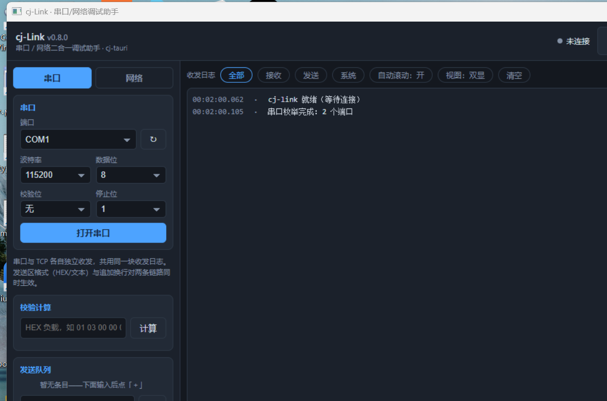

# cj-Link · 串口/网络二合一调试助手

cj-tauri 示例：串口与 TCP 客户端共用一块收发日志的调试小工具（路线图「旗舰选题」的落地样板）。


## 功能

- **串口链路**：端口枚举（连接前点 ↻）、波特率/数据位/校验/停止位参数面板，走官方 `serial` 插件
  （C 桥 termios，Linux/Windows 两平台同名导出）；收走前端轮询 `serial:read`。
- **网络链路**（模式三选一，面板下拉切换）：
  - *TCP 客户端*：应用级 `link:netConnect(mode=tcp-client)`（`std.net` 的 `TcpSocket`，5s 建连超时）；
  - *TCP 服务器*：`link:netConnect(mode=tcp-server)` 本机监听，accept 线程收客户端（上限 16），
    每客户端一条读线程，发送缺省广播、可按通道 `#id` 定向；
  - *UDP 客户端*：`link:netConnect(mode=udp)` connect 到对端后 send/receive（数据报语义）。
  收均走宿主事件推送 `link:tcpData`（报文带 `mode`/`channel`/`from` 字段区分来源）。
- **收发日志**：HEX/ASCII 双显（双显/HEX/文本三档视图）、方向分色（↑TX 黄 / ↓RX 绿 / ·系统灰）、
  毫秒时间戳、按方向过滤、TX/RX 字节与错误计数。
- **发送区**：HEX/文本双模式、追加 CRLF、定时发送（周期 50ms–60s 可调）。
- **发送队列**：常用报文存成列表（HEX/TXT 各自标记），点一条发一条，随 store 持久化。
- **校验计算**：`link:crcCalc` 算 CRC16-Modbus（低前/高前）、CRC16-CCITT、累加和、异或和、LRC，
  一键取「整帧+CRC」回填发送框（协议逻辑在仓颉侧，前端只展示）。
- **面板配置持久化**：`store:get/set` 落 `store.json`，重启自动恢复。

## 命令表

| 命令 | 归属 | 说明 |
| --- | --- | --- |
| `serial:list/open/read/write/close` | serial 插件 | 串口能力（`serial:default` 权限集） |
| `store:get/set` | store 插件 | 面板配置持久化 |
| `link:serialList` | 应用级 | 串口枚举统一出口 |
| `link:netConnect/netSend/netClose/netStatus` | 应用级 | 网络会话（TCP 客户端 / TCP 服务器 / UDP，`mode` 参数区分） |
| `link:crcCalc` | 应用级 | 校验计算（CRC16-Modbus/CCITT、累加和、异或和、LRC、整帧拼装） |
| `link:ping` / `report` / `quit` | 应用级 | 探针自检辅助 |

能力清单见 `capabilities/default.json`——没声明的命令一律 `command not allowed`。

## 运行

```bash
# Linux（自动套 Xvfb；对端由 python3 pty + TCP echo 扮演）
bash run.sh

# Windows（三档：build 只构建 / 不带参数起窗 / selfcheck 跑探针自检）
run.bat build
run.bat
run.bat selfcheck

# 手动
cd examples/cj-link && cjpm run
```

`run.bat` 一律在示例根目录启动应用（`capabilities/` 与 `ui/` 按工作目录相对路径读），
判绿口径是「stderr 日志里没有 `FAIL ` 行」。Windows 的 `selfcheck` 需要先摆好对端（见下节）。

## 探针自检（自动化取证）

`CJ_LINK_PROBE=1` 时宿主经 document-start 预执行脚本注入配置，页面自动跑
「串口 open→write→read→close + CRC 标准向量（01 03 00 00 00 02 → c40b）+ TCP connect→send→recv→close
+ UDP connect→send→recv→close」共 11 步，
逐项经 `report` 回投 stderr；对端由 `cj-link-peer.py` 扮演（串口 pty echo + TCP echo + UDP echo），
收发证据落在应用进程之外（`rx` 文件 + 对端日志）。`run.sh` 的 33 条断言全绿即三条链路都是活的。

```bash
CJ_LINK_PROBE=1 CJ_LINK_PROBE_SERIAL_PATH=/dev/pts/N \
CJ_LINK_PROBE_TCP_HOST=127.0.0.1 CJ_LINK_PROBE_TCP_PORT=15021 CJ_LINK_PROBE_UDP_PORT=15022 \
  ./target/release/bin/main 2> app.log
```

其余变量：`CJ_LINK_PROBE_QUIT=0` 不自动退出（人眼手测用）。

### Windows 侧对端

Linux 那份 `cj-link-peer.py` 靠 pty 扮演串口，Windows 没有 pty——串口那侧改用**本机一对互通的
虚拟串口**（示例随机器的 COM1↔COM2 就是一对）：对端拿 COM2「收什么回什么」，收到的报文记进日志，
于是「命令成功了」这件事有**线路上真收到过什么**的凭证，而不只是应用自己的自述。

```powershell
# 串口对端：占住 COM2，收到什么回什么（日志落在对端侧）
powershell -NoProfile -File link-serial-echo.ps1 COM2 serial.log 90

# 网络对端：TCP/UDP echo（纯 stdlib，不需要装东西）
python link-peer-win.py peer.log 15021 15022

# 应用侧（探针变量与 Linux 同名）
CJ_LINK_PROBE=1 CJ_LINK_PROBE_SERIAL_PATH=COM1 \
CJ_LINK_PROBE_TCP_HOST=127.0.0.1 CJ_LINK_PROBE_TCP_PORT=15021 CJ_LINK_PROBE_UDP_PORT=15022 \
  ./target/release/bin/main 2> app.log
```

两个脚本随示例放在根目录（`link-peer-win.py` / `link-serial-echo.ps1`）；本机实测 `app.log` 侧
**11/11**，对端侧留下 `rx 12 bytes: cj-link-ping`（串口）、`rx 16 bytes`（TCP/UDP）。

## 打成单文件 exe（免 SDK 分发）

页面与能力清单都走「内嵌优先」，所以打出来的产物只有一个 exe：源码树里改 `ui/index.html` 立即生效，
打包后页面进二进制、换台没装仓颉 SDK 的机器也能跑（串口/TCP/UDP 都是系统 API）。

```bash
# 仓库根执行；CANGJIE_STDX 必须先导出（框架根 cjpm.toml 用它展开 stdx 路径）
export CANGJIE_STDX=/d/cangjie-stdx/windows_x86_64_cjnative/dynamic/stdx
bash scripts/pack-win-single.sh examples/cj-link
```

产物 `examples/cj-link/dist-single/cj-link.exe` 本机实测：**5,745,664 字节**、
`Subsystem=00000002`（GUI，双击不弹控制台）、导入表 8 个 DLL **全是系统库**
（msvcrt / KERNEL32 / WS2_32 / SHELL32 / dbghelp / comdlg32 / USER32 / ole32），
WebView2Loader 内嵌在 exe 里（首次运行释放到 `%TEMP%\cj-tauri-loader\`）。



## 已知边界

- 串口与网络各自独立收发、同一时刻只用一条（单链路收发，互斥提示在页面）；
  「串口↔网口透明互转」是有意不做的二期。
- TCP 服务器面向调试场景：最多 16 个客户端、发送缺省广播；UDP 只做 connect 型客户端
  （send/receive 语义），纯 bind 收报（无固定对端）二期。
- TCP 服务器 accept 多客户端后的**通道管理界面**（按 #id 定向发送的前端控件）二期——
  命令层已支持（`link:netSend` 带 `channel`）。
