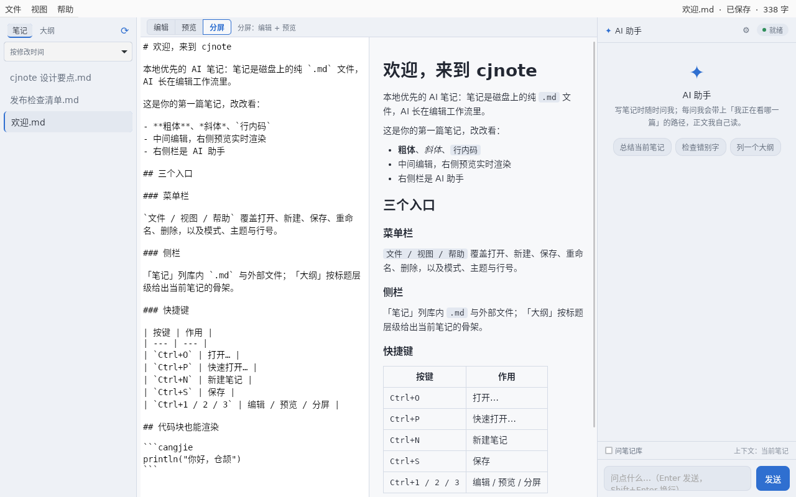
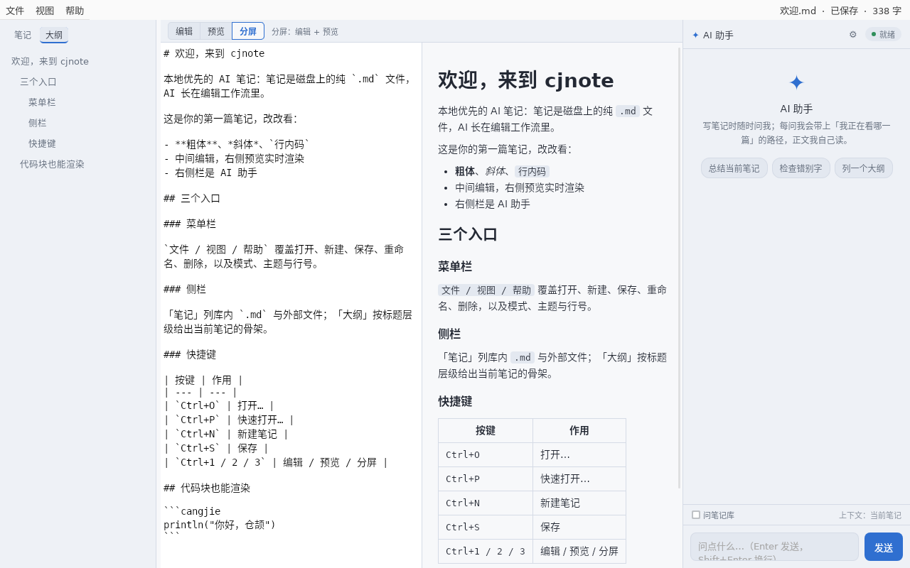
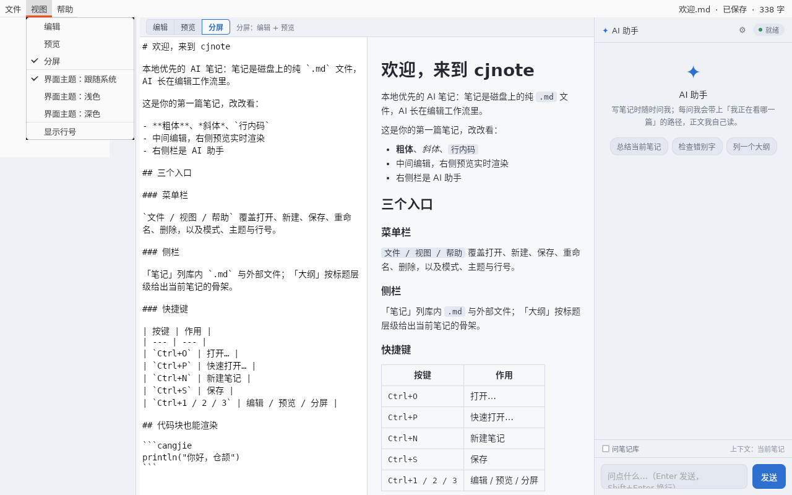
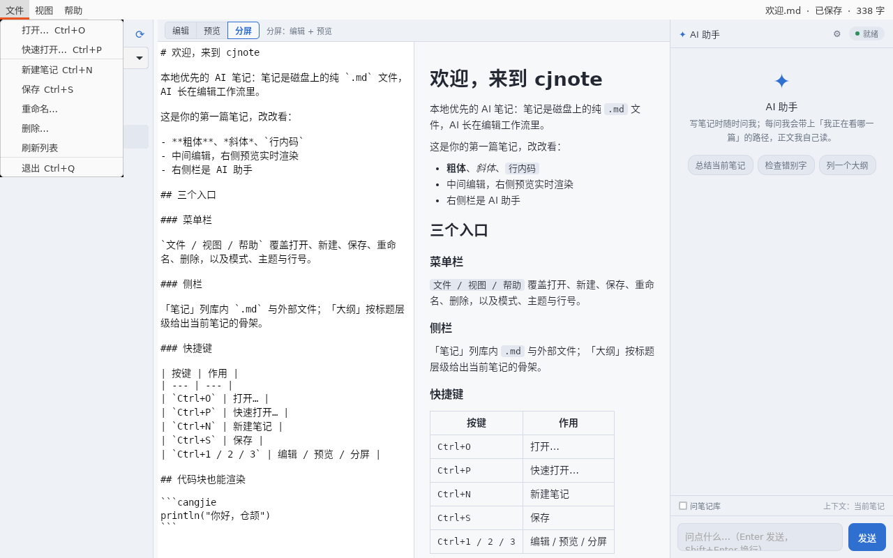
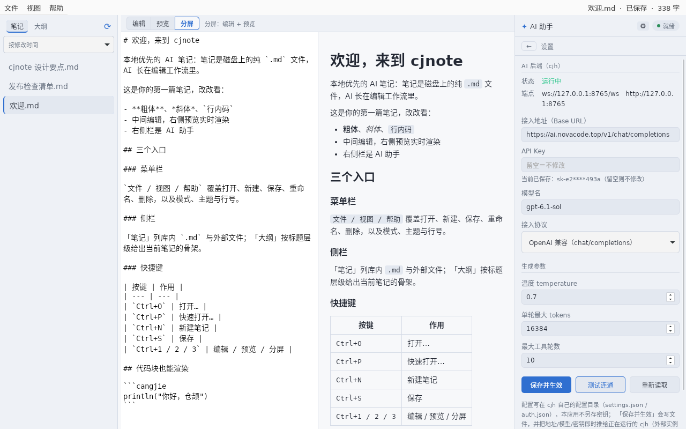

# cjnote — AI 原生 Markdown 笔记

用 [仓颉](https://cangjie-lang.cn/) + [cj-tauri](https://atomgit.com/qq8864/cj-tauri) 写的桌面笔记应用：
**后端静态编译，前端就是系统 WebView**（Linux WebKitGTK / Windows WebView2），不捆 Chromium、不带 Node。

三栏布局（笔记库 / 编辑区 / AI 助手），原生 GTK 菜单栏，顶栏的标题、保存状态与字数推进系统菜单行右侧的副标题。
本机实测：菜单、副标题、AI 流式对话、笔记增删改查整条链路都有 stderr 凭证。

> 📖 **cj-tauri 官网**：<https://yangyongzhen.github.io/cj-tauri/> —— 特性、实机截图与文档入口。

## 界面



*分屏模式：左侧编辑器（仓颉高亮 + 行号），右侧实时预览，最右是 AI 助手。系统菜单行右侧是「文件 · 状态 · 字数」副标题，页面自己的顶栏因此整条隐藏。*

<table>
<tr>
<td></td>
<td></td>
</tr>
<tr>
<td><em>大纲页签：标题点击跳行，围栏里的 <code>#</code> 不算标题</em></td>
<td><em>原生「视图」菜单：三态与界面主题都是勾选项，与页面状态同步</em></td>
</tr>
</table>



*原生「文件」菜单：新建 / 打开 / 保存 / 重命名 / 删除都走宿主菜单栏，快捷键与页面内操作同权。*



*⚙ 打开的是整页设置：接入地址、密钥（脱敏回显、留空不改）、模型名、接入协议、温度 / tokens / 轮数，
顶上显示后端状态与两个端点；带「测试连通」。*

## 功能

| 能力 | 说明 |
| --- | --- |
| **三态视图** | 编辑 / 分屏 / 预览，`Ctrl+1/2/3`；与原生「视图」菜单同名同序，切换后菜单勾选自动回写 |
| **原生菜单栏** | 文件 / 视图 / 帮助 三个顶层菜单；`Ctrl+O` 打开外部文件、`Ctrl+P` 快速打开、`Ctrl+N` 新建、`Ctrl+S` 保存、`Ctrl+Q` 退出 |
| **原生副标题** | 标题 · 已保存/未保存 · 字数，走 `setTitlebarSubtitle` 推到菜单行右侧；能力不可用（如 WebView2）时自动退回页面顶栏 |
| **大纲** | 侧栏第二个页签，抽 1~3 级标题（跳过围栏代码块里的 `#`），点一条跳一行（编辑器光标与预览区同步滚动） |
| **最近打开** | `Ctrl+O` 打开的库外文件直接并进左侧单列表（只显示文件名、完整路径悬停可见，点击重开、文件没了自动清条目，最近 8 条持久化）；重启自动恢复上次打开的笔记 |
| **列表排序** | 侧栏「按修改时间 / 按名称」下拉，默认按修改时间（最近动过的在最上），偏好落盘 |
| **侧栏可调宽** | 拖动侧栏右缘拖条调宽（160~480px 夹取），双击复位 220px，偏好落盘；长内容 ellipsis 截断不受影响 |
| **AI 面板可调宽** | 拖动 AI 面板左缘拖条调宽（240~640px 夹取），双击复位 320px，偏好落盘；上限还跟窗口走——窄窗口下自动让位给编辑区（保底 320px），不会把中间挤成 0 |
| **重命名 / 删除** | 「文件」菜单作用于当前笔记：真重命名（保留 mtime、拒绝覆盖已存在目标名）、删除带页内确认；外部文件被拒 |
| **AI 助手** | 后端是 [cjh](https://atomgit.com/qq8864/cjh)（随包分发、自动拉起、退出收尾）；页面经 ws 直连 `ws://127.0.0.1:8765/ws` 流式收帧，逐字落进对话区，回复按 markdown 渲染（代码块高亮，与预览同源）；状态胶囊（就绪/未连接/忙/出错）、空态建议按钮一键提问、工具调用单行展示、审批请求内联成卡片（批准/拒绝） |
| **AI 上下文（指针式）** | 每问默认只带**当前笔记的绝对路径**（外加笔记库根），**不带正文**——正文由 AI 自己按需 `read_file` 读，读的是最新内容。勾「问笔记库」则显式要求这一轮做全库检索；页面不做预取 |
| **设置页** | 点 AI 头部 ⚙ 切到**整页设置**（不是浮层状态卡）：可改接入地址（Base URL）、API Key、模型名、接入协议（OpenAI 兼容 / Anthropic）、温度、单轮最大 tokens、最大工具轮数；显示后端状态与两端点；带**测试连通**按钮。密钥只脱敏回显、留空即不修改。保存是**两条腿**：写 cjh 自己的 `~/.cjh`（管下次拉起与协议字段）+ 把地址 / 模型 / 密钥即时推给**正在运行的那只 cjh**——哪怕它是别的程序拉起的也照样生效，不必等重启；只有接入协议（`provider_protocol`）只认配置文件、需重启 cjh |
| **选区动作** | 选中正文 → 重写 / 续写 / 翻译，结果先进 diff 确认条，接受才改文档、丢弃则原样 |
| **主题** | 跟随系统 / 浅色 / 深色，页面与原生菜单勾选双向同步，偏好落盘 |
| **外部文件草稿** | `Ctrl+O` 打开库外 `.md` 只进内存，首次 `Ctrl+S` 才落成库里的新笔记，**绝不静默改写磁盘原文件** |

## 快捷键

| 按键 | 动作 |
| --- | --- |
| `Ctrl+1` / `Ctrl+2` / `Ctrl+3` | 编辑 / 分屏 / 预览 |
| `Ctrl+N` | 新建笔记 |
| `Ctrl+S` | 保存（外部草稿首次保存＝落库） |
| `Ctrl+O` | 打开磁盘上的 `.md`（原生文件对话框） |
| `Ctrl+P` | 页内快速打开库内笔记（`↑↓` 移动、`Enter` 打开、`Esc` 关闭） |
| `Ctrl+Q` | 退出 |

## 架构

```
ui/index.html            单页前端（HTML+CSS+JS，无构建步骤，改完重启即生效）
src/main.cj              应用装配：命令注册、菜单模型与 MenuRouter、主题/副标题回写、ws 与 cjh 装配
src/notestore.cj         笔记存储：列表 / 检索 / 打开 / 保存 / 新建 / 删除（名字净化，路径穿越在入口挡掉）
src/cjh_host.cj          cjh 托管：二进制发现、健康检查、按需拉起与收尾，以及配置读写（settings.json / auth.json）
capabilities/default.json 能力清单：命令放行、事件声明、http/ws 域名白名单
vendor/cjh/bin/          随包 cjh 二进制（按平台分目录，Linux 4 个 .so / Windows 4 个 DLL 同级）
notes/                   笔记库（运行期数据，不入库）
```

应用注册 18 条命令，一律经 `invoke` 走 IPC：

| 命令 | 作用 |
| --- | --- |
| `note:list` / `note:open` / `note:save` / `note:create` / `note:delete` / `note:rename` | 笔记增删改查 + 重命名（`note:list` 每条带 `mtime`，并回笔记库根绝对路径） |
| `note:search` | 全库关键词检索（标题 + 正文，返回命中片段）。**朴素 `contains`：自然语言提问通常 0 命中**，所以检索交给 AI 自己（`grep` / 列目录） |
| `note:readExternal` | 读库外文件（外部草稿入口） |
| `notes:env` | 运行环境：是否自检模式、笔记库相对路径、框架版本号（「关于」浮层要显示它） |
| `cjh:status` / `cjh:start` | cjh 是否就绪 / 按需拉起（返回 `wsUrl`、`apiUrl`） |
| `cjh:config` / `cjh:saveConfig` / `cjh:restart` | 设置页的配置通路：读（密钥脱敏）、合并写 + **即时推给运行中的 cjh**（`POST /api/settings` 白名单字段）、重启（协议改动才需要） |
| `theme:apply` / `titlebar:sync` | 主题同步到原生菜单勾选 / 副标题推送 |
| `linenos:sync` | 行号开关同步到原生「视图」菜单的勾选项 |
| `report` | 页面自检结论回投 stderr（异步命令，供无人值守取证） |
| `dialog:open`、`store:*`、`http:*`、`ws:*`、`log:write`、`clipboard:write`、`system:version` | 框架插件 / 内置命令提供（对话框 / 偏好落盘 / REST / 聊天流 / 日志 / 剪贴板 / 框架版本） |

> 能力清单里放行的是 32 条（含上述插件命令）；未放行的命令前端一调就被拒并在 stderr 留一行
> `尚未授权`——启动日志里那几条 `dialog:save` / `dialog:pickFolder` / `dialog:message` 的提示即属此类。

**AI 只有 cjh 一个后端，应用不做任何直连**：聊天走 `ws:connect` + `ws:send` 到
`ws://127.0.0.1:8765/ws` 收流式帧（`delta` 逐字、`tool_start`/`tool_result` 单行、审批帧内联成卡、
`done` 收尾），配置读写走宿主（页面没有 `~/.cjh` 的写权限）。模型与凭证都在 cjh 自己的配置里，
所以要换服务商／模型／密钥，改设置页即可，本应用不保存也不中转明文密钥。

**上下文为什么只给指针**：`Chat`（当前笔记）按**绝对路径 + 笔记库根**发出去，正文由 AI 自取。
绝对路径是硬前提——cjh 的 `read_file` 对相对路径是按**它当时的工作区**解析的，给相对路径会静默读错目录；
而给正文快照则会读到旧内容（页面持有的文本可能落后于盘）。指针式既省 token，又保证 AI 读到的永远是最新落盘内容。

为什么不直接只调 cjh 的 `/api/settings`：实测该接口是**字段白名单**的部分更新——
`baseUrl` / `model` / `apiKey` / `temperature` / `maxTokens` / `maxIterations` 能改（改完立刻生效并落盘），
但 `provider_protocol`（接入协议）传进去会被静默忽略（GET 也不回显）。所以设置页的保存是**两条腿**：
写盘（管下次拉起 + 协议字段）+ 把白名单字段推给正在运行的实例；协议改了才提示重启，其余不必等。

**测试连通**用的是一个更轻的通道：cjh 的 `chat` 帧支持**帧级 `model` / `baseUrl` / `apiKey` 覆盖**
（单次生效、不落盘、不粘连），于是按钮直接把表单里的值随一条最小对话发过去——
测的就是「我填的这组值能不能用」，而且配置一字未动。探针不带 `session_id`（cjh 为这一轮另开会话），
既不污染当前对话，也不会顶掉当前会话 id。

端口与二进制位置都可用环境变量覆写：`CJNOTE_CJH_PORT`（默认 8765）、`CJNOTE_CJH`（指向别的 cjh 可执行文件）。

## 运行

依赖与 cj-tauri 相同：仓颉 SDK 1.2.0 + stdx（同代），Linux 另需 `gcc pkg-config libwebkit2gtk-4.1-dev libgtk-3-dev`。

```bash
# 1) 编 C 桥（首次或框架有 C 改动时；产物在框架根的 native/）
bash ../../native/build_linux.sh

# 2) 编本应用
cjpm build

# 3) 跑（stdx 动态库与桥都要进 LD_LIBRARY_PATH，否则启动即退、只留一行 so not found）
export LD_LIBRARY_PATH=$CANGJIE_HOME/runtime/lib/linux_x86_64_cjnative:$CANGJIE_STDX:../../native:$LD_LIBRARY_PATH
./target/release/bin/main
```

工作目录就是笔记库根：首次启动会在 `notes/` 下播种一篇 `欢迎.md`。

Windows（WebView2）侧同样是「编桥 → 编应用 → 跑」，区别只在**依赖怎么进 PATH**：仓颉运行时、stdx、
C 桥与按名字加载的 `WebView2Loader.dll` 四处都得在，缺任何一处都是「进程起来又没了、日志一行没有」。

```bat
rem 1) 编 C 桥（首次或框架有 C 改动时；产物落在框架根 native\）
..\..\native\build_win.bat
rem 2) 编本应用
cjpm build
rem 3) 跑：设好四段 PATH，再在当前目录（= 示例根）启动
set "PATH=%CANGJIE_HOME%\runtime\lib\windows_x86_64_cjnative;%CANGJIE_STDX%;..\..\native;..\..\native\webview2;%PATH%"
target\release\bin\main.exe
```

`CANGJIE_STDX` 指的是 stdx 的 `dynamic\stdx`（DLL 目录），不是 stdx 包根；从 Git Bash 起这些路径要写
POSIX 形式（`/d/...`），盘符形式会被 MSYS 破掉——见框架 `AGENTS.md` §4 同名条目。

AI 后端 cjh 随包放在 `vendor/cjh/bin/<平台>/`：应用启动时先探 `127.0.0.1:8765`，端口上已有活着的 cjh 就
直接复用（不动别人的进程），没有就用随包二进制自己拉起（`web --port 8765 --bind 127.0.0.1`），退出时只收掉
自己拉起的那只。模型与凭证配在 cjh 自己的 `~/.cjh` 里——点 AI 头部的 ⚙ 进设置页改即可，
不需要装 cjh、不需要找路径、也没有任何 API Key 落在本应用的 `store.json`。

拉起走框架的 `launchHidden()`（`src/cjh_host.cj`），不是 `std.process.launch`：本应用是 GUI 子系统
（`--subsystem=windows`）、父进程没有控制台，用 `launch` 起控制台程序 cjh 会让 **Windows 给 cjh 单独
配一个控制台窗口**——桌面上就是「点一下笔记，旁边蹦出一个黑窗口」。改走 C 桥的
`CreateProcessW` + `DETACHED_PROCESS` 之后，cjh **根本没有控制台**（不是「藏起来」：`CREATE_NO_WINDOW`
只是不显示，子进程仍持有一个隐藏 console、`conhost.exe` 照样挂在它名下）。Windows 实机 A/B：同一份
`cjh.exe`，不给创建标志时可见控制台 1 → 2 个，给了之后恒为 0 个，而 cjh 照常 `127.0.0.1:8765`
LISTENING、页面 ws 连得上（单文件形态同样复核过：`cjh` 的 `MainWindowHandle=0`、可见控制台窗口 0）。
代价是拿不到 cjh 的 stdout / stderr——本应用不依赖它（健康检查按 HTTP 探端口）。

## 单文件打包（可选）

> **Windows 已发布的产物**：[`dist-single/cjnote.exe`](dist-single/cjnote.exe)（**34.1 MB**，单文件，
> 双击即用）——C 桥 / 仓颉运行时 / stdx / 插件包全部静态链进这一个文件，页面与 `capabilities/`
> 内嵌成 base64，**随包 cjh 与它的 4 个运行时 DLL** 作为 PE 资源（`RT_RCDATA`）一起塞在里面，
> 首次运行释放到 `%LOCALAPPDATA%\cjnote\runtime\`。不装仓颉 SDK、不设 `PATH`、不需要 `vendor/` 目录。
> Linux 单文件产物用 `pack-linux-single.sh`（**不含 cjh**，需与 `vendor/cjh/` 同级摆放）。
>
> 上表那份 `cjnote.exe` 已随「AI 面板可拖宽度」与「AI 后端两态分流」两项改动**重打**
> （2026-10-21 23:10 构建，34 184 192 字节，GUI 子系统、导入表只有系统 DLL），源码与产物同版。
> 重打时顺带修掉一个真问题：Git Bash 的 `HOME` 是 POSIX 形式（`/c/Users/yang`），原生 Win32
> 读不到 `~/.cjh`——**从 Git Bash 启动时配置页一片空白**（自检里 `cjh:config` 拿不到 model）。
> 现在宿主会把 `/<盘符>/…` 与 `/cygdrive/<盘符>/…` 规范成原生路径再拼 `~/.cjh`。
> 取证：同一份 exe，Git Bash 下自检 `84 PASS / 0 FAIL / 1 SKIP`（汇总行 `passed=84`、明细 84 条 PASS、
> 0 条 FAIL；SKIP 那条是真实 cjh 聊天探针当时没连上，不算失败）；空配置目录下仍如实报
> `CJH-WARN 服务商密钥未配置`（`未配置` 与 `未启动` 两条轴没有混）。
>
> **另一台机器上报的「cjh 在运行、页面 ws 连不上」已修**：仓颉运行时算 ws 握手的随机 nonce 走 OpenSSL，
> 而它按**裸名**找 `libcrypto-3-x64.dll` / `libssl-3-x64.dll`（SDK 与 stdx 都不带，开发机上只是恰好命中
> PATH 里 Git 自带的那份）——于是 `/api/health` 照常 200、页面显示「cjh 在运行」，只有 ws 报
> `Can not load openssl library or function RAND_bytes.`。现在宿主在随包资源释放完成后**按绝对路径预加载**
> 这两个 DLL（先 `libcrypto` 后 `libssl`），运行时再按裸名加载即命中已加载模块——不改 PATH、
> 不把 DLL 摆到 exe 旁边，零新增体积（它们本来就在包里）。取证：默认日志里两行
> `[cj-bridge] preload: …\cjnote\runtime/lib{crypto,ssl}-3-x64.dll` 之后紧跟
> `[cj-tauri] ws: connected ws://127.0.0.1:8765/ws`。

想把应用交付成**一个文件**（没有 `lib/`、没有 `ui/`、没有 `capabilities/`），用框架的通用打包脚本：

```bash
bash ../../scripts/pack-linux-single.sh                             # 默认打本示例 → dist-single/cjnote
bash ../../scripts/pack-linux-single.sh examples/cjnote /tmp/out    # 也可指定示例与输出目录
```

### 两个体积数字、不是两个程序

最容易读岔的一点先说清：**11.2M 与 7.6M 是同一个应用的两份产物，差别只在「依赖有没有被编进文件里」**
（体积按 1024 进位，与 `ls -h` 同口径）：

| 形态 | 产物文件 | 体积 | 文件里有什么 |
| --- | --- | --- | --- |
| 开发态（`cjpm build` 直接编出来的） | `target/release/bin/main` | **7.6M** | 只有应用自己的代码。C 桥 `libcjtbridge.so`、仓颉运行时、stdx、各插件包都在文件**外面**，运行时靠 `LD_LIBRARY_PATH` 去找 |
| 单文件（跑完本节脚本的产物） | `dist-single/cjnote` | **11.2M** | 上表那些**全部静态编进这一个文件**，另外把 `ui/`（页面 + 前端库）与 `capabilities/` 清单内嵌成 base64 |
| 单文件（Windows，`pack-win-single.sh`） | `dist-single/cjnote.exe` | **32.6M** | 同上一行，另外把**cjh 与它的 4 个运行时 DLL** 嵌进 exe（PE 资源 `RT_RCDATA`，首次运行释放到 `%LOCALAPPDATA%\cjnote\runtime\`）；子系统是 GUI，双击不弹控制台 |

多出来的 3.6M 就是被静态链进来的运行时与插件包，加上内嵌的页面资源——换来的是「换一台机器只要系统有
WebKitGTK / GTK 就能直接跑」。

### 它和目录包的区别

`pack-linux-single.sh` 打的是**一个文件**，`pack-linux.sh` 打的是**一个目录**：

| | 目录包（`pack-linux.sh`） | 单文件（`pack-linux-single.sh`） |
| --- | --- | --- |
| 链接方式 | 动态（`libcjTauri*.so`、`libcjtbridge.so`） | 静态（`--static --static-std --static-libs` + 静态 C 桥归档） |
| 运行时依赖 | 仓颉运行时 + stdx + 桥，须随包发或让用户设 `LD_LIBRARY_PATH` | **只要系统 WebKitGTK / GTK 那一套**，不再需要 SDK / stdx / `LD_LIBRARY_PATH` |
| 页面 / 前端库 / 能力清单 | 随包的 `ui/`、`capabilities/` 目录 | 编进二进制（启动日志会打「能力清单来自内嵌资源」） |
| 适合 | 本机调试、目标机器已装 SDK | 免 SDK、免解压的交付 |

Linux 侧有个硬天花板：**系统 WebKitGTK / GTK 没有静态库**（发行版里查无 `libwebkit2gtk-4.1.a` / `libgtk-3.a`），
所以「全静态 ELF」在 Linux 上不可得——产物仍动态依赖系统那套图形栈，能静态下来的只是「本框架带来的依赖」。
实测启动（刻意摘掉 `LD_LIBRARY_PATH`）：窗口建成、菜单 16 项生效、
`[cjnote] 能力清单来自内嵌资源（1 份，共 1568 字节 base64）`，stderr 49 行、无 `not found`。

两条注意：① **cjh 的位置两个平台不一样**——Windows 单文件把它**嵌进 exe 里**（PE 资源 `RT_RCDATA`，
清单是本示例的 `pack-assets.txt`），首次运行释放到 `%LOCALAPPDATA%\cjnote\runtime\`，之后复用、不重复解包；
Linux 单文件**仍不含 cjh**——它按 `vendor/cjh/bin/<平台>/` 找现成二进制，所以产物要和 `vendor/cjh/`
**同级摆放**，且**工作目录就是它所在目录**（笔记库 `notes/` 同样按相对路径读）；
② 脚本本身是通用的（示例路径当第一个参数、包名从示例的 `cjpm.toml` 读，脚本内无任何示例专属逻辑），
示例侧只需备好三件套（`src/packed_assets.cj` 空存根、`src/packed_resources.cj`、至少一份 `capabilities/*.json`），
要内嵌外部程序就再加一份 `pack-assets.txt`（一行一个文件），
所以它留在框架的 `scripts/` 里、不必复制进每个示例。

## 自检

无人值守跑一轮页面自检，结论经 `report` 回投 stderr：

> 注意：其中两条涉及 cjh 配置的断言（`cjh:config` / `cjh:saveConfig`）按「本机已装并配置过 cjh」写。
> 用隔离 HOME 跑沙盒时先放一份 `~/.cjh/settings.json`，否则 `cjh:config` 那条会因读不到 model 而红——
> 那是「这台机器没配置过 cjh」，不是回归。

```bash
CJNOTE_SELFCHECK=1 ./target/release/bin/main 2>&1 | grep SELFCHECK
# SELFCHECK DONE passed=84 failed=0        # Windows/WebView2 实测（另有 1 条 SKIP）；Linux 上次为 passed=68
```

（汇总行的 `passed` 与 PASS 明细条数**不保证末行对齐**：`report` 是异步命令，聚合行之后还可能再来明细，
所以探针那条断言会落在汇总行之后——判据是「PASS 明细条数、FAIL 0 条、汇总 failed=0」三者一致。）

「后端给了绝对路径」那两条断言用 `isAbsPath()` 判定（`/…` 或 `E:/…` 都算绝对）——只认 `/` 会让
Windows 上恒红，那是判定写窄了、不是后端没给。

断言覆盖：列表与打开、保存与字数同步、三态切换与持久化、主题切换与勾选回写、外部草稿保存、
大纲抽取与跳行、原生副标题能力探测、AI 设置页切换、四个可编辑字段与按钮齐备、配置通路
（`cjh:config` 回模型名且密钥脱敏、`cjh:saveConfig` 写盘并回报写入键、白名单字段即时推给运行中的实例），
**两条宽度拖条**（侧栏右缘 / AI 面板左缘：真改变宽度、超限夹取、双击复位、偏好落 store），
**AI 后端两态分流**（「离线文案按卡点分支」三条 + 「缺密钥判未配置」两条 + 「未配置卡带『去配置』且点了直达设置页」，
以及「晚到的启动期卡片不得抹掉正在进行的对话」两条竞态回归），
以及两条**真实 cjh** 的通路：流式聊天探针（有后端才跑，连不上记一行 SKIP，不把「环境里没有后端」算成失败）
与设置页的**测试连通**（帧级覆盖真发一轮，回包非空才算过）。
本轮实测：Windows/WebView2 **84 PASS / 0 FAIL / 1 SKIP**；Linux 沙盒上次为 **68 PASS / 0 FAIL / 1 SKIP**（新增断言未在 Linux 复跑）。

## 平台状态

| 平台 | 状态 |
| --- | --- |
| Linux（WebKitGTK） | **已实机跑通**：菜单、副标题、AI 流式（markdown 气泡、工具行、审批卡）、AI 设置页（改配置即时生效 + 测试连通）、笔记增删改查重命名、最近打开、侧栏与 AI 面板均可调宽；沙盒自检 **68 PASS / 0 FAIL**、单文件产物启动同样取证过 |
| Windows（WebView2） | **已实机跑通（2026-10-21）**：窗口与页面、`Ctrl+O` 打开笔记、视图菜单三态与行号开关勾选回写、6 个插件装配正常；**随包 cjh 自动拉起**（`[cjnote] cjh web 已就绪（port=8765，等了 0ms）`）、页面 ws 连上（`CJH ws connected ws://127.0.0.1:8765/ws`）、`/api/health` → 200。副标题能力位为 0，按设计回落页面顶栏。**单文件形态同样取证**：`cjnote.exe` 34.1 MB、GUI 子系统、导入表只有系统 DLL；干净目录双击等价启动 → `cjh` 从 `%LOCALAPPDATA%\cjnote\runtime\` 自行释放拉起、`8765` LISTENING、页面 ws 连上，且 `cjh` 无窗口（`MainWindowHandle=0`）、可见控制台窗口 **0** 个。**页面自检同样跑通**：`CJNOTE_SELFCHECK=1` → **84 PASS / 0 FAIL / 1 SKIP**（含两条宽度拖条断言与 AI 后端两态分流的断言；SKIP 是真实 cjh 聊天探针当时未连上）；顺带修正了「绝对路径」断言只认 `/` 的 POSIX 假设。**AI 后端两态分流另在空配置目录取证**：`HOME` 指向空目录启动 → cjh 自行拉起、`CJH ws connected ws://127.0.0.1:8765/ws`、页面报 `CJH-WARN 服务商密钥未配置（cjh 已连上 ws://127.0.0.1:8765/ws）`，状态胶囊为「未配置密钥」、消息区给「去配置」卡（不再说「cjh 没起来」） |

## 相关文档

- cj-tauri 官网：<https://yangyongzhen.github.io/cj-tauri/>
- 用仓颉写个桌面应用：cj-tauri 与 Markdown 笔记 —— [实战拆解](https://atomgit.com/qq8864/cj-tauri/blob/main/docs/用仓颉写个桌面应用-cj-tauri与Markdown笔记.md)
- cj-tauri 框架：[README](https://atomgit.com/qq8864/cj-tauri) · [使用文档](https://atomgit.com/qq8864/cj-tauri/blob/main/docs/使用文档.md)

## License

MIT
