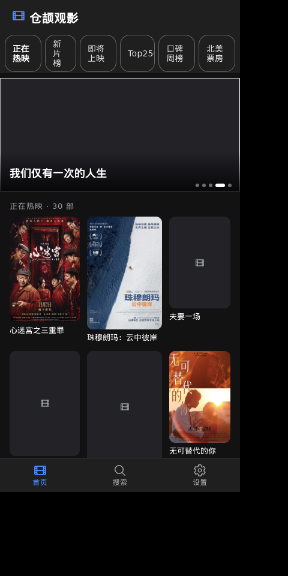

# ionic-movie —— Ionic 前端的移动端形态观影应用



cj-tauri 的 **Ionic Vue** 前端示例（第二个）：竖屏窄窗（400×820，手机比例），后端与
[`examples/movie`](../movie/README.md) **共用同一套命令**（源码拷贝，仅改包名
`ionic_movie_app`）——轮播、榜单、搜索、详情、**在线播放（m3u8 经 hls.js）**一应俱全。

## 界面与功能

| 页签 | 内容 |
|---|---|
| 首页 | 六个榜单分类 chips（正在热映 / 新片榜 / 即将上映 / Top250 / 口碑周榜 / 北美票房，各自本地缓存切换不重抓）、**轮播图**（榜单前 5 部大封面，3.5 秒自动翻页 + 指示点）、海报网格（带评分角标） |
| 搜索 | 关键词搜片，结果进同一个海报网格 |
| 设置 | 框架版本、数据源说明、播放说明（hls.js / 换源提示）、关于 |

详情与播放：

- 点海报进详情页：大封面（500px）+ 简介（`movie:detail`）+ **播放源 chips**（`movie:source`
  的主源 tvurls 先直接播；换源走 `movie:sourceitem`，按 note/aid 取对应源的播放地址）；
- **m3u8 流经 hls.js 播放**（WebKitGTK 的 `<video>` 不原生支持 HLS），直链 mp4 直接 `src`；
  流加载失败按致命错误 toast 提示换源；
- 封面全部经宿主命令 `movie:image` 取回转 data: URL（豆瓣图源防盗链，页面侧直连必然全灭），
  网格 200px、详情 500px 懒加载；部分图源连宿主侧都只能拿到「HTTP 200 + 0 字节」，
  此时显示占位海报（已知边界，见下）。

## 前端关键点（与 app-vue 模板的差异）

与 [ionic-music](../ionic-music/README.md) 相同的三条（`vue-router` 硬依赖、ionicons 小驼峰导出、
`ion-palette-dark` 挂 `<html>` class），外加：

- **`hls.js`**：m3u8 播放的关键依赖（约 500KB，随单文件产物内联）；
- 榜单分类切换做了**按 kind 的本地缓存**（`cacheByKind`），来回切不重复请求上游（豆瓣限流友好）。

## 运行

```bash
# 首次：装前端依赖并构建（产物 assets/ui/dist/index.html）
cd assets/ui && npm install && npm run build && cd ../..

npx cj-tauri build        # 编后端（骨架 + 业务 static 包）
npx cj-tauri run          # 实机跑（桥日志有 [movie] 行）
```

工作目录 = 项目根（capabilities/ 与 assets/ 按相对路径读）。后台接口基址可用
环境变量 `CJ_MOVIE_API` 覆盖（同 movie）。

## 已知边界

- 部分豆瓣封面连宿主侧都只能取到「HTTP 200 + 0 字节」（图源防盗链或已下架），
  命令层如实拒绝（`command rejected (movie:image)`），页面显示占位海报；
- 播放源由后台**现抓上游解析**，源站偶尔抽风——换一个源 chips 即可；
- 上游是豆瓣，榜单请求做了 count 上限（命令层夹到 ≤60）与本地缓存，别拿高频轮询打它；
- 桌面端关窗时 WebKitGTK 的退出期析构偶尔 abort（exit 134）——框架已知边界，不影响功能。

## 与 movie（老形态）的差异

| | examples/movie | 本示例 |
|---|---|---|
| 工程形态 | 老形态（无清单，页面 `ui/index.html` 内联读取） | 新形态（`cj-tauri.toml` 清单 + `assets/ui` Vite 工程 + 骨架派生） |
| 业务入口 | `main()` 可执行 | `public func build(): AppSpec`（业务 static 包，骨架 launcher 调用） |
| 前端 | 原生 JS 单页 | Ionic Vue + hls.js |
| 命令层 | 相同（拷贝自 movie，仅包名不同） | 相同 |
