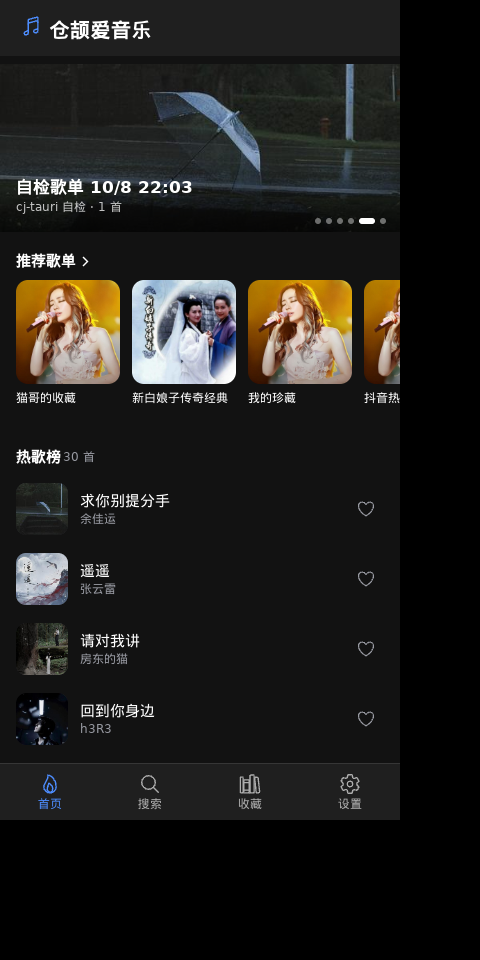

# ionic-music —— Ionic 前端的移动端形态音乐播放器



cj-tauri 的 **Ionic Vue** 前端示例：竖屏窄窗（400×820，手机比例），`@ionic/vue` 组件铺满呈现，
后端与 [`examples/music-next`](../music-next/README.md) **共用同一套命令**（源码拷贝自 music-next，
仅改包名 `ionic_music`）——验证「框架对前端零约束，Ionic 也能当 cj-tauri 的 UI」。

## 界面与功能

| 页签 | 内容 |
|---|---|
| 首页 | **轮播图**（歌单封面横滑，3 秒自动翻页 + 指示点，点进歌单详情）、**推荐歌单**横滑卡片、**热歌榜**列表 |
| 搜索 | 关键词搜歌（后台搜索结果的 title 字段是 GBK 乱码，页面不显示它，自己拼「“关键词” 的搜索结果」） |
| 收藏 | 本地收藏列表（底部页签带数量徽标），心形一键收藏/取消 |
| 设置 | 框架版本、音乐数据源说明、收藏管理（带确认的清空）、关于 |

播放与歌词：

- 底部常驻播放条（封面 + 上一首/播放/下一首 + 可拖进度条 + 时间），点封面或标题展开**全屏歌词页**；
- 歌词随播放进度**逐行高亮并自动滚动居中**（活跃行由 `music:lyric` 的毫秒时间轴驱动）；
- 封面全部经宿主命令 `music:image` 带正确 Referer 取回转 data: URL（防盗链图源页面侧直连必然
  全灭），列表 200px、正在播放 500px 懒加载；
- 「正在播的那份列表」由播放上下文记忆：在热歌榜里点播就顺着榜切歌，在歌单详情里就顺着歌单切。

## 它演示了什么

- **Ionic 组件接入 cj-tauri**：`@ionic/vue` 的 `ion-app / ion-toolbar / ion-searchbar / ion-range /
  ion-refresher / ion-tab-bar / ion-badge` 等在系统 WebView 里直接工作，无需任何桥接适配；
- **移动端形态**：桌面窗口按手机比例竖着开，信息架构按移动端音乐 App 的惯例组织
  （轮播 → 歌单 → 榜单 → 播放条 → 歌词页）；
- **后端零改动复用**：`music:hot / music:search / music:menus / music:lyric / music:image /
  fav:get / fav:set / music:quit / report` 全部来自 music-next 的命令层，三处联动齐全。

## 前端关键点（与 app-vue 模板的差异）

- `package.json` 多三个依赖：`@ionic/vue`（自带 `@ionic/core`）、**`vue-router`（@ionic/vue 的
  硬依赖，缺它 `vite build` 直接失败）**、`ionicons`（图标导出是**小驼峰**，如
  `musicalNotesOutline`，写成 `MusicalNotesOutline` 会报 rollup unresolved）；
- `main.js` 引 `@ionic/vue/css/*` 四个基础样式；深色主题用 `dark.class.css` 调色板——
  它是 **class 选择器**，必须把 `ion-palette-dark` class 挂到 `<html>` 上才生效（只引 CSS
  不挂 class 是浅色，第一版界面发白就是这个原因）；
- `vite-plugin-singlefile` 照旧：产物是 `assets/ui/dist/index.html` 单文件（约 1.2 MB，
  Ionic 全量内联），清单 `[assets] page` 指向它；
- 页面等桥出现再调 invoke（`waitForBridge`，与模板同款）。

## 运行

```bash
# 首次：装前端依赖并构建（产物 assets/ui/dist/index.html）
cd assets/ui && npm install && npm run build && cd ../..

npx cj-tauri build        # 编后端（骨架 + 业务 static 包）
npx cj-tauri run          # 实机跑（数据来自在线音乐接口，桥日志有 [music] 行）
```

工作目录 = 项目根（capabilities/ 与 assets/ 按相对路径读）。后台接口基址可用
环境变量 `CJ_MUSIC_API` 覆盖（同 music-next）。

## 已知边界

- 音乐接口依赖其自身的 mongodb 在线（接口网关返回 `Request Timeout` 时，页面按业务错误
  呈现空态与提示，下拉可重试）；
- 封面是防盗链图源，只能由宿主命令取回（见上）；
- `fav:set` 是**整表替换**（`{songs: [...]}`），页面收藏按钮先本地增删再整表发回；
- 后台搜索结果的 title 是 GBK 乱码（music-next 已知后台缺陷），前端已规避；
- 桌面端关窗时 WebKitGTK 的退出期析构偶尔 abort（exit 134）——框架已知边界，
  见根 README 的 Linux 收尾说明，不影响功能使用。
