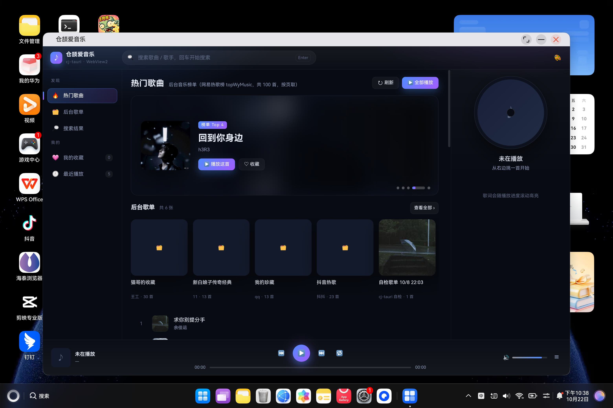

# 鸿蒙（HarmonyOS）应用工程

这个目录放**跑在鸿蒙设备上的 cj-tauri 应用**，一个应用一个子目录。与桌面示例（`examples/<名字>`）
的关系是「同一份业务层、两套宿主接入」——业务流程写在桌面示例里，鸿蒙工程只负责宿主侧（ArkUI /
ArkWeb / Ability 生命周期），见各工程自己的 README。

| 子目录 | 是什么 | 设备形态 |
| --- | --- | --- |
| `ohos-music/` | `examples/music`（爱音乐）在鸿蒙 PC 上的落地：内嵌页面 + music 命令层 | 鸿蒙 PC（`deviceTypes: 2in1`） |
| `ohos-movie/` | `examples/movie`（仓颉观影）在鸿蒙 PC 上的落地：内嵌页面 + movie 命令层，封面走系统网络栈取图 | 鸿蒙 PC（`deviceTypes: 2in1`） |

两个工程复用同一份调试签名（bundleName `com.yang.testcj`），**同一台设备只能装一个**——
装第二个会顶掉第一个。

| ohos-music | ohos-movie |
| --- | --- |
|  |  |

`examples/ohos-probe/` 是更早的**宿主探针工程**（不在此目录下，因为它按「一个示例一个目录」的惯例
留在 `examples/` 根），只做桥/多窗口/弹窗的取证，没有业务。

## 建新工程的三个前置（踩过的都在 `docs/鸿蒙ArkWeb接入踩坑.md`）

1. **DevEco Studio 6.1** 与它自带的 hvigor / node；仓颉构建插件由 hvigorw 自己找，
   命令行 headless 构建要 `DEVECO_CANGJIE_PLUGIN_ENABLED=true` + `NODE_PATH=<工程>/node_modules`，
   否则报的是「`cangjieOptions` schema 不认识」——像工程写错，实为插件没被加载（§10.8）。
2. **鸿蒙版 stdx**：`export CANGJIE_STDX_OHOS=<stdx>/linux_ohos_aarch64_cjnative/dynamic/stdx`，
   工程根的 `stdx` 联接由构建脚本按它创建（`entry/cjpm.toml` 只写相对路径 `../stdx`，§10.7）。
3. **签名**：复用 `com.yang.testcj` 那份调试证书（`build-profile.json5` 的 `signingConfigs`）。
   换 bundleName 就得在 DevEco 里重新「自动签名」一次，命令行做不了。

## 两个只能靠真机确认的判据

- **页面自证**：`hdc shell snapshot_display` 抓图，看得到业务内容（不是白屏/错误 toast）。
- **hilog**：`hdc -t <serial> shell hilog > f`（**先起流**再 `aa start`，缓冲会滚掉启动瞬间的行）。
  仓颉侧 `eprintln` 在设备上**不进 hilog**，诊断必须用 `Hilog.info`。
