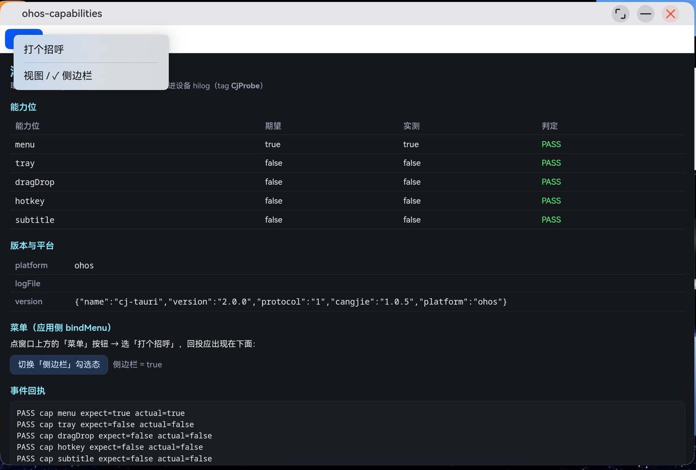

# ohos-capabilities：鸿蒙宿主能力位探针（新形态工程）

用 `cj-tauri create --template ohos` 生成、再 `cj-tauri sync ohos` 派生的**新形态**工程，
唯一用途是给「鸿蒙宿主能力位」取证：页面向后端要 `system:host`，把每个能力位的实测值与期望值对账，
**每一条断言同时写进设备 hilog**（tag `CjProbe`），验收读日志而不是读源码。

| 能力位 | 期望 | 现状 |
| --- | --- | --- |
| `menu` | true | 2026-10-24 真机取证通过（见 `native/platforms/harmonyos/README.md` 的「菜单能力位」） |
| `tray` | false | 鸿蒙无桌面级托盘 API，如实拒绝 |
| `dragDrop` | false | 没有「start 前定稿」的宿主语义，未做能力位 |
| `hotkey` | false | 鸿蒙无系统级热键 API，如实拒绝 |
| `subtitle` | false | 未实现 |



## 为什么断言要经命令写日志

鸿蒙设备上框架的 `eprintln` **不进 hilog**（AGENTS §4），页面 `console.log` 也只有调试器看得见。
所以页面把每条断言 `invoke("probeLog", { text })` 送到业务包，由业务包用应用侧 `Hilog.info`
写进设备日志（`src/main.cj` 的 `probeLog`，`@When[env == "ohos"]` 分支）。`hdc shell hilog` 一抓，
断言就逐条可对账——这也是本工程唯一的取证通道。

## 跑一遍（真机）

前置：DevEco Studio（含鸿蒙 SDK 与签名工具）、设备已连上 `hdc list targets`、桌面侧 SDK 与
[stdx](https://atomgit.com/qq8864/cj-tauri) 在 `PATH` 里（`cj-tauri` CLI 自己要 `stdx.encoding.json`）。

```bash
# 1) 派生鸿蒙工程骨架（targets/ 是生成物、不入库；每次 sync 都会重置它）
cj-tauri sync ohos

# 2) 把本机调试证书补进去（sync 之后必须重跑一次，见「签名」一节）
bash tools/apply-signing.sh

# 3) 编 hap（脚本自带清理与 --no-daemon，DEVECO_WIN 指 DevEco 安装根）
export CANGJIE_STDX_OHOS="<SDK>/linux_ohos_aarch64_cjnative/dynamic/stdx"
cd targets/ohos && bash build-hap.sh

# 4) 装 + 起（先起日志流，否则启动瞬间的行会被滚掉）
hdc shell hilog > /tmp/hilog.txt &
hdc install -r targets/ohos/entry/build/default/outputs/default/entry-default-signed.hap
hdc shell aa start -a EntryAbility -b com.yang.testcj

# 5) 读断言
grep -a CjProbe /tmp/hilog.txt
```

包名 `com.yang.testcj` 是本机调试证书的固定 bundleName（同目录的 `ohos-music` / `ohos-movie` /
`ohos-probe` 共用一套证书），所以**同一时刻只装得下一个**——ABCD 几个探针要轮流装。

## 签名（为什么是脚本而不是提交配置）

`targets/` 是 `sync` 派生的生成物，不入库；而调试证书与本机 DevEco 账号绑定，也不该入库。
于是签名只能在「sync 之后、build 之前」补一刀，`tools/apply-signing.sh` 就是这一刀：

- 默认从兄弟工程 `../ohos-music/build-profile.json5` 借 `signingConfigs` 段（都是同一套证书）；
- 换机器用 `CJ_OHOS_SIGNING_SOURCE=/path/to/signed/build-profile.json5` 指过去；
- 幂等：目标里已有 `signingConfigs` 内容就跳过，重复执行无副作用。

**注意它不能用 `awk -v` 传那段文本**：变量赋值会处理转义，证书路径里的 `\\` 会被解成 `\`，
写回去就是非法 json5（见 AGENTS §4「转义被吃」同族）。脚本里改成先落临时文件再 `getline` 读回。

想在 DevEco IDE 里点 Run，做法等价：`targets/ohos` 在 IDE 里打开 → File > Project Structure >
Signing Configs → 勾 *Automatically generate signature*（需登录华为账号）。

## 目录

```
cj-tauri.toml                 清单：id / 目标端（ohos bundleName = id）/ 窗口配置
src/main.cj                   业务包：greet / timer / probeLog / 菜单模型
assets/ui/index.html          探针页：能力位表格 + 断言 + 菜单事件回执
assets/capabilities/default.json  能力清单：放行 probeLog / system:* 与 menu:setChecked
tools/apply-signing.sh        调试签名注入（targets/ 生成后跑）
docs/device-evidence.txt      一轮真机的 hilog 原文
docs/evidence-menu-popup.jpeg 菜单弹窗与断言的全屏截图（裁到应用窗口）
targets/ohos/                 sync 派生的鸿蒙工程（生成物，不入库）
```

## 已知问题（与能力位无关，记录备查）

- `cj-tauri create --label` 传中文会以 `Invalid utf8 byte sequence` 崩——Windows 侧 argv 按 UTF-8
  解码，非 ASCII 标签过不去。绕过办法：先用 ASCII 名建工程，再改 `cj-tauri.toml` 的 `label`。
- Git Bash 下 `hdc` 的远端路径会被 MSYS 改写（`/data/local/tmp/x` → `D:/Program Files/Git/...`），
  抓图/取文件时给 `hdc` 加 `MSYS_NO_PATHCONV=1`，本地落盘用相对路径（先 `cd` 到目标目录）。
