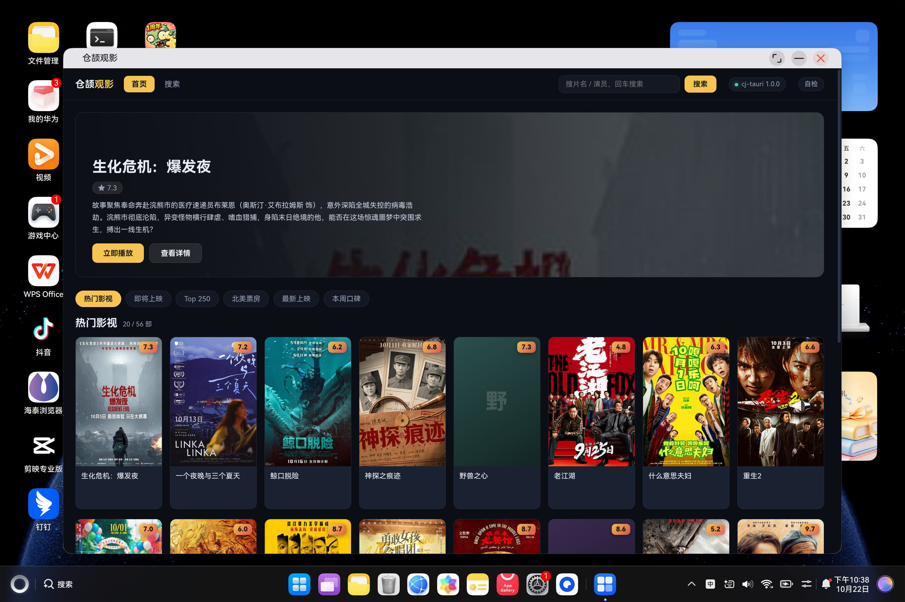
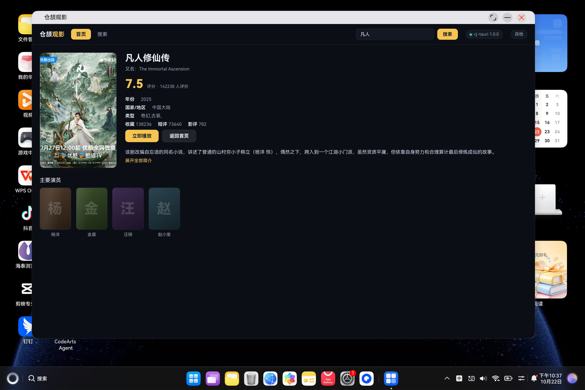

# ohos-movie · 仓颉观影（鸿蒙 PC）

`examples/movie` 那套「片单 + 搜索 + 详情 + 播放」在**鸿蒙 PC**（实测 HUAWEI MateBook Pro HAD-W32 /
HarmonyOS 7.0.0.107 / API 26 / aarch64）上的落地：同一份前端页面、同一份仓颉命令层，
换掉的只有宿主侧——桌面用 WebView2 / WebKitGTK，这里用 ArkWeb 组件。



*实机截图（2026-10-22）：桌面形态窗口、片单封面全部出图、评分与分区都在。*



*详情页：海报、评分、年份/地区/类型、简介与演职员，按钮区「立即播放 / 返回首页」可用。*

## 与 ohos-music 的关系

两个工程是**同一套脚手架的两个应用**（`examples/ohos/README.md` 有建工程的三个前置）：
业务层都来自桌面示例、页面都在构建期内嵌、宿主都只有「一扇 ArkWeb 窗口 + 框架装配」。
差别在于 movie **没有本地存储**（不装 `store` 插件、不写沙箱文件），所以少掉 music 里
「把沙箱路径注入业务层」那一步；片单、详情、播放地址、封面全部来自后台接口。

## 目录与「谁是源」

```
examples/ohos/ohos-movie/
├── build-hap.sh                 构建入口：同步业务层 + 内嵌页面与能力清单 + 编 hap
├── build-profile.json5          签名（复用 com.yang.testcj 调试证书）
├── screenshot-list.jpg          实机截图（列表页）
├── screenshot-detail.jpg        实机截图（详情页）
└── entry/
    ├── cjpm.toml                只依赖框架源码（path = ../../../..）+ 工程根的 stdx 联接
    ├── build-profile.json5      cangjieOptions.path + checkDeviceTypes=false（放行 2in1）
    └── src/main/
        ├── module.json5         deviceTypes: 2in1 + ohos.permission.INTERNET
        └── cangjie/
            ├── main_ability.cj  UIAbility：窗口尺寸按屏幕 px 折算 + 非 UI 线程跑框架 + 等宿主登记再建树
            ├── index.cj         ArkWeb 宿主组件（单窗口）
            ├── movie_host.cj    装配：movie:* 命令 + 内嵌能力清单 + run(html)
            ├── ohos_movie_image.cj  **鸿蒙侧专属**：用系统网络栈取封面（见下节）
            └── movielib/        **生成物（不入库）**：examples/movie/src 的副本 + 内嵌资源
```

**业务代码只有一份，在 `examples/movie/`**。`build-hap.sh` 每次构建把 `examples/movie/src/*.cj`
（去掉 `main.cj`）复制到 `movielib/`，只改包声明一行（`package movie_app` →
`package ohos_app_cangjie_entry.movielib`），并把 `ui/index.html` 与 `capabilities/default.json`
以 base64 编成 `movielib/ohos_assets.cj`。所以：**改业务逻辑去改 `examples/movie`**，
改完重跑 `bash build-hap.sh`（`--no-sync` 可跳过同步）。

命令表与桌面版一一对应，只换了一个实现：

| 命令 | 实现 | 说明 |
| --- | --- | --- |
| `movie:list` / `movie:search` / `movie:detail` | `movielib` | 后台接口（http），与桌面同一份 |
| `movie:source` / `movie:sourceitem` | `movielib` | 播放地址 |
| `movie:image` | **`ohos_movie_image.cj`** | 封面取图走系统网络栈（桌面版是 stdx + TLS） |
| `report` / `system:version` | 框架 | 页面自检回投 / 版本 |

## 封面为什么要单独一套实现

这两件事都是真的，而且必须一起看：

1. **页面不能直连封面**。图源是豆瓣/百度图床的 **https**，按 `Referer` 放行、按 UA 判浏览器；
   直连的失败形状是 **HTTP 200 + 0 字节**（不是 403，页面上就是「空图」）。所以桌面版一直是
   「页面把地址交给宿主命令 → 宿主带 `Referer`/UA 取回 → 以 `data:` URL 交还」
   （`examples/movie/src/commands.cj` 的 `movie:image`）。
2. **鸿蒙上仓颉运行时装不了 TLS**。同一套 `stdx.net.http` + `TlsClientConfig()` 在设备上直接失败，
   真机 hilog 是：

   ```
   W MUSL-LDSO: load libcrypto_openssl.z.so failed, namespace=moduleNs_default, errno=2
   W MUSL-LDSO: load libssl_openssl.z.so failed, namespace=moduleNs_default, errno=2
   ```

   即运行时按名字去 dlopen OpenSSL 3，设备上没有这两个库。表象极具误导性：**后台接口是 http，
   片单/搜索/播放全都正常，只有封面全灭**，页面上是「首字色块」——与 `AGENTS.md` §4 记的
   Windows 侧「漏 `libssl`/`libcrypto` → 只有 https 全灭」完全同形。

修法不是把 OpenSSL 塞进 hap（ABI/符号对不上就再炸一次），而是把取图**换到系统网络栈**：
`ohos.net.http`（NetworkKit）的 `createHttp()` + `HttpRequest.request`，TLS、证书链、系统代理
全部交给操作系统，应用侧只管发请求。落点就是 `ohos_movie_image.cj` 的 `OhosMovieImageCommand`：
命令名、入参、返回值（`data:image/...;base64,...`）与桌面版**完全一致**，前端契约一行不动；
白名单（`imageSourceOf`）、浏览器 UA、5 MB 上限全部复用 `movielib` 里那份，
**安全判定只留一份**（这也是把那三个符号在 `examples/movie/src/api.cj` 里改成 `public` 的原因）。

两个实现细节值得记：

- `HttpRequest.request` **只有回调形态**，没有同步版本。命令 handler 跑在框架的 worker 线程上
  （不是 UI 线程），所以「发请求 → sleep 轮询等回调 → 收结果」是安全的，冻不住界面；
  结果装在一个对象盒子里往回调里写（仓颉的 lambda 不能捕获可变的局部变量）。
- 响应体按 `expectDataType: HttpDataType.ArrayBuffer` 取字节，再自己编 base64
  （框架侧没有编码器）；`Content-Type` 从 `resp.header` 里大小写不敏感地找。

真机判据：列表页 8 张可见封面里 7 张是真实海报，剩下 1 张（「野兽之心」）仍是色块——
那一条是图源自己回 **HTTP 200 + 0 字节**（防盗链），hilog 有对应凭证：

```
CjMovie: image http=200 bytes=0 type=image/jpeg
```

也就是说，通道已经通了，取不到的个别图源会如实回错误、页面回退成色块，不会白屏也不会假装成功。

## 构建与运行

```bash
export CANGJIE_STDX_OHOS=/d/cangjie-stdx-ohos/linux_ohos_aarch64_cjnative/dynamic/stdx
export DEVECO_WIN='D:\oh\DevEcoStudio'       # DevEco 安装根，不在默认位置才需要
bash examples/ohos/ohos-movie/build-hap.sh   # 产物：entry/build/default/outputs/default/entry-default-signed.hap

HDC=/d/oh/DevEcoStudio/sdk/default/openharmony/toolchains/hdc.exe
"$HDC" -t <serial> install -r entry/build/default/outputs/default/entry-default-signed.hap
"$HDC" -t <serial> shell aa force-stop com.yang.testcj      # 换包后先停旧实例
"$HDC" -t <serial> shell aa start -a EntryAbility -b com.yang.testcj
```

取证（两条都要）：

```bash
"$HDC" -t <serial> shell hilog > /tmp/movie-hilog.txt       # 先起流，再 aa start
"$HDC" -t <serial> shell snapshot_display -f /data/local/tmp/x.jpeg
MSYS_NO_PATHCONV=1 "$HDC" -t <serial> file recv /data/local/tmp/x.jpeg x.jpeg   # 远端绝对路径不加这个会被 MSYS 改写
```

hilog 里应有的行（`CjMovie` tag，`N` 随设备负载变化）：

```
startTauriMovie begin
capability embedded bytes=246
page loaded bytes=63810
host registered after N polls label=main
host pageUrl label=main url="file:///data/storage/el2/base/haps/entry/files/cj-tauri-main.html"
page begin label=main    /    page end label=main
main window sized 2683x1747 px on screen 3120x2080, rect=[218 166 2683 1747]
```

`aa start` 需要**屏幕已解锁**（开发者模式下无法自动解锁），锁屏时表现为启动失败 / 抓到锁屏画面。

## 与 music 一致的两条「不这么写就不对」

1. **`deviceTypes` 必须写 `2in1`**（`entry/src/main/module.json5`）：只写 `phone` / `tablet`
   时系统当手机应用，窗口是竖屏兼容窗。仓颉构建插件默认只放行 `phone` / `tablet`（写 `2in1`
   直接判 `01103012`），开关在 `entry/build-profile.json5` 的
   `cangjieOptions.checkDeviceTypes = false`。
2. **`ohos.permission.INTERNET`**（同文件 `requestPermissions`）：缺了每次请求都死成
   `SocketException: Failed to create socket: Operation not permitted.`，页面显示
   「连不上后台接口」——看着像断网。`normal` 级，安装即生效。

## 已知限制（如实记）

- **与 ohos-music 共用一个 bundleName（`com.yang.testcj`）**：两个工程复用同一份调试签名，
  所以**装这个会顶掉那个**，同一台设备上只能留一个。换 bundle 要在 DevEco 里重新自动签名
  （命令行做不了），这一步没做。
- **没有退出入口**：`movie:*` 里没有 quit，窗口关闭由系统处理；要停进程用 `aa force-stop`。
- **个别封面图源取不到**：见上节，防盗链回 `200 + 0 字节`，页面回退成首字色块。
- **多窗口 / 原生对话框不在本工程**：一扇窗、无 overlay；那两条能力的取证在
  `examples/ohos-probe`（结论：鸿蒙侧页面触发的弹窗只能用声明式 overlay，见 `AGENTS.md` §4）。
