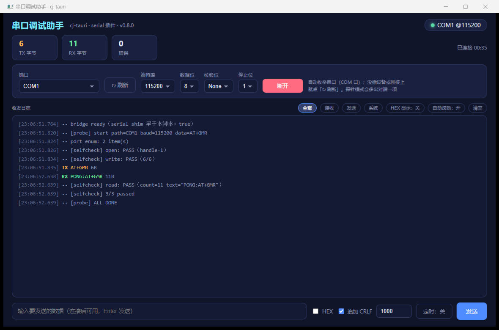

# 串口调试助手（serial-assistant）

cj-tauri 官方 `serial` 插件的业务向示例：**端口下拉自动枚举**（`serial:list`，↻ 刷新）+
参数面板（波特率 / 数据位 / 校验 / 停止位）+ TX/RX 分色收发日志（时间戳、字节数、HEX 显示、按方向过滤）+
收发计数与连接态 + 发送区（HEX、「追加 CRLF」、**定时发送**、Enter 直发）。
由 `cj-tauri create serial-assistant --template app` 起骨架，再一行 `.plugin(SerialPlugin())` 接入。



上图是 Windows 实机（COM1↔COM2 虚拟串口对）：右上角是连接态与已连时长，左上角是 TX/RX 计数与错误数；
日志区里 `[probe]` 一轮 `open / write / read` 三条自检全 PASS，TX/RX 分色带时间戳与字节数；
下方发送区是 HEX、追加 CRLF、定时发送与 Enter 直发。

## 怎么跑

本示例是**新形态工程**（RFC-002 §7）：清单 `cj-tauri.toml` 是单一真相，业务只有
`src/main.cj` 一个 `public func build(): AppSpec`，页面与能力清单在 `assets/` 下，
桌面 / 鸿蒙的骨架由 `cj-tauri sync` 派生到 `targets/`（不入库，克隆后先跑一次 sync）。

```bash
cd examples/serial-assistant
cj-tauri sync                 # 派生 targets/desktop 与 targets/ohos
bash run.sh                   # Linux：pty 造虚拟串口对端，探针自动跑一轮 收→发→收 自检并断言
run.bat                       # Windows：PowerShell 造对端，8 条断言（需先有 COM1/COM2 这样一对口）
run.bat manual                # Windows：不带探针、不起对端，开窗手测（关窗即退出）
```

手动模式：`cj-tauri run`（或 `cd targets/desktop && cjpm build` 后从工程根启动产物——
资产按 `assets/` 相对**工作目录**解析）。从「端口」下拉选设备（下拉由 `serial:list`
自动枚举；没插设备或刚接上点「↻ 刷新」）→ 连接 → 收发。

Windows 侧串口桥**已实机跑通**（2026-10-10，COM1↔COM2 虚拟对，`run.bat` rc=0、8/8 断言全绿）：
枚举走 C 桥 `QueryDosDeviceW`，open 用 `CreateFileW("\\.\COMx", …, FILE_FLAG_OVERLAPPED)` 独占打开、
读写按 `WaitForSingleObject` 的剩余预算控制（超时不报错，返回 `count=0`）。

## 鸿蒙（HarmonyOS PC）怎么跑

```bash
cd examples/serial-assistant
export CANGJIE_STDX_OHOS=<鸿蒙版 stdx>/dynamic/stdx   # 桌面版 stdx 的 ABI 不通
cj-tauri sync ohos
bash targets/ohos/build-hap.sh                        # 出 entry/build/default/outputs/default/*-signed.hap
hdc install -r targets/ohos/entry/build/default/outputs/default/entry-default-signed.hap
hdc shell "aa start -a EntryAbility -b com.yang.testcj"
hdc shell hilog | grep -E "CjProbe|CjSerialProbe"
```

`bundleName` 取 `com.yang.testcj` 是为了直接复用本机鸿蒙调试证书
（`examples/ohos/ohos-music/build-profile.json5` 那份，按该 id 签的）——**换成别的 id 必须
在 DevEco 里对本工程重新「自动签名」**，否则装包就被拒；代价是它与 `ohos-capabilities` /
`ohos-music` / `ohos-movie` 共用同一个 bundleName，装这个会顶掉那几个。

设备上没有环境变量，所以 `build()` 按平台注入 `window.__SERIAL_PROBE__ = { …, deviceProbe: true }`，
页面自动走「枚举 → 逐个尝试 open → 如实报 errno」，每条经 `probeLog` 命令写进 **hilog**
（tag `CjSerialProbe`）——设备上 `eprintln` 不进 hilog，这是唯一能逐条对账的通道。

**真机取证结论（2026-10-24，HarmonyOS PC `3QC0124B20000048`）**：启动链完整
（`startApp begin (business = serialAssistant.build())` → `page begin/end label=main`，无 `SIGSEGV`），
`serial:list` 回 0 个端口，6 条候选路径的 errno 如实返回：

| 候选路径 | 结果 | 含义 |
| --- | --- | --- |
| `/dev/bus/ttyUSB0`、`/dev/bus/ttyACM0` | `Permission denied` | 节点在，但需 DDK/USB 权限或系统签名 |
| `/dev/ttyUSB0`、`/dev/ttyACM0`、`/dev/ttyAMA0` | `No such file or directory` | 该机型没有这些节点 |
| `/dev/ttyS0` | `tcgetattr failed: I/O error` | 节点存在，但不是可用串口 |

即「FFI → musl libc → 内核 open → errno 回页面」这条链路成立；**接真实串口的收发回环尚未取证**，
所以本示例在鸿蒙侧标的是「FFI 通路真机验证、真实收发待硬件」，不标「可用」。

### 为什么真实 USB 串口打不开（2026-10-24 权限取证）

- `/dev/ttyS0` 是 `0666 root:root`：`open` 能过，`tcgetattr` 才报 `I/O error` —— 卡点不是文件权限位。
- `/dev/bus` 与 `/sys/bus/usb/devices` **连 `hdc shell`（uid 2000 / `u:r:sh:s0`）都进不去**
  （`ls`/`stat` 皆 permission denied），所以 `/dev/bus/ttyUSB0` 的 `open` 回 `EACCES`。
- 能豁免它的 `ohos.permission.ACCESS_DDK_USB_SERIAL` 是 `grantMode: SYSTEM_GRANT` +
  `availableLevel: SYSTEM_BASIC`，**普通调试证书拿不到**（要带 ACL 的 profile 或系统签名）。
- 三方应用的正路是 **`@ohos.usbManager.serial`**（namespace `serialManager`，**没有 `@permission`**）：
  `getPortList()` 查端口 → `requestSerialRight(portId)` 弹用户授权 → `open(portId)` →
  `setAttribute()` / `read()` / `write()` → `close()`。框架代管设备节点，全程不碰 `/dev/bus`。
  仓颉 SDK 没有这个绑定。**框架一度用 Cangjie↔ArkTS 互操作接过这条路线，但真机把它否掉了**（见下条）。
- **真机 A/B 结论（2026-10-24 晚）：纯仓颉进程建不了 `JSRuntime`，`serialManager` 这条路走不通**。
  三组对照（同机、同业务码，每次重打 hap 装机启动，只换串口后端）：

  | 产物 | 内容 | 字节 | 真机结果 |
  | --- | --- | --- | --- |
  | 有互操作、真去用 | `spawn` 出 owner 线程建 `JSRuntime()` | 2 097 601 | **启动即 `signal:6`（SIGABRT）**，日志停在 `startApp begin`，`initScripts` 都不打 |
  | 只有互操作、从不执行 | 同名符号全留，owner 线程刻意不起 | 2 095 085 | 正常启动：`pidof` 有、`page end label=main`、自检跑完 |
  | 互操作整段摘掉 | 纯 POSIX | 2 013 936 | 同样正常启动 |

  第二组才是判据：`llvm-objdump -p` 复核它**确实仍链着** `libohos.ark_interop.so` /
  `libohos.ark_interop_helper.so`（`NEEDED` 两条在、4 个 `JSRuntime` 未定义符号）——
  **链接无害，执行 `JSRuntime()` 才 abort**。再把创建点挪到 UI 线程（`onWindowStageCreate`，
  与 ArkTS 同一条线程）也只打出 `runtime probe begin [ui-thread]` 就当场消失，
  所以不是线程选错，而是**整个纯仓颉进程没有 ArkTS VM**。
  推论：放进应用业务包也一样 abort——能不能建 `JSRuntime` 与代码放哪儿无关。
- **当前状态：这条后端已如实降级**。`src/plugins/serial/serial_manager_ohos.cj` 保持六个同名导出
  （`usbSerialOpenByPath` / `:Read` / `:Write` / `:Close` / `usbSerialListNames` / `usbSerialIsHandle`），
  一律返回「不可用」并把原因写进错误槽，**不再 import `ark_interop`**，因此不再拉
  `libohos.ark_interop.so` 进依赖表。真机复验：应用正常启动（`pidof` 有、`page end label=main`），
  自检 6 条候选路径的 errno 照旧如实分流（见上表）。
  **要真正用 USB 串口，`serialManager` 只能由真正的 ArkTS 侧发起**（混合工程，或应用自宿主
  ArkTS 模块），框架只留接口——决策全文见 `docs/设计决策记录.md` D-022 附段。
- 裸 `open` 路线保留为兜底（对「已授权 / 系统签名」的环境成立）。

**顺带澄清对比面**：Windows 上的 SSCOM 这类工具能开 COM 口，是因为 Windows 的串口对普通用户进程
默认开放（本示例 Windows 侧实测 8/8 断言全绿），与鸿蒙的 SELinux + 权限模型不是一回事，不能横向类比。

## 探针环境变量

设 `CJ_SERIAL_PROBE_PATH` 即进探针模式（配置经 document-start 预执行脚本注入页面）：
`CJ_SERIAL_PROBE_BAUD` / `_DATA` / `_READ_MS` / `_QUIT(0|1)`（默认 1：跑完自退；0：保持连接便于截图）。
探针对端（pty）不算「本机串口」，会额外补进端口下拉便于复现。

`_QUIT=0` 是「展示轮」：探针跑完一轮后**不关连接**，窗口留在「已连接」态，方便抓图或对着界面讲——
它同样会接上接收循环，对端之后推来的帧照样落进 RX 日志（2026-10-10 修：此前展示轮只在
`connect()` 里起接收循环，探针自己连的口没接上，窗口看着「已连接」却一个字节都收不到）。


