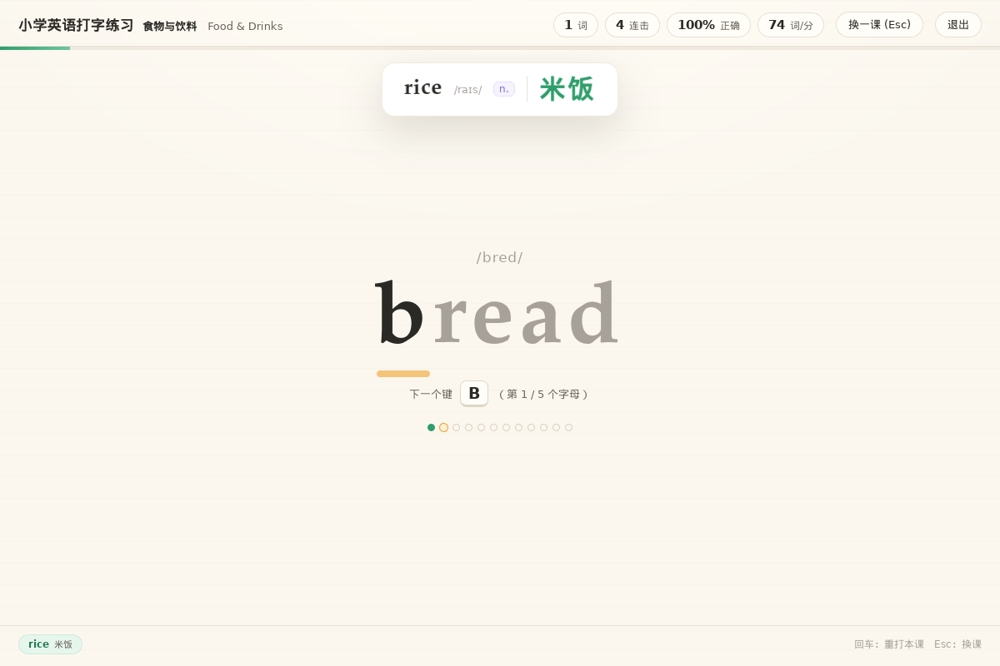

# 小学英语打字练习示例（examples/typing-english）

一个用 **cj-tauri** 写的小学英语打字练习：屏幕中间一个大单词，旁边标着音标，
小朋友照着敲键盘——**一个词打完整，页面正上方就浮出一张中文释义卡**（`rice /raɪs/ n. 米饭`），
停留几秒再淡出；连续打对好几个词时，卡片**一张一张排队展示**，不会互相顶掉。
后端是**仓颉**（静态编译），前端是系统 WebView（HTML/CSS/JS），**纯 2D、零第三方前端依赖**。



> 这篇 README 是照着做用的：先跑起来，再讲释义队列这条主线怎么实现，然后是验收办法与两个真踩过的坑。
> 与 `examples/typing-poem` 的关系：那个示例练的是「汉字 + 拼音」，用 three.js 画 3D 卡面；
> 这个示例刻意**不引 three.js**（页面是 `run(html)` 的内联来源，引它就得上 `addInitScript` 注入通道），
> 体积小一个数量级，重点全在「打完词 → 中文上浮」这条交互上。

## 目录

- [1. 一课怎么玩](#1-一课怎么玩)
- [2. 跑起来](#2-跑起来)
- [3. 释义浮窗：一次一张，多的排队](#3-释义浮窗一次一张多的排队)
- [4. 命令 ↔ 页面](#4-命令--页面)
- [5. 无人值守自检（38 条断言）](#5-无人值守自检38-条断言)
- [6. 实机验收记录](#6-实机验收记录)
- [7. 踩坑记录](#7-踩坑记录)
- [8. 文件](#8-文件)

## 1. 一课怎么玩

词库 8 课 112 个词，都是小学三四年级的常用词：数字与颜色、动物、食物与饮料、家人与职业、
学校与文具、身体与衣物、天气与自然、动作与形容。每个词带三样东西：**音标**（`/raɪs/`）、
**词性**（`n.`）、**中文释义**（`米饭`）——打对之后这三样一起浮出来，见词、见音、见义。

| 交互 | 行为 |
| --- | --- |
| 敲字母 | 只认 a–z。打对当场点亮那个字母；打错不弹窗、不扣命，只是**连击清零**（页脚进度条也跟着退） |
| 打完整词 | 上方浮出中文释义卡，停留默认 2.6 秒；页脚记一条「已学」，本课进度 +1 |
| 连续打对 | 释义卡**排队**，一张接一张展示（§3） |
| 回车 | 重打本课（进度与已学清空，成绩会先落盘） |
| Esc | 回选课面板换一课 |
| 本课打完 | 结算：星级 + 用时 + 正确率 + 速度（词/分），并写入个人最好成绩 |

两条口径与打字练习的常识一致：

- **只跟自己比**：成绩按「一课」存自己的历史最好，不排行、不联网、不上传（`typing-english-scores.local.json`）。
- **正确率与速度都要**：三星要求正确率 ≥95% 且速度 ≥12 词/分，二星放宽到 85% / 8 词/分。

## 2. 跑起来

### Windows

```bat
cd examples\typing-english
run.bat                :: 正常开窗玩
run.bat selfcheck      :: 无人值守：页面自己把一课打完，回投 38 条断言后退出
```

`run.bat` 认 `CANGJIE_HOME` / `CANGJIE_STDX` 两个环境变量（没设就用它内置的默认路径），
日志落在 `%TEMP%\cj-typing-english.log`——**GUI 产物双击时 stderr 是无效句柄**，
所以脚本一律带 `2> 日志` 启动，取证看那个文件（AGENTS §4 有这条坑的完整形状）。

不想装仓颉 SDK 也可以直接用随仓库分发的单文件包：

```bat
dist-single\typing-english.exe      :: 双击即开（GUI 子系统，不弹黑窗）
```

它是在 Linux 上用 `bash scripts/winbuild.sh examples/typing-english` 交叉编出来的
（4.8 MB：仓颉运行时静态链进来、`WebView2Loader.dll` 内嵌成字节、页面与能力清单以 base64
编进源码，导入表里只有系统 DLL）。**只有构造证据、还没有 Windows 真机运行证据**，判据见 §6。

### Linux

```bash
cd examples/typing-english
export LD_LIBRARY_PATH=<stdx>/dynamic/stdx:<仓颉SDK>/runtime/lib/linux_x86_64_cjnative:<仓库>/native:$LD_LIBRARY_PATH
CJ_TYPING_SELFCHECK=1 ./target/release/bin/main 2> /tmp/te.log    # 自检
./target/release/bin/main                                         # 正常玩
```

三个环境变量（都只在诊断与取图时用，日常玩不需要）：

| 变量 | 作用 |
| --- | --- |
| `CJ_TYPING_SELFCHECK=1` | 页面自己把一课打完并回投断言，然后经 `typing:quit` 退出（§5） |
| `CJ_TYPING_LESSON=food` | 跳过选课面板直奔一课，截图归档用（课 id 见 `src/words.cj`） |
| `CJ_TYPING_POP_MS=900` | 释义卡停留时长，区间 600–12000，默认 2600；自检时调小可缩短等待 |

## 3. 释义浮窗：一次一张，多的排队

这是本示例唯一真正需要设计的部分。**朴素做法是错的**：每打对一个词就往浮层里塞一张卡、
各起一个 `setTimeout` 到点删——连着打三个词，三张卡同时出现又各自错位消失，屏幕上就是一团乱，
小朋友根本来不及读。

所以这里按「**队列 + 单展厅**」来：任意时刻页面上**最多一张**释义卡，其余排队等它退场。

```
打完词 ──▶ enqueuePop(word)
              │
              ├─ 没在展示 ──▶ drainPop()：取队首 → 挂上浮层 → 起 popMs 计时
              │                                   └─ 计时到 → 退场动画 → 再看队里有没有下一条
              └─ 正在展示 ──▶ 只入队，不动场上那张
                              └─ 立刻刷新「还有 N 条释义在排队」
```

三条约束都落在这一处（`ui/index.html` 的 `enqueuePop` / `drainPop` / `renderPopMore`）：

1. **不覆盖**：正在展示时入队只 push，绝不替换当前卡片——先出现的那条必须被读完。
2. **依次展示**：排空循环用 `setTimeout` 串起来（不是 `setInterval` 定时清空），
   前一张完全退场后才挂下一张，所以「依次」是结构上保证的，不靠计时对齐。
3. **停留可见**：卡片进场 220ms、停留 `popMs`、退场 220ms；`CJ_TYPING_POP_MS` 可调。

页脚那句淡提示（`还有 2 条释义在排队`）只在队列非空时出现，队空即撤——它同时是
「你打得比卡走得快」的可见反馈：打快的孩子会看到数字一点点涨，再一点点消。

## 4. 命令 ↔ 页面

六条命令，按 AGENTS §2 的三处联动（实现 → `register` → 能力清单 `commands`）：

| 命令 | 参数 | 回什么 | 干什么 |
| --- | --- | --- | --- |
| `word:list` | — | 8 课的 `{id,title,titleEn,words[]}` | 词库下发（星级由仓颉侧定） |
| `typing:config` | — | `{popMs,scoresPath,startLesson,...}` | 自检开关、停留时长、直奔哪一课 |
| `score:list` | — | 全部最好成绩 | 首页「我的纪录」 |
| `score:save` | `{lesson,seconds,correct,total,wpm,errors}` | `{ok,updated,attempts,bestStars}` | 结算落盘，回「有没有破纪录」 |
| `report` | `{line}` | `{ok}` | 自检断言回投成 stderr 日志行 |
| `typing:quit` | — | — | 退出（页面收尾不自己关窗，见 §7） |

能力清单 `capabilities/default.json` 里还登记了 `word:nope`——**它故意没有实现**，
自检拿它验证「清单登记了但没实现的命令」会被拒成 `command not registered`；
另一半用「清单没写但实现存在」的命令验证 `command not allowed`。

## 5. 无人值守自检（38 条断言）

设 `CJ_TYPING_SELFCHECK=1`，页面会把整整一课打完（模拟真实按键，不是直接改状态），
逐条把断言经 `report` 回投成 `[english-selfcheck] PASS/FAIL 名字 :: 明细` 日志行，
最后打一条聚合行 `DONE passed=N failed=M`，再经 `typing:quit` 退出。

```bash
CJ_TYPING_SELFCHECK=1 CJ_TYPING_POP_MS=900 ./target/release/bin/main 2> /tmp/te.log
grep -c PASS /tmp/te.log          # 明细条数
grep 'DONE' /tmp/te.log           # 聚合行：passed 必须等于上面的条数、failed 必须为 0
```

**判据只能取计数一致**：`report` 是异步命令（命令分发在 worker 线程并发执行），
明细行与聚合行的**先后顺序不保证**——按「最后一行必须是 DONE」判会假红，
只看「有没有 FAIL 行」会假绿（AGENTS §4 已记这条）。

断言覆盖五类：命令契约（词库形状、成绩往返、权限边界两条）、打字判定（对键/错键/连击/进度）、
**释义浮窗（打完整词才浮、一次只一张、连打依次展示、停留时长、队空归零）**、
结算（星级门槛、破纪录回包）、以及重复进入一课时的状态清理。

## 6. 实机验收记录

Linux（Xvfb 1400×900，真实按键经 `xdotool type` 打进 WebView，非直接改状态）：

| 证据 | 结果 |
| --- | --- |
| `cjpm build` | 成功，**零警告** |
| 页面自检 | `DONE passed=38 failed=0` |
| 打 `rice` 后 | 顶部浮出 `rice /raɪs/ n. 米饭`，页脚记「rice 米饭」 |
| 连打 `bread` `milk` | 场上仍是 `rice`（未覆盖），卡片下标「还有 2 条释义在排队」 |
| 2.5 秒后 | 轮到 `bread /bred/ n. 面包`，下标变成「还有 1 条释义在排队」 |
| 队列走完 | 浮层清空、页面回常态，已学清单三条都在 |

截图归档：`/tmp/cj-tauri-shots/te-0{1..5}-*.png`（宿主临时目录，不入库）。

Windows 单文件包（`bash scripts/winbuild.sh examples/typing-english`，本机 Linux 交叉编）：

| 证据 | 结果 |
| --- | --- |
| `cjpm build --target x86_64-w64-mingw32` | 成功，**零警告**（源码告警已清零；只剩工具链对 `--static-libs` 的弃用提示） |
| 产物 | `dist-single/typing-english.exe`，4 950 016 字节（strip 前 28 340 736） |
| PE 判据 | `pei-x86-64`；`Subsystem 00000002`（GUI，双击不弹黑窗） |
| 导入表 | 只有 `KERNEL32` / `USER32` / `SHELL32` / `ole32` / `oleaut32` 系与 `WS2_32`、`comdlg32`、`msvcrt`、`dbghelp` —— 无 `libcangjie-runtime.dll`、无 `libcjtbridge.dll`、无 `WebView2Loader.dll` |
| 内嵌 loader | `WebView2Loader.dll`（162 392 字节）整份字节在 exe 里（不是只链了个名字） |
| 节表 | 无 `.rsrc` 是对的：本示例没有 `pack-assets.txt`，页面与能力清单是 base64 编进源码的 |

**未在本轮验证的**：Windows（WebView2）实机**运行**——本机是 Linux，上面那张表只证明
「产物构造正确」，不证明「双击能开窗」。页面与命令层跨平台共用，但 Windows 上的降采样字体
与 `xdotool` 无关；要出 Windows 运行证据得在 Windows 上双击 `dist-single\typing-english.exe`
（或跑 `run.bat`）后人工核对，`CJ_TYPING_LESSON=food` 可固定到一课，便于两次截图对账。
另：本机 Linux 收尾时进程以 `SIGABRT`(134) 结束，日志停在
`gtk_main_quit: assertion 'main_loops != NULL' failed` —— **`examples/hello` 在本机同样 134**，
是框架在本机 Linux 上的收尾形态，与本示例无关；功能证据以自检与截图为准，不看退出码。

## 7. 踩坑记录

1. **页面收尾别自己 `window.close()`**。自检跑完想让窗口自己关掉，最直觉的写法是
   `invoke('typing:quit')` 之后补一个 `window.close()`——它会绕开宿主去销毁 WebKit 窗口，
   正好落进「退出期析构里 abort」（AGENTS §4 那条）。正确做法是只发 `typing:quit`，
   窗口交给应用级退出流程收。
2. **CSSOM 会把 `100.0%` 归一化成 `100%`**。进度条断言写成 `style.width === '100.0%'` 会假红：
   设进去的是 `"100.0%"`，读回来浏览器序列化成最短形式 `"100%"`。断言按数值比
   （`parseFloat(width) === 100`），别比字符串。
3. **排队提示只在排空循环里刷新，会漏掉「正在展示时入队」这一刻**。第一版 `renderPopMore()`
   只在 `drainPop()` 末尾调用，于是连打时新词进了队、提示条却不出现（自检「排队提示条出现」当场红）。
   入队与排空两处都要刷。
4. **`Int64.parse` 的返回类型别想当然**，本 SDK 上按 `Option<Int64>` 写会得到
   `enum pattern is not matched`。停留时长这种小整数直接按字节解析更稳，也顺带把「非数字就当没填」
   写清楚了：`String` 的迭代给的是 `UInt8` 字节，不是 Rune。

## 8. 文件

```
examples/typing-english/
├── src/
│   ├── main.cj               启动、窗口、页面来源（读盘 / 内嵌两条路）
│   ├── commands.cj           六条命令 + 成绩落盘 + 停留时长与自检开关
│   ├── words.cj              8 课 112 词（音标/词性/中文）+ 素材自检
│   ├── packed_assets.cj      单文件打包用的位图存根（仓库内为空）
│   └── packed_resources.cj   base64 解码 / 内嵌优先取文本
├── ui/index.html             打字主流程 + 释义浮窗队列 + 自检（约 1470 行）
├── capabilities/default.json 能力清单（含两条权限边界断言用的命令）
├── cjpm.toml                 工程配置（Windows 段带 --subsystem=windows）
├── run.bat                   启动器（纯 ASCII + CRLF；`run.bat selfcheck` 无人值守）
└── README.md                 本文
```
